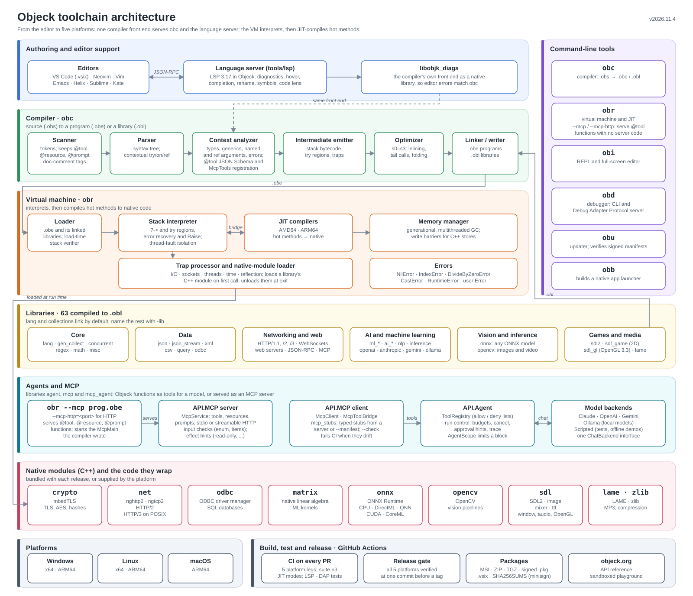

<p align="center">
  
</p>

<p align="center">
<strong>Object-oriented • JIT-compiled • AI-native • Robust APIs
</p>

<hr/>

<p align="center">
  <a href="https://github.com/objeck/objeck-lang/actions/workflows/codeql.yml"></a>
  <a href="https://scan.coverity.com/projects/objeck"></a>
  <a href="https://github.com/objeck/objeck-lang/actions/workflows/ci-build.yml"></a>
  <a href="https://github.com/objeck/objeck-lang/actions/workflows/release-build.yml"></a>
  <a href="https://github.com/objeck/objeck-lang/releases"></a>
</p>

<p align="center">
  <a href="https://playground.objeck.org">Try it online</a> &middot;
  <a href="#downloads">Download</a> &middot;
  <a href="#quick-start">Quick start</a> &middot;
  <a href="#libraries">Libraries</a> &middot;
  <a href="https://www.objeck.org">Documentation</a> &middot;
  <a href="https://github.com/objeck/objeck-lang/discussions">Discussions</a>
</p>

## Why Objeck?

**Built for modern development:**
- 🚀 **JIT-compiled** for performance (ARM64/AMD64)
- 🤖 **AI-native**: OpenAI, Anthropic, Gemini, Ollama, ONNX, OpenCV — no third-party packages
- 🌐 **Network-complete**: HTTP/1.1 · HTTP/2 · HTTP/3/QUIC · WebSocket · DTLS — all standard library
- 💻 **Developer-friendly**: REPL shell, LSP plugins for VSCode/Sublime/Kate, DAP debugger
- 🌍 **Cross-platform**: Linux, macOS, Windows (x64 + ARM64, including 64-bit Raspberry Pi)
- 🔧 **Full-featured**: Threads, generics, closures, reflection, serialization

**Perfect for:**
AI/ML prototyping • Computer vision • Web services • Real-time applications • Game development

## Try It Online

👉🏽 [Playground](https://playground.objeck.org) — 42 demos across 10 categories, Monaco editor, no install required.

## Quick Start

```bash
# Ubuntu 24.04: one package, system libraries included (-arm64 for ARM)
curl -LO https://github.com/objeck/objeck-lang/releases/download/v2026.11.1/objeck-ubuntu24.04-x64_2026.11.1.deb
sudo apt install ./objeck-ubuntu24.04-x64_2026.11.1.deb

# Other Linux (see Platform support below), or macOS: the archive
curl -LO https://github.com/objeck/objeck-lang/releases/download/v2026.11.1/objeck-linux-x64_2026.11.1.tgz
tar xzf objeck-linux-x64_2026.11.1.tgz
# Linux only: install the system libraries the toolchain links against
# (mbedTLS, readline, SDL2/GL, OpenCV, unixODBC, LAME) --
# obr does not start without them. --check reports without installing.
./objeck-lang/install_deps.sh
# Sets PATH and OBJECK_LIB_PATH for this shell. Source it, do not run it.
source ./objeck-lang/env.sh

# Hello World
echo 'class Hello {
  function : Main(args : String[]) ~ Nil {
    "Hello World"->PrintLine();
  }
}' > hello.obs

# Compile and run (modern syntax)
obc hello && obr hello
```

📖 **Full docs**: [objeck.org](https://www.objeck.org) &nbsp;·&nbsp; 💡 **Examples**: [github.com/objeck/objeck-lang/programs](https://github.com/objeck/objeck-lang/tree/master/programs)

### Platform support

| Platform | Install with | Notes |
|---|---|---|
| Windows (x64, ARM64) | `.msi` or `.zip` | Nothing else needed |
| macOS (Apple silicon) | `.pkg`, `.tgz` or `.zip` | Nothing else needed |
| Ubuntu 24.04 (x64, ARM64) | `.deb` | Installs its own dependencies |
| Other Linux (x64, ARM64) | `.tgz` | glibc 2.38 or newer, then `install_deps.sh` |

<details>
<summary>On an older Linux, such as Debian 12 or Ubuntu 22.04?</summary>

The Linux release is built on Ubuntu 24.04 and needs glibc 2.38 or newer, which Debian 12 (and antiX 23, MX 23 and other distributions based on it) and Ubuntu 22.04 do not have, so `dpkg` refuses the `.deb` there. Two ways to run Objeck on them:

- **A container:** run the Ubuntu 24.04 release in Docker, Podman or distrobox.
- **From source:** build with `core/release/deploy_posix.sh`, the path `install_deps.sh` itself points to (not checked on every distribution).

A Linux build that runs on older distributions is planned.

The toolchain also links the system libraries `install_deps.sh` lists, such as the mbedTLS 2.28 (`.so.14`) and OpenCV 4.6 (`.so.406`) sonames. Some newer distributions do not package those versions either (Debian 13, Fedora, Arch and openSUSE Leap, checked in September for v2026.9.2). `./objeck-lang/install_deps.sh --check` reports what is missing without installing anything.

</details>

## Examples

Every program below was compiled and run; the output is what it printed. They are in
[`programs/examples/guides`](programs/examples/guides/), with longer ones and a [guide](docs/guides/README.md)
for each topic. Libraries are named with `-lib`; `obc` does not pull in a library's own dependencies.

### The language

Classes, virtual methods, a generic `Vector`, a closure and string formatting.

<details>
<summary>Program and output (<code>readme_tour.obs</code>)</summary>

```ruby
use Collection;

class Shape {
  @name : String;

  New(name : String) {
    @name := name;
  }

  method : virtual : public : Area() ~ Float;

  method : public : Describe() ~ String {
    return "{$@name}: area {$(Area()):.2}";
  }
}

class Circle from Shape {
  @radius : Float;

  New(radius : Float) {
    Parent("circle");
    @radius := radius;
  }

  method : public : Area() ~ Float {
    return Float->Pi() * @radius * @radius;
  }
}

class Square from Shape {
  @side : Float;

  New(side : Float) {
    Parent("square");
    @side := side;
  }

  method : public : Area() ~ Float {
    return @side * @side;
  }
}

class Tour {
  function : Main(args : String[]) ~ Nil {
    shapes := Vector->New()<Shape>;
    shapes->AddBack(Circle->New(1.5));
    shapes->AddBack(Square->New(2.0));
    each(i : shapes) {
      shapes->Get(i)->Describe()->PrintLine();
    };

    # a function that returns a function (the closure remembers `factor`)
    triple := Scaler(3);
    "triple(14) = {$(triple(14))}"->PrintLine();
  }

  function : Scaler(factor : Int) ~ (Int) ~ Int {
    return \(Int) ~ Int : (x) => x * factor;
  }
}
```

```text
$ obc -src readme_tour.obs
$ obr readme_tour.obe
circle: area 7.07
square: area 4.00
triple(14) = 42
```

</details>

### A database in your program

`Query.Structured` runs SQL over typed in-memory tables, files and archives. A bad query is a message, not a crash. [Guide](docs/guides/query.md)

<details open>
<summary>Program and output (<code>readme_query.obs</code>)</summary>

```ruby
use Query.Structured;

class Sales {
  function : Main(args : String[]) ~ Nil {
    sales := Table->New("sales", ["region", "item", "qty", "price"]);
    Add(sales, "east", "widget", 10, 2.5);
    Add(sales, "west", "gadget", 4, 10.0);
    Add(sales, "east", "gadget", 3, 10.0);
    Add(sales, "west", "widget", 7, 2.5);

    result := sales->Query("select region, sum(qty * price) as revenue from sales group by region order by revenue desc");
    result->ToCsv()->Print();

    if(sales->Query("select nothing from sales") = Nil) {
      sales->GetError()->PrintLine();
    };
  }

  function : Add(table : Table, region : String, item : String, qty : Int, price : Float) ~ Nil {
    row := table->Insert();
    row->Set("region", region);
    row->Set("item", item);
    row->Set("qty", IntRef->New(qty));
    row->Set("price", FloatRef->New(price));
  }
}
```

```text
$ obc -src readme_query.obs -lib query,misc,net,json,regex,xml,csv,cipher
$ obr readme_query.obe
region,revenue
west,57.5
east,55.0
unknown column 'nothing'
```

</details>

### JSON

Parse, read typed values, build, and tell when the text is not JSON. [Guide](docs/guides/data_and_text.md)

<details>
<summary>Program and output (<code>readme_json.obs</code>)</summary>

```ruby
use Data.JSON;

class Json {
  function : Main(args : String[]) ~ Nil {
    root := JsonParser->TextToElement("{\"name\": \"Ada\", \"langs\": [\"en\", \"fr\"], \"age\": 36}");
    name := root->Get("name")->GetString();
    age := root->Get("age")->GetInt();
    langs := root->Get("langs")->Size();
    "{$name} is {$age} and speaks {$langs} languages"->PrintLine();

    doc := JsonElement->New(JsonElement->JsonType->OBJECT);
    doc->Insert("ok", true);
    doc->Insert("count", 3);
    doc->ToString()->PrintLine();

    broken := JsonParser->TextToElement("{\"name\": ");
    "broken text parses to Nil: {$(broken = Nil)}"->PrintLine();
  }
}
```

```text
$ obc -src readme_json.obs -lib json
$ obr readme_json.obe
Ada is 36 and speaks 2 languages
{"count":3,"ok":true}
broken text parses to Nil: true
```

</details>

### Regular expressions

Find, capture, replace. A pattern the engine cannot accept is not OK and matches nothing. [Guide](docs/guides/data_and_text.md)

<details>
<summary>Program and output (<code>readme_regex.obs</code>)</summary>

```ruby
use Query.RegEx;

class Dates {
  function : Main(args : String[]) ~ Nil {
    text := "shipped 2026-10-31, patched 2026-11-02";
    found := RegEx->New("(\\d{4})-(\\d{2})-(\\d{2})")->Find(text);
    each(i : found) {
      date := found->Get(i);
      "{$(date->GetValue())} is month {$(date->GetGroup(2))}"->PrintLine();
    };

    hidden := RegEx->New("\\d")->ReplaceAll("call 555-0199", "#");
    hidden->PrintLine();

    bad := RegEx->New("a{2,1}");
    "a{2,1} is a valid pattern: {$(bad->IsOk())}"->PrintLine();
  }
}
```

```text
$ obc -src readme_regex.obs -lib regex
$ obr readme_regex.obe
2026-10-31 is month 10
2026-11-02 is month 11
call ###-####
a{2,1} is a valid pattern: false
```

</details>

### Collections

A `Hash` to count, a `Map` to report in key order. [Guide](docs/guides/collections.md) and [choosing a collection](docs/COLLECTIONS_GUIDE.md)

<details>
<summary>Program and output (<code>readme_collections.obs</code>)</summary>

```ruby
use Collection;

class Words {
  function : Main(args : String[]) ~ Nil {
    counts := Hash->New()<String, IntRef>;
    words := "the cat and the hat and the bat"->Split(" ");
    each(i : words) {
      seen := counts->Find(words[i]);
      if(seen = Nil) {
        counts->Insert(words[i], IntRef->New(1));
      }
      else {
        seen->Set(seen->Get() + 1);
      };
    };

    ordered := Map->New()<String, IntRef>;
    pairs := counts->GetKeyValues();
    each(i : pairs) {
      ordered->Insert(pairs->Get(i)->GetFirst(), pairs->Get(i)->GetSecond());
    };
    entries := ordered->GetKeyValues();
    each(i : entries) {
      "{$(entries->Get(i)->GetFirst())}: {$(entries->Get(i)->GetSecond()->Get())}"->PrintLine();
    };
  }
}
```

```text
$ obc -src readme_collections.obs
$ obr readme_collections.obe
and: 2
bat: 1
cat: 1
hat: 1
the: 3
```

</details>

### A web server and a client

A one-route server, a request to it, and a clean stop. [Guide](docs/guides/http.md)

<details>
<summary>Program and output (<code>readme_http.obs</code>)</summary>

```ruby
use System.Concurrency;
use Web.HTTP.Server;

class Greeter from HttpRequestHandler {
  New() {
    Parent();
  }

  method : ProcessGet(request : Request, response : Response) ~ Bool {
    name := request->GetParam("name");
    if(name = Nil) {
      name := "world";
    };
    response->SetCodeTypeContent(200, "text/plain", "Hello, {$name}!");
    return false;
  }

  method : ProcessPost(request : Request, response : Response) ~ Bool {
    response->SetCodeContent(405, "Method not allowed");
    return false;
  }
}

class HelloWeb {
  function : Main(args : String[]) ~ Nil {
    # Serve() blocks, so it runs on a thread; port 0 means any free port
    server := Thread->New() {
      New() {
        Parent();
      }

      method : public : Run(arg : System.Base) ~ Nil {
        WebServer->Serve(Greeter->New()->GetClass(), "127.0.0.1", 0);
      }
    };
    server->Execute(Nil);

    while(WebServer->GetBoundPort() = 0) {
      Thread->Sleep(25);
    };
    port := WebServer->GetBoundPort();

    client := Web.HTTP.HttpClient->New();
    response := client->Get(Web.HTTP.Url->New("http://127.0.0.1:{$port}/hello?name=Ada"));
    "{$(response->GetCode())} {$(response->GetContent()->ToString())}"->PrintLine();

    WebServer->Stop();
  }
}
```

```text
$ obc -src readme_http.obs -lib net,net_server,json,cipher
$ obr readme_http.obe
200 Hello, Ada!
```

</details>

### Game search

Describe a game once; `Minimax` and `MonteCarloTreeSearch` choose moves. [Guide](docs/guides/ai.md)

<details>
<summary>Program and output (<code>readme_ai.obs</code>)</summary>

```ruby
use System.AI;

class Nim implements GameState {
  @stones : Int;
  @a_to_move : Bool;

  New(stones : Int, a_to_move : Bool) {
    @stones := stones;
    @a_to_move := a_to_move;
  }

  method : public : GetMoves() ~ Int[] {
    count := @stones < 3 ? @stones : 3;
    moves := Int->New[count];
    each(i : count) {
      moves[i] := i + 1;
    };
    return moves;
  }

  method : public : Apply(move : Int) ~ GameState {
    return Nim->New(@stones - move, <>@a_to_move);
  }

  method : public : IsTerminal() ~ Bool {
    return @stones = 0;
  }

  # +1 when player A took the last stone, -1 when B did
  method : public : Evaluate() ~ Float {
    if(@stones > 0) {
      return 0.0;
    };
    return @a_to_move ? -1.0 : 1.0;
  }

  method : public : IsMaximizing() ~ Bool {
    return @a_to_move;
  }
}

class Play {
  function : Main(args : String[]) ~ Nil {
    state := Nim->New(10, true)->As(GameState);
    "Minimax takes {$(Minimax->New(12)->FindBestMove(state))} of 10 stones"->PrintLine();
    "Monte Carlo takes {$(MonteCarloTreeSearch->New(2000, 1.414, 7)->FindBestMove(state))} of 10 stones"->PrintLine();
  }
}
```

```text
$ obc -src readme_ai.obs -lib ai
$ obr readme_ai.obe
Minimax takes 2 of 10 stones
Monte Carlo takes 2 of 10 stones
```

</details>

More: [all the guides](docs/guides/README.md), the 32 numbered programs in [`programs/deploy`](programs/deploy/README.md) that ship with every release, and [what is new in v2026.11.1](#whats-new).

## What's New

Full details for every release are in the [CHANGELOG](CHANGELOG.md).

### v2026.11.2
  * **A long linked chain no longer crashes the VM** &mdash; a `List`, `Queue`, `CompareList` or linked `Stack` of about 500,000 or more nodes exited with code 127, because marking recursed once per node and overflowed the collector thread's native stack; marking now uses a bounded per-thread work stack, and a 2-million-node chain passes with and without the JIT (`binarytrees` is unchanged)
  * **Sorting and strings are faster** &mdash; the `Vector` and `CompareVector` merge sorts skip a merge when the halves are already in order (500,000 sorted elements: about 500 ms to 80 ms, random input unchanged, still stable), and `String->Append(String)` copies strings of 32 or more characters in one block (1,000-character pieces: 1,660 ms to 292 ms)
  * **Faster image loading for convolutional networks** &mdash; `System.ML.Cnn` decodes a batch of images on several native threads and prefetches the next one, so training no longer waits on the JPEG decoder (decoding 10,000 face images: 1,107 images/s on one thread, 5,236 on eight; a 20,000-image epoch on an RTX 4090: about 30 to 34 s, now 9.1 s), with bit-identical results
  * **Result tables for a study that arrives over time** &mdash; `ResultTable` has scientific, p-value (`<0.0001`) and integer number formats, and `System.ML.Report` has a safe CSV loader, CSV tables, placeholders that read `not run yet`, figure slots and a run-status table
  * **OpenAI output cap** &mdash; the Responses API now gets `max_output_tokens` and Chat Completions `max_completion_tokens`; before, the cap was sent under a name the endpoint ignored
  * **One command finishes a release** &mdash; `tools/cicd/release_finish.sh` waits for the build, signs the installers (unattended from a DPAPI-protected password file, or at one prompt), deploys the playground and the site, and runs the release gates; the site deploy script targets the new server
  * **Topic stability is a distribution** &mdash; `docs/AI.md` explains how to read `TopicMetrics->Stability` (about 1.0 when two seeds find the same optimum, 0.67 to 0.8 when one merged two topics), measured against Gensim over 15 seed pairs

### v2026.11.1 ✅
  * **Compiler errors that say what is wrong** &mdash; the scanner gives each rejected token a concrete reason with a source excerpt and caret (bad escapes, unterminated strings reported at the opening quote, malformed numbers such as `1e3`, `0o9` and `1.2.3`); the parser says "Expected X, found Y" and names the opener of an unclosed `(`; the analyzer suggests "Did you mean ..." for an undefined variable, class or method and details call signatures and casts. Recovery after a lexical error no longer buries it under follow-on errors.
  * **Large programs compile faster** &mdash; the optimizer's dead-store pass was quadratic, so a 100,000-statement program took 54 s to compile at `-opt s3` and now takes 5 s; 20,000 `select` labels went from 6 s to 0.6 s; and a program that uses the query library compiles in 0.7 s instead of 1.4 s because the intermediate instructions are freed in one pass.
  * **Front-end fixes from negative testing** &mdash; `x.;` now reports `Expected a name after '.'` once, at the right place; a zero-width space inside a name is one error instead of two; and a NUL byte in a source file on Windows is reported instead of silently ending the source.
  * **Claude client** &mdash; `API.Anthropic` is a client for the Claude Messages API with tool use, streaming, forced-tool JSON output and thinking blocks, in the shape of the OpenAI, Gemini and Ollama clients; tested against recorded responses and a local HTTPS server, not yet against the live API.
  * **Local vector index** &mdash; `System.ML.VectorSearch` keeps `Float[]` vectors under `String` ids and answers `Search(query, k)` by exact scan for `COSINE`, `DOT` or `L2` (100,000 vectors of 384 values: 44 ms); `Store` and `Load` write a checksummed file.
  * **ML model files and input** &mdash; `Load` on a corrupt, truncated or foreign model file returns `Nil` instead of ending the program (15 loaders), and `Fit`, `Predict`, `Transform` and `Score` on a `Nil`, empty or wrong-width matrix return a failure value; `RandomForest->PredictScore` gives the vote fraction, with AUC tests.
  * **ONNX execution provider per session** &mdash; choose `ep=cuda`, `ep=dml` or `ep=cpu` when a session is created; a provider the loaded ONNX Runtime lacks is refused with the list it has, never silently replaced by the CPU; `OnnxRuntime->HasProvider` and `GetDefaultProvider` report what is there. No release ships CUDA.
  * **Charts** &mdash; `System.Plot` draws scatter, histogram, line and grouped bar charts, heatmaps, confusion matrices, box plots, ROC and precision-recall curves, text annotations and reference lines, with log axes, legends, color bars and subplots, as deterministic SVG with no SDL dependency, so it also runs in the web playground; bad input raises `PlotError`. `System.Plot.SDL` adds a window (mouse-wheel zoom, drag to pan, hover to read a position) and `PlotPng->Save`, which writes a PNG with no window and no display; it needs the SDL2 libraries and is not available in the playground.
  * **Statistics** &mdash; `System.Stats` is a statistics library beside the ML library: one-sample, Student, Welch and paired t-tests with confidence intervals and Cohen's d and Hedges' g, Pearson correlation with a Fisher-z interval, an OLS fit (QR) with standard errors, t and F tests, R-squared, AIC/BIC and a statsmodels-style summary, and the t, normal, chi-square and F distributions. Bad input returns an invalid result, never ends the program. Expected values come from statsmodels and SciPy.
  * **NLP for text classification** &mdash; `TF_IDF` takes an n-gram range, `min_df` and `max_features`, `Fit` returns a Bool, and `TransformAll` and `FitTransform` give a matrix; a `SpellChecker` over a word list you supply; `TextFeatures` (token counts, type-token ratio, punctuation and uppercase rates, sentence length); and `BertEmbedder` can pool the last layer, the sum of the last four or their concatenation. TF-IDF values are checked against scikit-learn.
  * **Topic modeling** &mdash; `System.NLP.Topics` reads a MongoDB BSON dump (`BsonReader`), tokenizes and filters text, trains LDA by online variational Bayes in Gensim's form (`Lda`), and measures it with UMass, C_NPMI and C_V coherence, topic diversity, overlap and stability (`TopicMetrics`), with an intertopic map and relevance bars as SVG (`TopicPlots`). Coherence agrees with Gensim's `CoherenceModel` to 1e-16; model fits are comparable in kind, not numerically identical.
  * **Convolutional networks** &mdash; `System.ML.Cnn` trains convolutional networks: native `Conv`, `MaxPool`, `ReLU`, `Flatten`, `Dense` and `Dropout` layers with Adam and SGD, the 16/32/64-filter study network (`CnnModel->Baseline`), an `ImageDataset` with a seeded split and training-only augmentation, and a `CnnTrainer` that records loss, accuracy and time per epoch. Gradients match PyTorch to 8.3e-7. `SetDevice("cuda")` runs the same model on an NVIDIA GPU through an optional library you build yourself (not shipped, not in CI); on an RTX 4090 the baseline trains 30 times faster than on the CPU engine.
  * **Lab** &mdash; `System.ML.Lab`: `ResultTable` and `Chart` treat NaN and infinity as a missing value (`n/a` in text and Markdown, an empty CSV field, `null` in JSON, a gap in a line), so `System.Stats` p-values flow into tables and valid JSON; and `Experiment->RunMetrics` and `Replicate` sweep any metric over any model for several seeds, with mean, standard deviation and a t interval, and failed trials recorded.
  * **Reports** &mdash; `System.ML.Report` collects per-seed values (`Replicates`: mean, standard deviation, a t interval, paired and Welch tests by seed) and builds a hand-in document (`Report`): numbered, labelled sections, tables, SVG or PNG figures and code, written as Markdown or one self-contained HTML file with a print stylesheet.
  * **Face verification** &mdash; `System.ML.Verification` (`ml_verify`, in `@ai`, pure Objeck) turns similarity scores and same / different labels into FAR, FRR and the equal error rate: `Verification->Evaluate` gives the whole FAR / FRR curve, the EER and its threshold (the interpolation rule is documented), accuracy and the best threshold, FRR at a FAR budget and ROC / DET point lists for `System.Plot`, and returns a result with `IsValid()` and `GetError()` on bad input; `System.ML.Clip` (`ml_clip`, in `@vision`) runs an exported CLIP image tower on ONNX Runtime with CLIP's preprocessing written in Objeck (Pillow's bicubic resize reproduced bit for bit, so `pixel_values` match `CLIPImageProcessor` to 3e-7 and embeddings match PyTorch to 5e-5), embeds single images and batches, scores LFW pairs by cosine similarity (`ClipEncoder`, `FacePairs`). On the 6,000 LFW pairs the EER is 5.47% for ViT-B/32, 4.27% for ViT-B/16 and 2.70% for ViT-L/14; the numbers were reproduced in Python (scikit-learn, and a pure PyTorch CLIP run). Example: `programs/examples/ml/clip_face_verification.obs`.
  * **The loader checks the operand stack** &mdash; `obr` now refuses an `.obe` whose method pops an empty operand stack, joins two paths at different stack heights, uses a non-zero integer literal as an array or object, declares a parameter count out of range, or holds more than 1,000 operand words, and `ArrayIndex` checks an array has as many dimensions as it is indexed with. Fuzzing the loader found five crashes and a hang; the same 30,000 mutants now give none, no valid program is refused (684 regression and 613 example, deploy and test programs), and loading a 160 KB program takes about 3 ms longer. What is still unchecked (the words each trap pops, `Int` versus reference mixing) is listed in the [security model](docs/SECURITY_MODEL.md).
  * **The loader is fuzzed in CI** &mdash; the `.obe` loader fuzz targets run every night for 30 minutes under ASan and UBSan, and for 5 minutes on every pull request as an advisory job that cannot block a merge.
  * **The verifier no longer refuses valid programs** &mdash; a program compiled at `-opt s3` in which the compiler reuses one scratch slot for unrelated temporaries (a lambda's closure, then a `select` selector) was refused as "an integer literal used as a reference"; the check now merges a slot at a join only where it is read afterwards, and a literal that can reach a dereference is still refused. The nightly fuzzer found it; a regression test covers it.
  * **GC marking threads return** &mdash; the three marking threads called `pthread_exit`, which aborts a Linux build that links libgcc statically (exit 134 on every program that collected); they now return, with no change for normal builds.
  * **Windows ARM64 deploy fix** &mdash; the deploy ships `libz.dll` and, when a vcpkg zlib 1.4 provides no `z.dll`, the same DLL under that name, so the OpenCV codecs load; it failed intermittently on runner images with zlib 1.4 and was checked on a Windows ARM64 machine.
  * **Documentation for compiler, runtime and research readers** &mdash; a reading path from the docs index, a map of what is tested and how ([Testing and assurance](docs/TESTING_AND_ASSURANCE.md)), the fuzz report, the JIT READMEs fact-checked against the code (including the amd64 and arm64 pages), 123 files reviewed, a disclosure in the crypto README that its AES-256 mode uses an IV and no authentication, and corrected install and updater checks (`obr` has no version flag; use `obc -v`).
  * **objeck.org** &mdash; a Playground pill in the header, fewer duplicate links, a click-to-play Internals video that makes no request to YouTube until played, security headers (with a report-only content security policy), and a daily visitor report from the access log with no cookies or scripts added to the site.
  * **Tooling** &mdash; `tools/release-stats/snapshot_traffic.py` keeps the repository traffic GitHub drops after 14 days, in a private folder and never in the repository; a flaky language-server test (the queued-batch ContentModified check) is fixed. The README gains a Platform support section: the Linux release needs glibc 2.38 or newer, with workarounds for older distributions.

### v2026.11.0
  * **A web server that serves a site** &mdash; `StaticFiles` serves a folder with content types from a whitelist of extensions, `index.html` for a folder, ETags and conditional requests (304), gzip for text and `Range` for large files (206 and 416), and refuses dotfiles, non-ASCII names and folder listings. `programs/examples/site_server.obs` is a complete server in about 160 lines, and objeck.org now runs on it behind Caddy.
  * **Hostile clients are bounded** &mdash; the whole request has a deadline, so a client that trickles its headers cannot hold a connection open; a `..` path in any spelling answers 400; `Request.GetHeader` is case-insensitive; and one silent connection no longer blocks every TLS client, because `TCPSecureSocketServer->Accept` no longer does the handshake inside the accept call. `tools/security` is a black-box harness of 93 hostile requests, and it passes.
  * **A long-running server no longer leaks a thread per connection** &mdash; connection threads were never joined and the plain-HTTP path started a second, unjoined thread, about 11 KB and four memory mappings per connection, until the OS mapping limit after roughly 16,000 connections. The handler now runs in the connection's thread and a reaper joins the finished ones.
  * **A joined thread's handle is closed on Windows** &mdash; the VM never closed the handle of a thread it had joined, in the interpreter or in the compiled code, so every thread a program started kept a kernel handle for the life of the process (3,000 joined threads: 3,101 handles before, 110 after). The new `runtime.process.handles` property reports kernel handles on Windows and open descriptors elsewhere.
  * **Checked, not assumed** &mdash; a six-hour release soak runs the site server under load beside the regression suite, the GC stress tests and the fuzzers on Linux and Windows and fails at resource limits; it found both leaks above. Thread stacks are overflow-checked (Coverity CID 1685914), two Coverity batches are fixed, and the release is verified on all five platforms by one script at one commit.
  * **A new look for objeck.org** &mdash; a teal-black page under a slow aurora, a hamburger menu on the left with the logo centered, a Powered by Objeck badge, and the performance figures re-measured on this version.

## Downloads

**Latest Release:** [v2026.11.1](https://github.com/objeck/objeck-lang/releases/latest)

| Platform | Architecture | Download |
|----------|--------------|----------|
| **Windows** | x64 | [MSI Installer](https://github.com/objeck/objeck-lang/releases/latest) / [ZIP](https://github.com/objeck/objeck-lang/releases/latest) |
| **Windows** | ARM64 | [MSI Installer](https://github.com/objeck/objeck-lang/releases/latest) / [ZIP](https://github.com/objeck/objeck-lang/releases/latest) |
| **Linux** | x64 | [DEB (Ubuntu 24.04)](https://github.com/objeck/objeck-lang/releases/latest) / [TGZ Archive](https://github.com/objeck/objeck-lang/releases/latest) |
| **Linux** | ARM64 | [DEB (Ubuntu 24.04)](https://github.com/objeck/objeck-lang/releases/latest) / [TGZ Archive](https://github.com/objeck/objeck-lang/releases/latest) |
| **macOS** | ARM64 | [TGZ Archive](https://github.com/objeck/objeck-lang/releases/latest) |
| **LSP** | All platforms | [ZIP Archive](https://github.com/objeck/objeck-lang/releases/latest) |

📦 **Alternative:** [Sourceforge](https://sourceforge.net/projects/objeck-lang/files/) • 📚 **API Docs:** [objeck.org/api/latest](https://www.objeck.org/api/latest/)

> **Note:** Windows installers are signed and timestamped (`CN=Randy Hollines`, Sectigo); the macOS `.pkg` is signed and notarized. Signing uses a hardware token and therefore happens locally after publication, so verify rather than assume — `Get-AuthenticodeSignature <file>.msi` reports `Valid` only when it really is signed. Check any download against the release's `SHA256SUMS`, which is regenerated after signing. Builds are automated on GitHub Actions runners.

### Verifying a download

Every release ships `SHA256SUMS` and an Ed25519 signature over it,
`SHA256SUMS.minisig`. Download both beside the archive:

```bash
obu verify objeck-linux-x64_<VERSION>.tgz SHA256SUMS
```

`obu` checks the signature before it reads a line of the manifest, and refuses a
manifest it cannot verify. Exit codes are distinct on purpose: `0` matches, `1`
does not match, `2` could not be checked.

The manifest matters because it is served from the same place as the assets it
describes — anyone able to replace an archive could replace the manifest to match.
The Linux and macOS archives carry no platform signature at all, so for those it
is the only integrity claim there is. The signature is what an attacker cannot
reproduce.

**The release public key**, for checking out of band — with `minisign`, or against
what `obu` reports:

```
untrusted comment: minisign public key 8237C6B17C7EA6B9
RWS5pn58scY3gv7X3EL/fJaOQli1V0HDwwFVt+2IWqPXBxvE4U1UhxHC
```

Key ID `8237C6B17C7EA6B9`. The same key is committed at
[`core/release/objeck-release.pub`](core/release/objeck-release.pub) and served,
independently of this repository, from
**<https://www.objeck.org/objeck-release.pub>**. A key you can only obtain from
the thing you are trying to verify proves nothing, which is why it is in more
than one place. Check that they agree:

```bash
curl -sS https://www.objeck.org/objeck-release.pub | sha256sum
# 864c6a9951a539ec356520dbeca4f97ec7a5fc9f4fd31d881f659f59bf7a6c04
```

That digest is of the whole 113-byte file, both lines, newline included. The
site serves `.pub` as `application/x-mspublisher`, so a browser offers to
download it rather than showing it; for reading in a browser there is an
identical copy at
[`objeck-release.pub.txt`](https://www.objeck.org/objeck-release.pub.txt),
served as text and with the same digest. Design and
key-rotation procedure: [`docs/release_integrity.md`](docs/release_integrity.md).

## See It In Action

### HTTP/2 Client
```ruby
use Web.HTTP;

# Persistent connection — multiple requests share one TLS session
client := Http2Client->New("httpbin.org");
resp := client->Get("/get");
"Status: {$resp->GetCode()}"->PrintLine();    # Status: 200

body := "{\"lang\":\"objeck\"}"->ToByteArray();
resp2 := client->Post("/post", body, "application/json");
client->Close();

# One-liner for quick requests
resp := Http2Client->QuickGet(Url->New("https://httpbin.org/get"));
```

### HTTP/3 / QUIC Client
```ruby
use Web.HTTP;

# QUIC over UDP — zero round-trip connection on repeat visits
client := Http3Client->New("quic.nginx.org");
resp := client->Get("/");
"Status: {$resp->GetCode()}"->PrintLine();    # Status: 200
client->Close();

# One-liner
resp := Http3Client->QuickGet(Url->New("https://quic.nginx.org/"));
```

### AI Integration
```ruby
# OpenAI Realtime API - get text AND audio
response := Realtime->Respond("How many James Bond movies?",
                              "gpt-4o-realtime-preview", token);
text := response->GetFirst();
audio := response->GetSecond();
Mixer->PlayPcm(audio->Get(), 22050, AudioFormat->SDL_AUDIO_S16LSB, 1);
```

### Face Recognition
```ruby
# SCRFD detector + ArcFace R50 embeddings (InsightFace buffalo_l)
session := FaceSession->New("det_10g.onnx", "w600k_r50.onnx");
r1 := session->Recognize(img1_bytes, 0.5);
r2 := session->Recognize(img2_bytes, 0.5);
faces1 := r1->GetResults(); faces2 := r2->GetResults();
sim := FaceSession->Compare(faces1[0]->GetEmbedding(), faces2[0]->GetEmbedding());
"Same person: {$(sim > 0.35)}"->PrintLine();
```

### Computer Vision
```ruby
# OpenCV: grayscale, blur and edge detection
image := Image->Load("photo.jpg");
gray := image->CvtColor(ColorConversionCodes->BGR2GRAY);
edges := gray->GaussianBlur(5, 5, 0.0)->Canny(50, 150);
edges->Save("edges.jpg");
```

### Natural Language Processing
```ruby
# Sentiment analysis and TF-IDF
text := "This product is absolutely wonderful!";
sentiment := SentimentAnalyzer->Classify(text);  # "positive"

# Train TF-IDF on documents
docs := ["cats are pets", "dogs are pets", "birds can fly"];
tfidf := TF_IDF->New();
tfidf->Fit(docs);
vector := tfidf->Transform("cats and dogs");  # [0.47, 0.0, 0.47, ...]
```

[🎯 More examples](https://github.com/objeck/objeck-lang/tree/master/programs/examples)

## Language Features

**Object-Oriented**
- Inheritance, interfaces, generics
- Type inference and boxing
- Reflection and dependency injection
- [See OOP examples →](docs/FEATURES.md#oop)

**Functional**
- Closures and lambda expressions
- First-class functions
- [See functional examples →](docs/FEATURES.md#functional)

**Strings & Formatting**
- Interpolation with expressions: `"{$i + 1}"`, `"{$obj->M()}"`
- Format specifiers: `"{$pi:.2}"`, `"{$n:05}"`, `"{$v:x}"`
- Positional templates: `String->Format("{0} = {1}", a, b)`
- [See string features →](docs/FEATURES.md#strings)

**Platform Support**
- Unicode, file I/O, sockets, named pipes
- Threading with mutexes
- [See platform features →](docs/FEATURES.md#platform)

## Libraries

**AI & Machine Learning** — [📖 AI Developer Guide](https://www.objeck.org/ai_guide.html) · [GitHub source](docs/AI.md) · [🤖 Getting Models](docs/MODELS.md)
- [OpenAI](https://github.com/objeck/objeck-lang/blob/master/core/compiler/lib_src/openai.obs) — chat, vision, realtime audio, image generation, embeddings, moderation, batch
- [Gemini](https://github.com/objeck/objeck-lang/blob/master/core/compiler/lib_src/gemini.obs) — chat, vision, search grounding, files, context caching, batch embeddings
- [Anthropic](https://github.com/objeck/objeck-lang/blob/master/core/compiler/lib_src/anthropic.obs) — Claude chat with system prompts, tool use, streaming and structured output; tested against recorded responses and a local mock server, not the live API
- [Ollama](https://github.com/objeck/objeck-lang/blob/master/core/compiler/lib_src/ollama.obs) — local LLM chat, vision, and embeddings; recommended models: `llama3.2`, `phi3`, `llava` ([get models →](docs/MODELS.md#ollama-models))
- [NLP](https://github.com/objeck/objeck-lang/blob/master/core/compiler/lib_src/nlp.obs) — tokenization, TF-IDF, text similarity, sentiment analysis
- [OpenCV](https://github.com/objeck/objeck-lang/blob/master/core/compiler/lib_src/opencv.obs) — computer vision: detection, transforms, video
- [ONNX Runtime](https://github.com/objeck/objeck-lang/blob/master/core/compiler/lib_src/onnx.obs) — local ML inference: YOLO, ResNet, DeepLab, OpenPose, Phi-3, face recognition ([get models →](docs/MODELS.md#onnx-models), [model reference](core/lib/onnx/MODELS.md))
- [Face Recognition](https://github.com/objeck/objeck-lang/blob/master/core/lib/onnx/README.md) — SCRFD detector + ArcFace R50 (InsightFace buffalo_l)
- [Phi-3 / Phi-3 Vision](https://github.com/objeck/objeck-lang/tree/master/programs/frameworks/opencv_onnx) — local SLM text and multimodal inference

**Web & Networking**
- HTTP/1.1 [server](https://github.com/objeck/objeck-lang/blob/master/core/compiler/lib_src/net_secure.obs)/[client](https://github.com/objeck/objeck-lang/blob/master/core/compiler/lib_src/net_secure.obs), [OAuth](https://github.com/objeck/objeck-lang/blob/master/core/compiler/lib_src/net_common.obs)
- [HTTP/2](https://github.com/objeck/objeck-lang/blob/master/core/compiler/lib_src/net_h2.obs) — multiplexed TLS client via nghttp2
- [HTTP/3 / QUIC](https://github.com/objeck/objeck-lang/blob/master/core/compiler/lib_src/net_quic.obs) — UDP-based client; ngtcp2 + nghttp3 on Linux/macOS, WinHTTP over MsQuic on Windows 11+
- [RSS](https://github.com/objeck/objeck-lang/blob/master/core/compiler/lib_src/rss.obs)

**Data**
- [JSON](https://github.com/objeck/objeck-lang/blob/master/core/compiler/lib_src/json.obs) (hierarchical + [streaming](https://github.com/objeck/objeck-lang/blob/master/core/compiler/lib_src/json_stream.obs)), [XML](https://github.com/objeck/objeck-lang/blob/master/core/compiler/lib_src/xml.obs), [CSV](https://github.com/objeck/objeck-lang/blob/master/core/compiler/lib_src/csv.obs)
- [SQL/ODBC](https://github.com/objeck/objeck-lang/blob/master/core/compiler/lib_src/odbc.obs), [In-memory queries](https://github.com/objeck/objeck-lang/blob/master/core/compiler/lib_src/query.obs)
- [Collections](https://github.com/objeck/objeck-lang/blob/master/core/compiler/lib_src/gen_collect.obs)

**Graphics & Gaming**
- [3D Graphics (OpenGL)](https://github.com/objeck/objeck-lang/blob/master/core/compiler/lib_src/sdl_gl.obs) — OpenGL 3.3 core: shaders, meshes, textures, cameras, lighting, shadows ([setup & examples →](docs/opengl.md))
- [2D Gaming (SDL)](https://github.com/objeck/objeck-lang/blob/master/core/compiler/lib_src/sdl_game.obs)

**Other**
- [Encryption](https://github.com/objeck/objeck-lang/blob/master/core/compiler/lib_src/cipher.obs), [Regex](https://github.com/objeck/objeck-lang/blob/master/core/compiler/lib_src/regex.obs)

## Architecture

[](docs/architecture.md)

One compiler front end serves `obc` and the language server; the VM interprets, then JIT-compiles hot methods for AMD64 and ARM64; libraries reach SDL2, ONNX Runtime, OpenCV, mbedTLS and more through native modules. [More diagrams](docs/architecture.md).

## Development

**Modern tooling and practices:**
- 🤖 **Claude Code** for pair programming, debugging, and refactoring
- 🔄 **CI/CD**: Fully automated build, test, sign, and release pipeline (GitHub Actions)
  - ✅ Every push triggers multi-platform builds (Windows, Linux, macOS)
  - ✅ macOS installers signed and notarized in CI (Windows signing is a local step — hardware token)
  - ✅ One-tag releases: `git tag v2026.2.1` → automated distribution in 60 minutes
  - ✅ Parallel builds across 6 platforms (x64/ARM64)
  - 📖 [Release Process Documentation](docs/release_process.md) • [CI/CD Architecture](docs/CI_CD.md) • [System Architecture](docs/architecture.md)
- 🔍 **Quality**: CodeQL security scanning + gitleaks secret scanning
- 🧪 **Testing**: 350+ tests across 3 suites (regression, comprehensive, deploy)
  - **Regression suite**: 10 focused tests for critical functionality
  - **Comprehensive suite**: 323+ tests for full language validation
  - **Deploy suite**: 17 real-world usage examples
  - Full cross-platform coverage (Windows/Linux/macOS, x64/ARM64)

**Editor Support:**
- LSP plugins for [VSCode, Sublime, Kate, Neovim, Emacs, Helix, and more](tools/lsp/)
- REPL for interactive development
- API docs at [objeck.org](https://www.objeck.org)

**📚 [Testing Documentation](programs/TESTING.md)** • **🧪 [Regression Tests](programs/regression/)** • **📊 [Performance & Benchmarks](docs/performance.md)**

## Resources

- 📖 [Documentation](https://www.objeck.org)
- 🏗️ [Architecture](docs/architecture.md) — a one-page toolchain diagram, plus Mermaid diagrams of the compiler, VM, JIT, libraries and CI/CD
- 🎯 [Examples](https://github.com/objeck/objeck-lang/tree/master/programs)
- 💬 [Discussions](https://github.com/objeck/objeck-lang/discussions)
- 🐛 [Issues](https://github.com/objeck/objeck-lang/issues)


