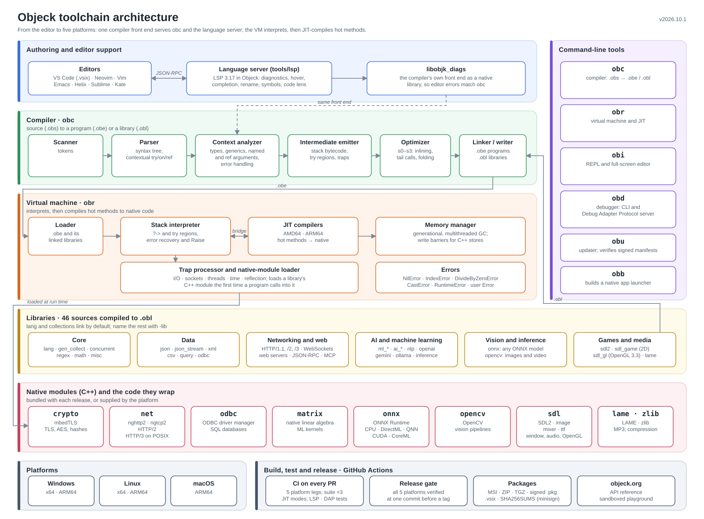

<p align="center">
  
</p>

<p align="center">
<strong>Object-oriented • JIT-compiled • AI-native • Robust APIs
</p>

<hr/>

<p align="center">
  <a href="https://github.com/objeck/objeck-lang/actions/workflows/codeql.yml"></a>
  <a href="https://scan.coverity.com/projects/objeck"></a>
  <a href="https://github.com/objeck/objeck-lang/actions/workflows/ci-build.yml"></a>
  <a href="https://github.com/objeck/objeck-lang/actions/workflows/release-build.yml"></a>
  <a href="https://github.com/objeck/objeck-lang/releases"></a>
</p>

## Why Objeck?

**Built for modern development:**
- 🚀 **JIT-compiled** for performance (ARM64/AMD64)
- 🤖 **AI-native**: OpenAI, Gemini, Ollama, ONNX, OpenCV — no third-party packages
- 🌐 **Network-complete**: HTTP/1.1 · HTTP/2 · HTTP/3/QUIC · WebSocket · DTLS — all standard library
- 💻 **Developer-friendly**: REPL shell, LSP plugins for VSCode/Sublime/Kate, DAP debugger
- 🌍 **Cross-platform**: Linux, macOS, Windows (x64 + ARM64, including 64-bit Raspberry Pi)
- 🔧 **Full-featured**: Threads, generics, closures, reflection, serialization

**Perfect for:**
AI/ML prototyping • Computer vision • Web services • Real-time applications • Game development

## Try It Online

👉🏽 [Playground](https://playground.objeck.org) — 42 demos across 10 categories, Monaco editor, no install required.

## Quick Start

```bash
# Ubuntu 24.04: one package, system libraries included (-arm64 for ARM)
curl -LO https://github.com/objeck/objeck-lang/releases/download/v2026.10.2/objeck-ubuntu24.04-x64_2026.10.2.deb
sudo apt install ./objeck-ubuntu24.04-x64_2026.10.2.deb

# Any other Linux, or macOS: the archive
curl -LO https://github.com/objeck/objeck-lang/releases/download/v2026.10.2/objeck-linux-x64_2026.10.2.tgz
tar xzf objeck-linux-x64_2026.10.2.tgz
# Linux only: install the system libraries the toolchain links against
# (mbedTLS, readline, SDL2/GL, OpenCV, unixODBC, LAME) --
# obr does not start without them. --check reports without installing.
./objeck-lang/install_deps.sh
# Sets PATH and OBJECK_LIB_PATH for this shell. Source it, do not run it.
source ./objeck-lang/env.sh

# Hello World
echo 'class Hello {
  function : Main(args : String[]) ~ Nil {
    "Hello World"->PrintLine();
  }
}' > hello.obs

# Compile and run (modern syntax)
obc hello && obr hello
```

📖 **Full docs**: [objeck.org](https://www.objeck.org)
💡 **Examples**: [github.com/objeck/objeck-lang/programs](https://github.com/objeck/objeck-lang/tree/master/programs)

## Examples

Every program below was compiled and run; the output is what it printed. They are in
[`programs/examples/guides`](programs/examples/guides/), with longer ones and a [guide](docs/guides/README.md)
for each topic. Libraries are named with `-lib`; `obc` does not pull in a library's own dependencies.

### The language

Classes, virtual methods, a generic `Vector`, a closure and string formatting.

<details>
<summary>Program and output (<code>readme_tour.obs</code>)</summary>

```ruby
use Collection;

class Shape {
  @name : String;

  New(name : String) {
    @name := name;
  }

  method : virtual : public : Area() ~ Float;

  method : public : Describe() ~ String {
    return "{$@name}: area {$(Area()):.2}";
  }
}

class Circle from Shape {
  @radius : Float;

  New(radius : Float) {
    Parent("circle");
    @radius := radius;
  }

  method : public : Area() ~ Float {
    return Float->Pi() * @radius * @radius;
  }
}

class Square from Shape {
  @side : Float;

  New(side : Float) {
    Parent("square");
    @side := side;
  }

  method : public : Area() ~ Float {
    return @side * @side;
  }
}

class Tour {
  function : Main(args : String[]) ~ Nil {
    shapes := Vector->New()<Shape>;
    shapes->AddBack(Circle->New(1.5));
    shapes->AddBack(Square->New(2.0));
    each(i : shapes) {
      shapes->Get(i)->Describe()->PrintLine();
    };

    # a function that returns a function (the closure remembers `factor`)
    triple := Scaler(3);
    "triple(14) = {$(triple(14))}"->PrintLine();
  }

  function : Scaler(factor : Int) ~ (Int) ~ Int {
    return \(Int) ~ Int : (x) => x * factor;
  }
}
```

```text
$ obc -src readme_tour.obs
$ obr readme_tour.obe
circle: area 7.07
square: area 4.00
triple(14) = 42
```

</details>

### A database in your program

`Query.Structured` runs SQL over typed in-memory tables, files and archives. A bad query is a message, not a crash. [Guide](docs/guides/query.md)

<details open>
<summary>Program and output (<code>readme_query.obs</code>)</summary>

```ruby
use Query.Structured;

class Sales {
  function : Main(args : String[]) ~ Nil {
    sales := Table->New("sales", ["region", "item", "qty", "price"]);
    Add(sales, "east", "widget", 10, 2.5);
    Add(sales, "west", "gadget", 4, 10.0);
    Add(sales, "east", "gadget", 3, 10.0);
    Add(sales, "west", "widget", 7, 2.5);

    result := sales->Query("select region, sum(qty * price) as revenue from sales group by region order by revenue desc");
    result->ToCsv()->Print();

    if(sales->Query("select nothing from sales") = Nil) {
      sales->GetError()->PrintLine();
    };
  }

  function : Add(table : Table, region : String, item : String, qty : Int, price : Float) ~ Nil {
    row := table->Insert();
    row->Set("region", region);
    row->Set("item", item);
    row->Set("qty", IntRef->New(qty));
    row->Set("price", FloatRef->New(price));
  }
}
```

```text
$ obc -src readme_query.obs -lib query,misc,net,json,regex,xml,csv,cipher
$ obr readme_query.obe
region,revenue
west,57.5
east,55.0
unknown column 'nothing'
```

</details>

### JSON

Parse, read typed values, build, and tell when the text is not JSON. [Guide](docs/guides/data_and_text.md)

<details>
<summary>Program and output (<code>readme_json.obs</code>)</summary>

```ruby
use Data.JSON;

class Json {
  function : Main(args : String[]) ~ Nil {
    root := JsonParser->TextToElement("{\"name\": \"Ada\", \"langs\": [\"en\", \"fr\"], \"age\": 36}");
    name := root->Get("name")->GetString();
    age := root->Get("age")->GetInt();
    langs := root->Get("langs")->Size();
    "{$name} is {$age} and speaks {$langs} languages"->PrintLine();

    doc := JsonElement->New(JsonElement->JsonType->OBJECT);
    doc->Insert("ok", true);
    doc->Insert("count", 3);
    doc->ToString()->PrintLine();

    broken := JsonParser->TextToElement("{\"name\": ");
    "broken text parses to Nil: {$(broken = Nil)}"->PrintLine();
  }
}
```

```text
$ obc -src readme_json.obs -lib json
$ obr readme_json.obe
Ada is 36 and speaks 2 languages
{"count":3,"ok":true}
broken text parses to Nil: true
```

</details>

### Regular expressions

Find, capture, replace. A pattern the engine cannot accept is not OK and matches nothing. [Guide](docs/guides/data_and_text.md)

<details>
<summary>Program and output (<code>readme_regex.obs</code>)</summary>

```ruby
use Query.RegEx;

class Dates {
  function : Main(args : String[]) ~ Nil {
    text := "shipped 2026-10-31, patched 2026-11-02";
    found := RegEx->New("(\\d{4})-(\\d{2})-(\\d{2})")->Find(text);
    each(i : found) {
      date := found->Get(i);
      "{$(date->GetValue())} is month {$(date->GetGroup(2))}"->PrintLine();
    };

    hidden := RegEx->New("\\d")->ReplaceAll("call 555-0199", "#");
    hidden->PrintLine();

    bad := RegEx->New("a{2,1}");
    "a{2,1} is a valid pattern: {$(bad->IsOk())}"->PrintLine();
  }
}
```

```text
$ obc -src readme_regex.obs -lib regex
$ obr readme_regex.obe
2026-10-31 is month 10
2026-11-02 is month 11
call ###-####
a{2,1} is a valid pattern: false
```

</details>

### Collections

A `Hash` to count, a `Map` to report in key order. [Guide](docs/guides/collections.md) and [choosing a collection](docs/COLLECTIONS_GUIDE.md)

<details>
<summary>Program and output (<code>readme_collections.obs</code>)</summary>

```ruby
use Collection;

class Words {
  function : Main(args : String[]) ~ Nil {
    counts := Hash->New()<String, IntRef>;
    words := "the cat and the hat and the bat"->Split(" ");
    each(i : words) {
      seen := counts->Find(words[i]);
      if(seen = Nil) {
        counts->Insert(words[i], IntRef->New(1));
      }
      else {
        seen->Set(seen->Get() + 1);
      };
    };

    ordered := Map->New()<String, IntRef>;
    pairs := counts->GetKeyValues();
    each(i : pairs) {
      ordered->Insert(pairs->Get(i)->GetFirst(), pairs->Get(i)->GetSecond());
    };
    entries := ordered->GetKeyValues();
    each(i : entries) {
      "{$(entries->Get(i)->GetFirst())}: {$(entries->Get(i)->GetSecond()->Get())}"->PrintLine();
    };
  }
}
```

```text
$ obc -src readme_collections.obs
$ obr readme_collections.obe
and: 2
bat: 1
cat: 1
hat: 1
the: 3
```

</details>

### A web server and a client

A one-route server, a request to it, and a clean stop. [Guide](docs/guides/http.md)

<details>
<summary>Program and output (<code>readme_http.obs</code>)</summary>

```ruby
use System.Concurrency;
use Web.HTTP.Server;

class Greeter from HttpRequestHandler {
  New() {
    Parent();
  }

  method : ProcessGet(request : Request, response : Response) ~ Bool {
    name := request->GetParam("name");
    if(name = Nil) {
      name := "world";
    };
    response->SetCodeTypeContent(200, "text/plain", "Hello, {$name}!");
    return false;
  }

  method : ProcessPost(request : Request, response : Response) ~ Bool {
    response->SetCodeContent(405, "Method not allowed");
    return false;
  }
}

class HelloWeb {
  function : Main(args : String[]) ~ Nil {
    # Serve() blocks, so it runs on a thread; port 0 means any free port
    server := Thread->New() {
      New() {
        Parent();
      }

      method : public : Run(arg : System.Base) ~ Nil {
        WebServer->Serve(Greeter->New()->GetClass(), "127.0.0.1", 0);
      }
    };
    server->Execute(Nil);

    while(WebServer->GetBoundPort() = 0) {
      Thread->Sleep(25);
    };
    port := WebServer->GetBoundPort();

    client := Web.HTTP.HttpClient->New();
    response := client->Get(Web.HTTP.Url->New("http://127.0.0.1:{$port}/hello?name=Ada"));
    "{$(response->GetCode())} {$(response->GetContent()->ToString())}"->PrintLine();

    WebServer->Stop();
  }
}
```

```text
$ obc -src readme_http.obs -lib net,net_server,json,cipher
$ obr readme_http.obe
200 Hello, Ada!
```

</details>

### Game search

Describe a game once; `Minimax` and `MonteCarloTreeSearch` choose moves. [Guide](docs/guides/ai.md)

<details>
<summary>Program and output (<code>readme_ai.obs</code>)</summary>

```ruby
use System.AI;

class Nim implements GameState {
  @stones : Int;
  @a_to_move : Bool;

  New(stones : Int, a_to_move : Bool) {
    @stones := stones;
    @a_to_move := a_to_move;
  }

  method : public : GetMoves() ~ Int[] {
    count := @stones < 3 ? @stones : 3;
    moves := Int->New[count];
    each(i : count) {
      moves[i] := i + 1;
    };
    return moves;
  }

  method : public : Apply(move : Int) ~ GameState {
    return Nim->New(@stones - move, <>@a_to_move);
  }

  method : public : IsTerminal() ~ Bool {
    return @stones = 0;
  }

  # +1 when player A took the last stone, -1 when B did
  method : public : Evaluate() ~ Float {
    if(@stones > 0) {
      return 0.0;
    };
    return @a_to_move ? -1.0 : 1.0;
  }

  method : public : IsMaximizing() ~ Bool {
    return @a_to_move;
  }
}

class Play {
  function : Main(args : String[]) ~ Nil {
    state := Nim->New(10, true)->As(GameState);
    "Minimax takes {$(Minimax->New(12)->FindBestMove(state))} of 10 stones"->PrintLine();
    "Monte Carlo takes {$(MonteCarloTreeSearch->New(2000, 1.414, 7)->FindBestMove(state))} of 10 stones"->PrintLine();
  }
}
```

```text
$ obc -src readme_ai.obs -lib ai
$ obr readme_ai.obe
Minimax takes 2 of 10 stones
Monte Carlo takes 2 of 10 stones
```

</details>

More: [all the guides](docs/guides/README.md), the 32 numbered programs in [`programs/deploy`](programs/deploy/README.md) that ship with every release, and [what is new in v2026.10.3](docs/guides/whats_new_10_3.md).

## What's New

Full details for every release are in the [CHANGELOG](CHANGELOG.md).

### v2026.10.3
  * **Garbage collector roots, finished** &mdash; compiled code now tells the collector exactly which stack slots hold references (typed slots on x64 and ARM64), and an `Int[]` has its own heap tag, so an `Int` or an `Int[]` element that happens to equal an object's address is never rewritten by a collection, interpreted or compiled ([design](docs/GC_ROOTS_DESIGN.md))
  * **A hardened loader** &mdash; a fuzz target on `Loader::Load` (hundreds of millions of executions) fixed a crash on a repeated class or method id, allocations of up to 16 GB from a corrupt count, an abort on a bad method signature, a silent exit on an unknown opcode and a read past the end of a short `.obe`; a verifier now checks jump targets, local and trap ids and class, method and field ids before anything runs ([trust model](docs/SECURITY_MODEL.md))
  * **Errors no longer end the host** &mdash; a fatal compiler error and a failed library load are returned instead of calling `exit(1)`, so the language server stays up, and parser and analyzer diagnostics share one record
  * **Debugger** &mdash; output stays whole, messages are ordered, unknown requests are refused, you can pause, breakpoints keep their file and have their own ids, and a breakpoint-heavy run costs about 100&times; less in the hook (25 s to 0.25 s on four threads)
  * **Native library ABI is versioned** &mdash; `VMContext` carries an ABI version and its own size, so a library can tell it was built for a different VM; an unresolved call target and an exception on a worker thread are reported, not crashes
  * **`HttpClient` reuses connections** &mdash; plain-HTTP connections wait in a pool when the server allows it and a `GET` or `DELETE` to the same host reuses one, so a program making many requests no longer runs Windows out of ports; `HttpClient->CloseIdleConnections()` closes the waiting ones ([guide](docs/guides/http.md))
  * **Library fixes** &mdash; a failed request, an empty reply or a missing file in the OpenAI, Gemini, misc, net, JSON, XML, RegEx, RSS and JSON-RPC libraries no longer dereferences `Nil`; `RegEx` repeat counts are bounded (`a{99999999999}` no longer fills the heap); sorting a vector of `Collection.Pair` works ([guide](docs/guides/data_and_text.md))
  * **Language server** &mdash; edits analyze faster (a hover after an edit in a small workspace: 165 ms to 53 ms on Windows) and a library that fails to load no longer takes the server down ([guide](docs/guides/language_server.md))
  * **Checkers example** &mdash; an SDL2 game with ten AI levels built on `System.AI`, a self-play learner and generated music ([`programs/examples/checkers`](programs/examples/checkers/), [guide](docs/guides/ai.md))
  * **Tested more deeply** &mdash; the nightly hardening run is scheduled, a local script runs the cloud checks on your own machine first, and four intermittently failing tests were traced to their causes and fixed (three TLS tests whose certificates were valid only from the second they were made, and a JSON-RPC test that picked a port still held by an earlier connection)
  * **Getting-started guides** &mdash; [Query.Structured](docs/guides/query.md), [HTTP](docs/guides/http.md), [JSON, XML and RegEx](docs/guides/data_and_text.md), [collections](docs/guides/collections.md), [game AI](docs/guides/ai.md) and [editor setup](docs/guides/language_server.md), each with a program that was compiled and run, plus [what is new in 10.3](docs/guides/whats_new_10_3.md)
  * **New docs** &mdash; the [architecture assessment](docs/ARCHITECTURE_ASSESSMENT_2026_11.md), the VM trust model (an `.obe` is native code), a [collections guide](docs/COLLECTIONS_GUIDE.md), [error conventions](docs/ERROR_CONVENTIONS.md) and [how to add an intrinsic](docs/ADDING_AN_INTRINSIC.md)
  * **Upgrading** &mdash; recompile your `.obe` files and rebuild your own `.obl` libraries: the file format changed, and a program or library built by an earlier version is refused with a message saying so

### v2026.10.2 ✅
  * **Query.Structured** &mdash; a columnar database in the standard library: SQL with joins, grouping, indexes and expressions; files, URLs, archive members and worksheets named in `FROM`; a crash-safe `.otab` file format; sources that read CSV, JSON, XML, text logs, filesystems, zip/tar, Excel, ODBC, ML results and image detections as tables ([design](docs/QUERY_DESIGN.md))
  * **ML and NLP lab** &mdash; kernel and one-class SVMs, outlier detectors and an autoencoder, `System.ML.Lab` for experiments, result tables and charts, and BERT sentence embeddings over ONNX
  * **Hugging Face models without Python** &mdash; `TextClassifier` runs a text classifier as `pipeline()` does, `HubClient` downloads models by name into a verified cache, `BpeTokenizer` matches RoBERTa's and GPT-2's tokenizer id for id, and `GetToFile` streams downloads of any size to disk
  * **Security fix** &mdash; an HTTP redirect to another host no longer receives your `Authorization` header or cookies
  * **Stability** &mdash; an object's `GetInstanceID()` survives the collector moving it, so `Hash` and `Map` keyed by objects keep their entries; TLS reads time out on a peer that goes quiet; a connection reset mid-reply is a failed request, not an empty success
  * **Faster runtime** &mdash; a size-class allocator, a collection threshold that follows the live heap, an open-addressed `Hash`, an O(1) `Cache`, and unboxed `IntVector`/`IntMap`/`BitSet`
  * **Calls nest 16,384 deep** (`--call-depth`), and a full stack is recoverable compiled or interpreted
  * **Networking** &mdash; DTLS works for the first time, servers take IPv4 and IPv6 clients on every platform or bind one address, every socket failure says why, blocking I/O no longer stalls the collector, UTF-8 URLs, every HTTP status code
  * **Non-ASCII text on Windows** &mdash; arguments, environment variables, paths, install directories and console output, in every tool
  * **JIT fixes** &mdash; `Float->NaN()`/`Inf()` and two-dimensional array code are compiled instead of handed back to the interpreter, and a value is no longer lost at a loop's collection safepoint
  * **Garbage collector fix** &mdash; a conditional's value (`c ? a : b`) survives another thread's collection; multithreaded programs could store a dangling reference; interpreted code no longer has an `Int` that equals a young object's address rewritten by a collection
  * **Language server about 2&times; faster per edit** &mdash; each edit is analyzed once instead of twice
  * **32 new examples** &mdash; numbered in learning order, each with its compile and run lines and the output it prints, written for people new to the language
  * **Compiler and library fixes** &mdash; a quote inside `{$...}` is an error instead of a compiler hang; a bounded generic class returns its type argument and a literal in `{$...}` compiles; ambiguous names, numeric literals (`0o` is octal; `010` is an error), array literals; CSV, JSON (escapes are decoded on parse), regex, NLP, ML, Ollama, OpenAI, Gemini, SDL2 and ODBC, including a macOS driver manager that could load no driver
  * **Upgrading** &mdash; rebuild your own `.obl` libraries and recompile `.obe` files; a v2026.10.1 `obu` in a non-ASCII install directory cannot update itself, so install by hand; `Directory->List` drops `.` and `..` on Windows; `CompressBr` is `CompressDeflate`; `Byte[]->ToHexString` is a digest; `Hash` iteration order changes; stop calling `JsonElement->Decode` on parsed text; `TF_IDF->New()` smooths and normalizes by default; XML `FindElements` `[n]` is the n-th match, not the first n; `Query` returns `Nil` for an unknown column in a select list or `ORDER BY`; the full list is in the [CHANGELOG](CHANGELOG.md#v2026102---2026-10-31)

### v2026.10.1
  * **Typed errors** &mdash; `Runtime->Raise`, and `try`/`on`/`finally` that catch by error type
  * **Named arguments, method-level generics and `ref` parameters**
  * **Array literals hold expressions; jagged arrays**
  * **Language server rebuilt around LSP 3.17**
  * **Debian packages for Ubuntu 24.04**, plus fixes to the MSYS2 build, OpenCV 5 support and release verification

## Downloads

**Latest Release:** [v2026.10.2](https://github.com/objeck/objeck-lang/releases/latest)

| Platform | Architecture | Download |
|----------|--------------|----------|
| **Windows** | x64 | [MSI Installer](https://github.com/objeck/objeck-lang/releases/latest) / [ZIP](https://github.com/objeck/objeck-lang/releases/latest) |
| **Windows** | ARM64 | [MSI Installer](https://github.com/objeck/objeck-lang/releases/latest) / [ZIP](https://github.com/objeck/objeck-lang/releases/latest) |
| **Linux** | x64 | [DEB (Ubuntu 24.04)](https://github.com/objeck/objeck-lang/releases/latest) / [TGZ Archive](https://github.com/objeck/objeck-lang/releases/latest) |
| **Linux** | ARM64 | [DEB (Ubuntu 24.04)](https://github.com/objeck/objeck-lang/releases/latest) / [TGZ Archive](https://github.com/objeck/objeck-lang/releases/latest) |
| **macOS** | ARM64 | [TGZ Archive](https://github.com/objeck/objeck-lang/releases/latest) |
| **LSP** | All platforms | [ZIP Archive](https://github.com/objeck/objeck-lang/releases/latest) |

📦 **Alternative:** [Sourceforge](https://sourceforge.net/projects/objeck-lang/files/) • 📚 **API Docs:** [objeck.org/api/latest](https://www.objeck.org/api/latest/)

> **Note:** Windows installers are signed and timestamped (`CN=Randy Hollines`, Sectigo); the macOS `.pkg` is signed and notarized. Signing uses a hardware token and therefore happens locally after publication, so verify rather than assume — `Get-AuthenticodeSignature <file>.msi` reports `Valid` only when it really is signed. Check any download against the release's `SHA256SUMS`, which is regenerated after signing. Builds are automated on GitHub Actions runners.

### Verifying a download

Every release ships `SHA256SUMS` and an Ed25519 signature over it,
`SHA256SUMS.minisig`. Download both beside the archive:

```bash
obu verify objeck-linux-x64_<VERSION>.tgz SHA256SUMS
```

`obu` checks the signature before it reads a line of the manifest, and refuses a
manifest it cannot verify. Exit codes are distinct on purpose: `0` matches, `1`
does not match, `2` could not be checked.

The manifest matters because it is served from the same place as the assets it
describes — anyone able to replace an archive could replace the manifest to match.
The Linux and macOS archives carry no platform signature at all, so for those it
is the only integrity claim there is. The signature is what an attacker cannot
reproduce.

**The release public key**, for checking out of band — with `minisign`, or against
what `obu` reports:

```
untrusted comment: minisign public key 8237C6B17C7EA6B9
RWS5pn58scY3gv7X3EL/fJaOQli1V0HDwwFVt+2IWqPXBxvE4U1UhxHC
```

Key ID `8237C6B17C7EA6B9`. The same key is committed at
[`core/release/objeck-release.pub`](core/release/objeck-release.pub) and served,
independently of this repository, from
**<https://www.objeck.org/objeck-release.pub>**. A key you can only obtain from
the thing you are trying to verify proves nothing, which is why it is in more
than one place. Check that they agree:

```bash
curl -sS https://www.objeck.org/objeck-release.pub | sha256sum
# 864c6a9951a539ec356520dbeca4f97ec7a5fc9f4fd31d881f659f59bf7a6c04
```

That digest is of the whole 113-byte file, both lines, newline included. The
site serves `.pub` as `application/x-mspublisher`, so a browser offers to
download it rather than showing it; for reading in a browser there is an
identical copy at
[`objeck-release.pub.txt`](https://www.objeck.org/objeck-release.pub.txt),
served as text and with the same digest. Design and
key-rotation procedure: [`docs/release_integrity.md`](docs/release_integrity.md).

## See It In Action

### HTTP/2 Client
```ruby
use Web.HTTP;

# Persistent connection — multiple requests share one TLS session
client := Http2Client->New("httpbin.org");
resp := client->Get("/get");
"Status: {$resp->GetCode()}"->PrintLine();    # Status: 200

body := "{\"lang\":\"objeck\"}"->ToByteArray();
resp2 := client->Post("/post", body, "application/json");
client->Close();

# One-liner for quick requests
resp := Http2Client->QuickGet(Url->New("https://httpbin.org/get"));
```

### HTTP/3 / QUIC Client
```ruby
use Web.HTTP;

# QUIC over UDP — zero round-trip connection on repeat visits
client := Http3Client->New("quic.nginx.org");
resp := client->Get("/");
"Status: {$resp->GetCode()}"->PrintLine();    # Status: 200
client->Close();

# One-liner
resp := Http3Client->QuickGet(Url->New("https://quic.nginx.org/"));
```

### AI Integration
```ruby
# OpenAI Realtime API - get text AND audio
response := Realtime->Respond("How many James Bond movies?",
                              "gpt-4o-realtime-preview", token);
text := response->GetFirst();
audio := response->GetSecond();
Mixer->PlayPcm(audio->Get(), 22050, AudioFormat->SDL_AUDIO_S16LSB, 1);
```

### Face Recognition
```ruby
# SCRFD detector + ArcFace R50 embeddings (InsightFace buffalo_l)
session := FaceSession->New("det_10g.onnx", "w600k_r50.onnx");
r1 := session->Recognize(img1_bytes, 0.5);
r2 := session->Recognize(img2_bytes, 0.5);
faces1 := r1->GetResults(); faces2 := r2->GetResults();
sim := FaceSession->Compare(faces1[0]->GetEmbedding(), faces2[0]->GetEmbedding());
"Same person: {$(sim > 0.35)}"->PrintLine();
```

### Computer Vision
```ruby
# OpenCV: grayscale, blur and edge detection
image := Image->Load("photo.jpg");
gray := image->CvtColor(ColorConversionCodes->BGR2GRAY);
edges := gray->GaussianBlur(5, 5, 0.0)->Canny(50, 150);
edges->Save("edges.jpg");
```

### Natural Language Processing
```ruby
# Sentiment analysis and TF-IDF
text := "This product is absolutely wonderful!";
sentiment := SentimentAnalyzer->Classify(text);  # "positive"

# Train TF-IDF on documents
docs := ["cats are pets", "dogs are pets", "birds can fly"];
tfidf := TF_IDF->New();
tfidf->Fit(docs);
vector := tfidf->Transform("cats and dogs");  # [0.47, 0.0, 0.47, ...]
```

[🎯 More examples](https://github.com/objeck/objeck-lang/tree/master/programs/examples)

## Language Features

**Object-Oriented**
- Inheritance, interfaces, generics
- Type inference and boxing
- Reflection and dependency injection
- [See OOP examples →](docs/FEATURES.md#oop)

**Functional**
- Closures and lambda expressions
- First-class functions
- [See functional examples →](docs/FEATURES.md#functional)

**Strings & Formatting**
- Interpolation with expressions: `"{$i + 1}"`, `"{$obj->M()}"`
- Format specifiers: `"{$pi:.2}"`, `"{$n:05}"`, `"{$v:x}"`
- Positional templates: `String->Format("{0} = {1}", a, b)`
- [See string features →](docs/FEATURES.md#strings)

**Platform Support**
- Unicode, file I/O, sockets, named pipes
- Threading with mutexes
- [See platform features →](docs/FEATURES.md#platform)

## Libraries

**AI & Machine Learning** — [📖 AI Developer Guide](https://www.objeck.org/ai_guide.html) · [GitHub source](docs/AI.md) · [🤖 Getting Models](docs/MODELS.md)
- [OpenAI](https://github.com/objeck/objeck-lang/blob/master/core/compiler/lib_src/openai.obs) — chat, vision, realtime audio, image generation, embeddings, moderation, batch
- [Gemini](https://github.com/objeck/objeck-lang/blob/master/core/compiler/lib_src/gemini.obs) — chat, vision, search grounding, files, context caching, batch embeddings
- [Ollama](https://github.com/objeck/objeck-lang/blob/master/core/compiler/lib_src/ollama.obs) — local LLM chat, vision, and embeddings; recommended models: `llama3.2`, `phi3`, `llava` ([get models →](docs/MODELS.md#ollama-models))
- [NLP](https://github.com/objeck/objeck-lang/blob/master/core/compiler/lib_src/nlp.obs) — tokenization, TF-IDF, text similarity, sentiment analysis
- [OpenCV](https://github.com/objeck/objeck-lang/blob/master/core/compiler/lib_src/opencv.obs) — computer vision: detection, transforms, video
- [ONNX Runtime](https://github.com/objeck/objeck-lang/blob/master/core/compiler/lib_src/onnx.obs) — local ML inference: YOLO, ResNet, DeepLab, OpenPose, Phi-3, face recognition ([get models →](docs/MODELS.md#onnx-models))
- [Face Recognition](https://github.com/objeck/objeck-lang/blob/master/core/lib/onnx/README.md) — SCRFD detector + ArcFace R50 (InsightFace buffalo_l)
- [Phi-3 / Phi-3 Vision](https://github.com/objeck/objeck-lang/tree/master/programs/frameworks/opencv_onnx) — local SLM text and multimodal inference

**Web & Networking**
- HTTP/1.1 [server](https://github.com/objeck/objeck-lang/blob/master/core/compiler/lib_src/net_secure.obs)/[client](https://github.com/objeck/objeck-lang/blob/master/core/compiler/lib_src/net_secure.obs), [OAuth](https://github.com/objeck/objeck-lang/blob/master/core/compiler/lib_src/net_common.obs)
- [HTTP/2](https://github.com/objeck/objeck-lang/blob/master/core/compiler/lib_src/net_h2.obs) — multiplexed TLS client via nghttp2
- [HTTP/3 / QUIC](https://github.com/objeck/objeck-lang/blob/master/core/compiler/lib_src/net_quic.obs) — UDP-based client; ngtcp2 + nghttp3 on Linux/macOS, WinHTTP over MsQuic on Windows 11+
- [RSS](https://github.com/objeck/objeck-lang/blob/master/core/compiler/lib_src/rss.obs)

**Data**
- [JSON](https://github.com/objeck/objeck-lang/blob/master/core/compiler/lib_src/json.obs) (hierarchical + [streaming](https://github.com/objeck/objeck-lang/blob/master/core/compiler/lib_src/json_stream.obs)), [XML](https://github.com/objeck/objeck-lang/blob/master/core/compiler/lib_src/xml.obs), [CSV](https://github.com/objeck/objeck-lang/blob/master/core/compiler/lib_src/csv.obs)
- [SQL/ODBC](https://github.com/objeck/objeck-lang/blob/master/core/compiler/lib_src/odbc.obs), [In-memory queries](https://github.com/objeck/objeck-lang/blob/master/core/compiler/lib_src/query.obs)
- [Collections](https://github.com/objeck/objeck-lang/blob/master/core/compiler/lib_src/gen_collect.obs)

**Graphics & Gaming**
- [3D Graphics (OpenGL)](https://github.com/objeck/objeck-lang/blob/master/core/compiler/lib_src/sdl_gl.obs) — OpenGL 3.3 core: shaders, meshes, textures, cameras, lighting, shadows ([setup & examples →](docs/opengl.md))
- [2D Gaming (SDL)](https://github.com/objeck/objeck-lang/blob/master/core/compiler/lib_src/sdl_game.obs)

**Other**
- [Encryption](https://github.com/objeck/objeck-lang/blob/master/core/compiler/lib_src/cipher.obs), [Regex](https://github.com/objeck/objeck-lang/blob/master/core/compiler/lib_src/regex.obs)

## Architecture

[](docs/architecture.md)

One compiler front end serves `obc` and the language server; the VM interprets, then JIT-compiles hot methods for AMD64 and ARM64; libraries reach SDL2, ONNX Runtime, OpenCV, mbedTLS and more through native modules. [More diagrams](docs/architecture.md).

## Development

**Modern tooling and practices:**
- 🤖 **Claude Code** for pair programming, debugging, and refactoring
- 🔄 **CI/CD**: Fully automated build, test, sign, and release pipeline (GitHub Actions)
  - ✅ Every push triggers multi-platform builds (Windows, Linux, macOS)
  - ✅ macOS installers signed and notarized in CI (Windows signing is a local step — hardware token)
  - ✅ One-tag releases: `git tag v2026.2.1` → automated distribution in 60 minutes
  - ✅ Parallel builds across 6 platforms (x64/ARM64)
  - 📖 [Release Process Documentation](docs/release_process.md) • [CI/CD Architecture](docs/CI_CD.md) • [System Architecture](docs/architecture.md)
- 🔍 **Quality**: CodeQL security scanning + gitleaks secret scanning
- 🧪 **Testing**: 350+ tests across 3 suites (regression, comprehensive, deploy)
  - **Regression suite**: 10 focused tests for critical functionality
  - **Comprehensive suite**: 323+ tests for full language validation
  - **Deploy suite**: 17 real-world usage examples
  - Full cross-platform coverage (Windows/Linux/macOS, x64/ARM64)

**Editor Support:**
- LSP plugins for [VSCode, Sublime, Kate, Neovim, Emacs, Helix, and more](tools/lsp/)
- REPL for interactive development
- API docs at [objeck.org](https://www.objeck.org)

**📚 [Testing Documentation](programs/TESTING.md)** • **🧪 [Regression Tests](programs/regression/)** • **📊 [Performance & Benchmarks](docs/performance.md)**

## Resources

- 📖 [Documentation](https://www.objeck.org)
- 🏗️ [Architecture](docs/architecture.md) — a one-page toolchain diagram, plus Mermaid diagrams of the compiler, VM, JIT, libraries and CI/CD
- 🎯 [Examples](https://github.com/objeck/objeck-lang/tree/master/programs)
- 💬 [Discussions](https://github.com/objeck/objeck-lang/discussions)
- 🐛 [Issues](https://github.com/objeck/objeck-lang/issues)


