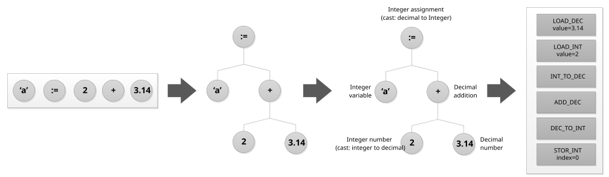

# Objeck Compiler (obc)

The Objeck compiler converts source code into Objeck executables (.obe) or Objeck libraries (.obl). It produces compressed bytecode for the Objeck VM, a stack-based runtime system, and performs extensive optimizations including method inlining. Optional debug symbols can be generated for use with the runtime debugger.



## Features

- **Modern CLI**: GNU-style flags (`--source`/`-s`, `--destination`/`-d`, `--debug`/`-D`) with backward compatibility
- **Optimizing compiler**: Multiple optimization passes for performance
- **Type safety**: Strong static typing with type inference
- **Generics support**: Type erasure and type boxing (v5.x+)
- **Debug symbols**: Optional debug information for debugger integration
- **Library support**: Links against external Objeck libraries (.obl)

## Usage

```bash
# Compile a program (modern syntax)
obc --source hello.obs --destination hello.obe

# Compile with shortcuts
obc -s hello.obs -d hello.obe

# Compile with debug symbols
obc -s myapp.obs -d myapp.obe --debug

# Legacy syntax (still supported)
obc -src hello.obs -dest hello.obe
```

## Architecture

`Compile()` in `compiler.cpp` runs these stages in order; each is one source file. The whole map, with the file formats and the VM, is [docs/ARCHITECTURE_MAP.md](../../docs/ARCHITECTURE_MAP.md).

| Stage | Source | Does |
|---|---|---|
| Scanner and parser | `scanner.cpp`, `parser.cpp`, `tree.h` | hand-written recursive descent into a `ParsedProgram` |
| Context analyzer | `context.cpp`, `types.cpp` | type checking and name resolution. It first calls `Linker::Load` (`linker.cpp`), which reads the `.obl` libraries named by `-lib` (and `lang`, `gen_collect`), so library classes are known before analysis |
| Intermediate emitter | `intermediate.cpp` | blocks of VM instructions (`../shared/instrs.h`) per method; pulls in the library classes the program calls |
| Optimizer | `optimization.cpp` | `-opt s0` to `s3` (default `s3`); see [docs/optimization_pipeline.md](../../docs/optimization_pipeline.md) for the passes at each level |
| File emitter | `emit.cpp` | writes the zlib-compressed `.obe` or `.obl` |

The same sources are also built as the bootstrap compiler `sys_obc` (`-D_SYSTEM`, for `lib_src/lang.obs`), as `compiler.a` (`-D_MODULE`, for `core/module` and the REPL) and, with only the front end, as `libobjk_diags` for the language server.

### Generics Implementation

As of v5.x, the compiler supports generics through type erasure, similar to Java. Generic types are compiled to their upper bounds, with runtime type checks inserted where necessary. Type boxing allows primitives to be used seamlessly with generic containers.

Type parameters support:

- **Bounds** — `T : Bound` constrains a parameter to an interface; the first bound is the erasure type.
- **Compound bounds** — `T : A & B` requires the concrete argument to satisfy every bound.
- **F-bounded constraints** — the bound may itself be generic and self-referential, e.g. `T : Compare<T>`. The constraint is enforced against the bound's raw interface (consistent with erasure).
- **Declaration-site variance** — `out T` (covariant) and `in T` (contravariant) relax the default invariance during generic type-argument checking; `out` is recognized contextually so it remains usable as an ordinary identifier. Variance is sound in both directions and is preserved across the `.obl` library boundary.

## Implementation

- **Language**: C++ with STL
- **Build System**: Visual Studio (Windows), Makefile (Linux/macOS)
- **Dependencies**: Standard C++ library, platform-specific APIs

## Output Format

The compiler produces bytecode files in Objeck's compressed format:
- **.obe files**: Executable programs
- **.obl files**: Reusable libraries

Both begin with the toolchain version (`VER_NUM`) and a magic number, and the VM and the linker refuse a file from another toolchain version. The bytecode is the same on every platform. Details: [docs/ARCHITECTURE_MAP.md](../../docs/ARCHITECTURE_MAP.md#file-formats).

## See Also

- [Main README](../../README.md) - Project overview
- [Virtual Machine](../vm/README.md) - Bytecode execution environment
- [Debugger](../debugger/README.md) - Runtime debugging
- [API Documentation](https://www.objeck.org) - Language reference
