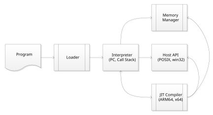

# Objeck Virtual Machine (obr)

The Objeck Virtual Machine is a high-performance stack-based VM with JIT compilation for ARM64 and AMD64 architectures. It features a generational garbage collector and native integration with platform capabilities.



## Features

- **JIT Compilation**: Converts bytecode to native machine code for performance
- **Stack-Based Architecture**: Simple, efficient execution model
- **Garbage Collection**: generational (nursery + old generation), moving for young objects, stop-the-world, mark-and-sweep; see the soundness notes under [Memory Management](#memory-management)
- **Cross-Platform**: Unified codebase for Windows, Linux, and macOS
- **Multi-Architecture**: JIT back ends for x64 (AMD64) and ARM64
- **Platform Integration**: Direct access to OS capabilities (networking, files, threading)
- **Automatic memory management**: no manual deallocation in Objeck code. This is not a safety guarantee against a hostile program: the VM trusts the `.obe` and native libraries (see [Trust and verification](#trust-and-verification))
- **Runtime Errors**: an error prints its message and the call stack and ends the program, unless it happens inside a `Try()` (`?->`) chain, which yields `Nil` instead

## Supported Platforms

| Platform | Architecture | Status |
|----------|--------------|--------|
| Windows | x64 (AMD64) | Built and released |
| Windows | ARM64 | Built and released (cross-compiled on an x64 runner; `release-build.yml`) |
| Linux | x64 (AMD64) | Built and released |
| Linux | ARM64 (including 64-bit Raspberry Pi) | Built and released |
| macOS | ARM64 (Apple Silicon) | Built and released |

There is no macOS x64 build: the release workflow has no such leg (`.github/workflows/release-build.yml`, platforms `windows-x64`, `windows-arm64`, `linux-x64`, `linux-arm64`, `macos-arm64`), and the changelog records that an advertised Intel macOS build "has never existed". The JIT back ends are AMD64 and ARM64 only; on any other target the VM stays an interpreter. **How to check:** `OBJECK_JIT_REPORT=1 obr prog.obe` reports, on stderr, each method the JIT compiled or handed back to the interpreter and why (`docs/cli_options.md`).

## Usage

```bash
# Run a program
obr myprogram.obe

# Run with command-line arguments
obr myprogram.obe arg1 arg2 arg3

# Run with library path
obr -lib /path/to/libs myprogram.obe

# Allow deeper recursion (default 16384 frames; `obr` with no arguments lists every option)
obr --call-depth=100000 myprogram.obe

# Display the toolchain version (obr has no version flag; the compiler does)
obc --version
```

## Architecture

### Major Components

1. **Interpreter**
   - Executes bytecode instructions
   - Manages execution stack
   - Handles method calls and returns
   - Dispatches to JIT-compiled code when available

2. **JIT Compiler**
   - Converts hot methods to native machine code (auto-JIT by call count)
   - Architecture-specific code generation; each back end has a `CanJitInstruction` whitelist, and a method containing an opcode the whitelist lacks stays interpreted
   - Local register caching; direct JIT-to-JIT calls (method inlining is the compiler's `-opt s3` pass, not the JIT's)
   - Direct JIT-to-JIT calling via call-site patching (`MTHD_CALL` → `MTHD_CALL_JIT`)
   - See [JIT internals](arch/jit/README.md)

3. **Memory Manager**
   - Generational mark-and-sweep collector
   - Young nursery (bump-allocated objects) + old generation
   - Automatic memory reclamation; old-gen free-list cache
   - Lock-free CAS marking; parallel root scanning
   - See [memory manager internals](arch/README.md)

4. **Platform Abstraction Layer**
   - Unified interface for Windows and POSIX systems
   - Thread management (pthreads/Windows threads)
   - File I/O and networking
   - Dynamic library loading
   - System calls and interrupts

### Execution Flow

```
Bytecode → Interpreter → [Hot Path Detection] → JIT Compiler → Native Code
                ↓                                        ↓
           Stack Management ← Memory Manager ← Garbage Collector
```

### JIT Compilation Strategy

The VM uses call-count-driven auto-JIT (no multi-tier recompilation):
1. **Interpretation**: methods start in the bytecode interpreter
2. **Counting**: each call increments a per-method counter
3. **Compilation**: at the threshold (`OBJECK_JIT_THRESHOLD`, default 10) the method's next entry compiles to native code, after a `CanJitInstruction` pre-scan. A method that contains a loop compiles on its first call instead, whenever the threshold is the default or lower (`JitEagerLoops` in `arch/jit/jit_common.h`); `main` is included
4. **Patching**: call sites are rewritten to dispatch straight to native code (`MTHD_CALL` → `MTHD_CALL_JIT`)
5. **Reuse**: compiled native code is cached on the method

Run with `--jit=off` (or set `OBJECK_JIT_DISABLE=1`) to stay fully interpreted, methods declared `native` included; `--jit=<calls>` or `OBJECK_JIT_THRESHOLD=N` changes the threshold, and the flag wins when both are given. See [JIT internals](arch/jit/README.md) for the full lifecycle and the callback bridge.

## Memory Management

### Garbage Collection

The VM uses a generational mark-and-sweep collector:
- **Young generation (nursery)**: objects are bump-allocated here and most die without ever entering the old-gen set
- **Old generation**: nursery survivors are promoted here; arrays are allocated here directly (they bypass the nursery — see [internals](arch/README.md))
- **Minor vs. major GC**: minor collections scan the remembered set (via a write barrier) + roots and recycle the nursery; major collections sweep both generations
- **Parallel mark**: root scanning fans out across threads with lock-free CAS mark bits. A collection is serialized against other collections (a `trylock` guards re-entry) and runs **cooperative stop-the-world**: other mutator threads park at safepoints (in the dispatch loop, at allocation, and across blocking syscalls such as thread join/sleep and socket I/O) for the duration of the collection

**Status:** implemented and on by default. The two-generation collector first landed 2026-02-16 (`868eeb8dbf`); PR #574 (merged 2026-06-24, 2026.6.3) enabled minor collections together with the JIT write barriers; typed root maps for interpreted and compiled frames are PRs #1466 to #1511 (see [GC roots](../../docs/GC_ROOTS_DESIGN.md)). The 128 MB nursery default is `YOUNG_REGION_SIZE` in `arch/memory.h`; `--nursery=<size>` (64k to 128m) or `OBJECK_NURSERY` lowers the usable limit, and `--gc-threshold` fixes the old-generation trigger.

**Invariants the collector relies on** (details and the evidence for each in [arch/README.md](arch/README.md)):
- Every object is preceded by three header words, `mem[-1]` flags (mark, old, remembered-set, closure-traced bits), `mem[-2]` class pointer (arrays: byte size) and `mem[-3]` memory type; a young object also has a size word before them. `EXTRA_BUF_SIZE` is 3.
- A collection runs only with every other mutator parked (cooperative stop-the-world); a thread that is mid-allocation is never parked, so the collector never sees a block between its bump and its header write.
- Any store of a reference into an old object goes through a write barrier (interpreter and both JITs), or a minor collection can free a live young object.
- Roots are exact for static memory, declared locals and fields. Operand-stack words are a **conservative** root set, narrowed by per-method reference maps: a word is skipped only when the map proves it `Int` or `Float`; a word the map leaves unknown or conflicting is treated as a possible reference.
- Native libraries that hand an object back through an argument array allocate it in the old generation (`AllocateObjectNative`, `force_old`), because a plain store there runs no write barrier.

**Limitations today:** arrays are never allocated in the nursery and never move; an `Int[]` that a native library or a trap allocates (rather than the compiler's `NEW_INT_ARY`) is still scanned conservatively; operand-stack words above the first compiled frame on a thread are still scanned conservatively. See [GC roots](../../docs/GC_ROOTS_DESIGN.md) for the exact residue.

**How to check:** `OBJECK_GC_STATS=1 obr prog.obe` prints a summary at exit (minor and major counts, pause, promoted bytes); `OBJECK_GC_VERIFY=1 obr prog.obe` runs the heap verifier every collection (`checkmark` adds a mark-completeness check; `OBJECK_GC_VERIFY_INJECT=field|barrier|mark` plants a fault to show the verifier catches it); `OBJECK_GC_ROOTS=audit` checks the reference maps against the live stacks, and `OBJECK_GC_ROOTS=conservative` restores the old scan as a negative control; `--nursery=64k` makes collections frequent.

### Object Layout

Objects are laid out in memory with:
- Size word (young objects only, used when promoting)
- Three header words: flags (mark, old-generation, remembered-set, closure-traced bits), class pointer, memory type
- Instance variables, one word each (two for a function reference); a zero-field class is padded to one word so the object's address stays inside its own block (`MemoryManager::ObjectBlockSize`)
- For arrays: the element count, the dimension count and the dimension sizes, then the elements

## Threading Model

- Native OS threads (pthreads on Unix, Windows threads on Windows)
- Thread-local storage for VM state
- Mutex and condition variable support
- Garbage collection runs **cooperative stop-the-world**: collections are serialized against each other via a `trylock`, and other mutator threads park at safepoints (dispatch loop, allocation, and blocking syscalls) for the duration of a collection

## Performance

### Optimizations
- JIT compilation with local register caching
- Direct JIT-to-JIT calling (no interpreter trampoline) via call-site patching
- Division by a constant as a multiply or shift in both JITs; method inlining is done by the compiler at `-opt s3`
- Young-generation bump allocation (lock-free) for short-lived objects
- Constant pool optimization

### Benchmarks
See [`docs/performance.md`](../../docs/performance.md) for current cross-language and version-over-version numbers.

## Building the VM

### Dependencies

The VM requires the following libraries at build time:

| Library | Purpose | Linux | macOS | Windows VS | MSYS2 |
|---------|---------|-------|-------|------------|-------|
| mbedTLS | TLS, crypto (`TCPSecureSocket`) | `libmbedtls-dev` | static 3.6.4, `tools/deps/build_macos_deps.sh` | bundled | `mingw-w64-ucrt-x86_64-mbedtls` |
| nghttp2 | HTTP/2 (`net_h2`) | static, `tools/deps/build_quic_deps.sh` | static, `tools/deps/build_quic_deps.sh` | vcpkg `nghttp2:x64-windows` | `mingw-w64-ucrt-x86_64-nghttp2` |
| ngtcp2 + nghttp3 | QUIC and HTTP/3 (`net_quic`) | static, `tools/deps/build_quic_deps.sh` | static, `tools/deps/build_quic_deps.sh` | WinHTTP (Windows 11+) | not built |
| AWS-LC | TLS 1.3 for QUIC | static, `tools/deps/build_quic_deps.sh` | static, `tools/deps/build_quic_deps.sh` | not used | not used |

On Linux and macOS, HTTP/2 and HTTP/3 (`OBJECK_HAS_NGHTTP2`, `OBJECK_HAS_NGTCP2`) link static libraries rather than distribution or Homebrew packages, so `obr` runs without them. `tools/deps/build_quic_deps.sh` builds pinned versions of AWS-LC, ngtcp2, nghttp3 and nghttp2 into `~/objeck-deps/<os>-<arch>`, which the Makefiles and the Xcode project read; set `OBJECK_DEPS` to use another prefix. It needs `git` and `cmake`, and runs once per version.

### Windows (Visual Studio)
```bash
cd core/vm/vs
msbuild vm.vcxproj /p:Configuration=Release /p:Platform=x64
```

### Linux x64 (Make)
```bash
# Install dependencies first (see table above)
sudo apt-get install -y libmbedtls-dev cmake git
bash tools/deps/build_quic_deps.sh    # once: static HTTP/2 + HTTP/3 libraries

cd core/vm
make -f make/Makefile.amd64
```

### Linux ARM64 (Make)
```bash
sudo apt-get install -y libmbedtls-dev cmake git
bash tools/deps/build_quic_deps.sh    # once: static HTTP/2 + HTTP/3 libraries

cd core/vm
make -f make/Makefile.arm64
```

### macOS (Xcode)
```bash
brew install cmake
MACOSX_DEPLOYMENT_TARGET=13.3 bash tools/deps/build_quic_deps.sh    # once
bash tools/deps/build_macos_deps.sh    # once: static mbedTLS 3.6.4, which the VM links
open core/vm/xcode/VM.xcodeproj
# Build → Product → Build (⌘B)
```

## Implementation Details

- **Language**: C++ with STL
- **Code Generation**: Custom assembler for x64 and ARM64
- **Line Count**: about 55,000 lines of C++ in `core/vm` (`wc -l` over the `.cpp` and `.h` files, JIT and collector included)
- **External Dependencies**: mbedTLS (TLS/crypto); on Linux and macOS, static nghttp2 (HTTP/2) and ngtcp2+nghttp3+AWS-LC (HTTP/3) from `tools/deps/build_quic_deps.sh`

## Trust and verification

An `.obe` is native-equivalent code: the VM does not sandbox it. After loading, `Loader::Verify` (PR #1512, 2026-11-01) checks jump targets, local and field ids, class and method ids, trap ids and that the last instruction ends the method; section 30 of `programs/regression/run_vm_flag_tests.py` mutates one operand per rule. It does **not** check operand-stack depth or types; a load-time stack check built on the reference-map builder (`arch/ref_map.h`) is in an open PR (#1598), not yet in this tree. See [SECURITY_MODEL.md](../../docs/SECURITY_MODEL.md).

## Debugging

The VM integrates with the Objeck debugger (obd) through:
- Debug symbol support in bytecode
- Breakpoint handling
- Stack trace generation
- Variable inspection
- Step execution

## See Also

- [Main README](../../README.md) - Project overview
- [Compiler](../compiler/README.md) - Bytecode generation
- [Debugger](../debugger/README.md) - Debugging support
- [JIT Architecture](arch/jit/README.md) - JIT compiler internals
- [Memory Manager](arch/README.md) - garbage collector internals
- [API Documentation](https://www.objeck.org) - Runtime API reference
