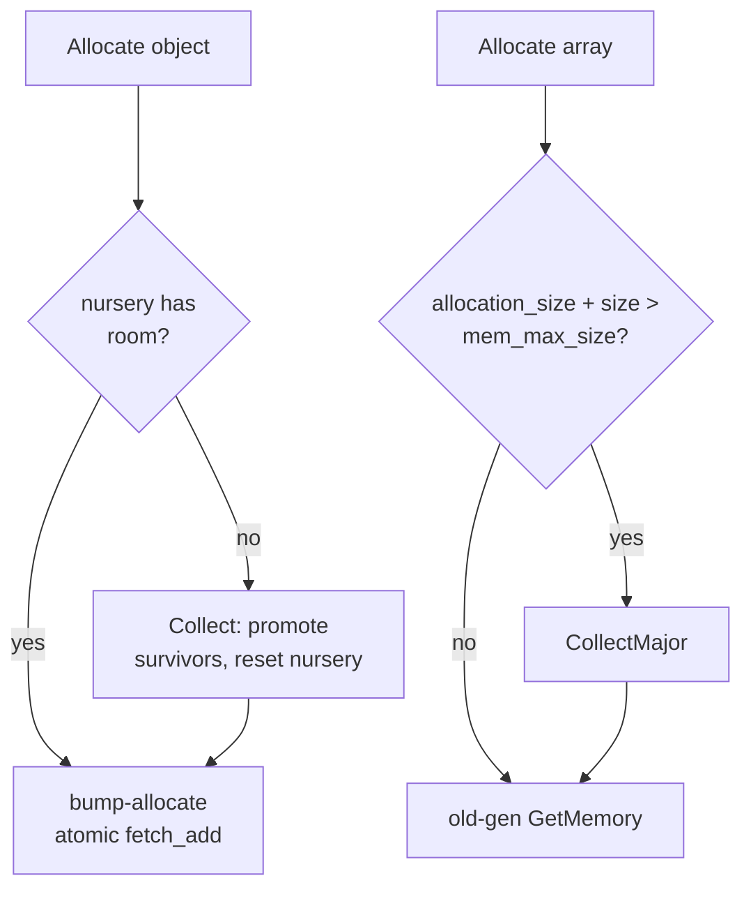
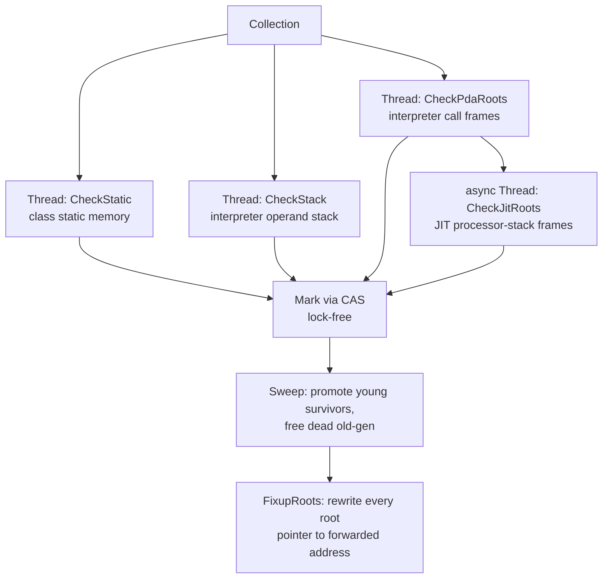

## Memory Manager
A **generational, stop-the-world mark-and-sweep** garbage collector with a moving nursery and a non-moving old generation. Marking is parallel (three mark threads); it is *not* concurrent with the mutators, which park for the whole collection.

**Status:** implemented and on by default. Two generations landed 2026-02-16 (`868eeb8dbf`); the minor collection was enabled by PR #574 (2026-06-24, v2026.6.3); the heap verifier shipped in v2026.9.5 (`4615beddbb`); typed root maps shipped in v2026.10.2 (interpreter) and v2026.10.3 (compiled frames, `Int[]` tag), PRs #1466 to #1511, see [GC_ROOTS_DESIGN.md](../../../docs/GC_ROOTS_DESIGN.md). Release membership is from `git tag --contains`.

**Soundness in one paragraph.** The collector is *precise* for static memory, declared locals and fields, and for an `Int[]` the compiler allocated, and it is *conservative* for operand-stack words: a word is skipped only when the method's reference map (`ref_map.h`) proves it `Int` or `Float`, and a word the map leaves unknown or conflicting is treated as a possible reference (`RK_UNKNOWN`, `RK_CONFLICT`). A conservative word is validated before it is dereferenced or relocated (`IsYoungCandidate`, `IsYoungObjectStart`, `IsClassPointer`, `ForwardedAddr`), so a stray integer cannot fault the collector, but an integer that equals a live young object's address on a stack the maps do not cover can still be retained or rewritten. That residue is listed in [GC_ROOTS_DESIGN.md](../../../docs/GC_ROOTS_DESIGN.md).

### Design
Memory is allocated until a threshold is reached, which triggers a collection. The collector scans all *roots* — class static memory, the interpreter operand stacks, interpreter (PDA) call frames, and compiled (JIT) frames — marks everything reachable, and reclaims the rest. A compiled frame is not scanned as raw processor stack: the collector reads its declared locals by declared type, plus the typed `TMP_REF_*` spill slots (`jit/jit_frame_layout.h`). Root scanning runs across **multiple threads**; marking is lock-free.

What's new since the original mark-and-sweep is a **young generation**: short-lived objects are bump-allocated into a nursery and die there cheaply, so the bulk of allocations never touch the old-generation set or its mutex. This is the source of the recent throughput and RSS gains (see [`docs/performance.md`](../../../docs/performance.md) for canonical benchmark numbers).

### Generational layout
```
                 ┌───────────────────────────────────────────────┐
 OBJECTS  ─────► │  YOUNG NURSERY  (contiguous, bump-allocated)   │
                 │  young_offset CAS loop  — lock-free             │
                 └───────────────────────────────────────────────┘
                          │ survives a collection
                          ▼  promote + forward
                 ┌───────────────────────────────────────────────┐
 ARRAYS  ──────► │  OLD GENERATION  (old_generation hash set)     │
                 │  GetMemory() + free-list cache, mutex-guarded   │
                 └───────────────────────────────────────────────┘
```

- **Objects** are bump-allocated in the nursery first (`AllocateObject`, `memory.cpp`). A young object carries no `GC_OLD_BIT`, is never inserted into `old_generation`, and takes no allocation mutex. The bump is a compare-and-swap loop that commits only when the block fits; a plain `fetch_add` was rejected because concurrent threads then advance `young_offset` past the end of the region without rolling back, and the collector uses `young_offset` as the length of its walk (see the comment in `AllocateObject`).
- **Arrays always go straight to old gen** (`AllocateArray`). Array interior pointers can't yet be safely fixed up during promotion, so they skip the nursery by design — see the comment at the top of `AllocateArray`. Two kinds of *object* also skip it: one larger than the nursery limit (it could never fit, and trying would collect on every such allocation), and one a native library allocates for an argument array (`AllocateObjectNative`, `force_old`), because a native's plain store into that array runs no write barrier.
- **Promotion is on first survival.** A minor collection promotes every reachable young object to the old generation (the comment in `CollectMinor` says "promote-all"); there is no survivor space and no age counter, so a short-lived object that happens to be live at a collection is promoted and only a major collection reclaims it.
- When the nursery fills, a collection promotes the survivors and resets `young_offset` to 0, recycling the whole region. Recycling is just the offset reset — the region's bytes are zeroed lazily *as they are re-allocated* (see [Nursery zeroing](#nursery-zeroing-zero-on-alloc)), not in the collection.

### Object header
Each allocation is preceded by reserved slots (`EXTRA_BUF_SIZE`). The flag word `mem[MARKED_FLAG]` packs four GC bits:

| Bit | Name | Meaning |
|---|---|---|
| `0x1` | `GC_MARK_BIT` | reachable this cycle |
| `0x2` | `GC_OLD_BIT` | lives in the old generation (0 = young) |
| `0x4` | `GC_RSET_BIT` | in the remembered set (old object holding a young ref) |
| `0x8` | `GC_TRACED_BIT` | a closure capture block whose captures were traced this collection (so a conservative mark cannot make the typed walk skip them; #880, #881) |

### Allocation & collection trigger


The old-gen threshold `mem_max_size` is recomputed after every **major** collection (only a major measures the old generation): it becomes `GC_HEAP_GROWTH` (2) times the live heap, never below `MEM_START_MAX` (8 MiB), so collection work stays proportional to allocation. An earlier policy grew it ×16 only after eight consecutive majors freed nothing and shrank it ×4 after 24 productive ones; a program holding a large live data set (a 70,000-row table) never met the first condition and ran 137 majors, which is what the comment in `CollectMemory` records as the reason for replacing it. `--gc-threshold=<n>` fixes the threshold for stress runs: it holds while a major leaves at least a quarter of it free (`GC_FIXED_HEADROOM_DIV`), and otherwise the threshold temporarily follows the live heap.

### Minor vs. major collection
Both collections run. The nursery-full path runs a **minor GC**; it falls back to a **major GC** once the old generation grows past the heap threshold (`old_allocation_size > mem_max_size`), since only a major GC reclaims dead old-gen objects. The old-gen allocation path (large objects, arrays) still triggers a major GC directly under memory pressure.
- **Major GC** (`CollectMajor`) — a full mark-and-sweep over both generations: it marks from all roots (recursing through old gen), promotes the surviving nursery objects to old gen, fixes up every pointer to a promoted object, frees dead old-gen objects, and resets the nursery.
- **Minor GC** (`CollectMinor`) — scans only the **remembered set** (old objects that point into the nursery) plus the roots, marks/promotes reachable young objects, fixes up the dirty + promoted objects, and recycles the nursery **without** sweeping old gen. Far cheaper than a major GC when the old generation is large.

The `minor_gc_mode` atomic flag switches `CheckObject` between "stop at old-gen" (minor) and "recurse everywhere" (major). The adaptive heap-size tuning is driven by major GCs only — a minor GC's dead count reflects only dead young objects.

**Stop-the-world (every collection path).** `CollectMinor` runs under the same stop-the-world discipline as `CollectMajor`/`CollectAllMemory`: it sets `stw_active` and waits for every other mutator to park (or, on lock contention, parks itself and waits the peer collection out) **before** touching the remembered set, roots, or nursery, then resumes the world afterward. This is mandatory — a minor GC that ran concurrently with live threads would miss young references held only in a running thread's registers / operand stack (never scanned → freed-while-live) or let a thread bump-allocate into the nursery being recycled. It was a real, intermittent corruption (`core_thread_gc_stress`) caught the first time `CollectMinor` shipped without STW; any new collection entry point must replicate this discipline.

### Nursery zeroing (zero-on-alloc)
Young objects must hand back zeroed field memory (the GC scans every field word as a potential reference). Originally each collection ended by zeroing the recycled region inside the stop-the-world window — `memset(young_region, 0, young_used)` — so both the interpreter and JIT bump allocators could assume a pre-zeroed nursery. With a 128 MB nursery filling each cycle, that memset was the **dominant pause cost** for minor-GC-heavy workloads (lots of short-lived objects, cheap old gen).

That zeroing now happens **at allocation time** instead: every young bump zeroes only its own field words (`alloc_size − EXTRA_BUF_SIZE·8` bytes), and the in-pause memset is gone. Same total work — moved off the pause path and onto the (already cache-hot) allocating thread, so it overlaps mutator progress and benefits from writing memory it's about to touch. There are exactly three bump sites, all that ever advance `young_offset`:
1. `AllocateObject` initial young bump (`memory.cpp`) — `memset` the field words before the release fence.
2. `AllocateObject` retry-after-GC bump — same.
3. amd64 `JitAmd64::EmitNewObjectInline` (`jit_amd_lp64.cpp`) — emits unrolled zero-stores over the header's `MARKED_FLAG` slot + field words; objects larger than the unroll cap `return -1` to fall back to the interpreter slow path (which zeroes via site #1).

The **arm64 JIT has no inline allocator** — `NEW_OBJ_INST`/`NEW_FUNC_INST` route through the interpreter callback into `AllocateObject`, so sites #1/#2 already cover arm64 and no arm64 codegen change was needed. Safety is the same ordering guarantee as the post-CAS header writes: a thread mid-allocation isn't parked, and STW waits for all mutators to park before walking the nursery, so the collector never reads a slot between its bump and its zero/header init. Validated x64 (regression 170/0, all GC-stress tests; ~23 % lower average minor pause on a minor-GC-dominated bench) and on-device arm64 (macOS) + Linux.

### Write barrier (remembered set)
Storing a young reference into an old object is invisible to a minor GC (which doesn't walk all of old gen). `WriteBarrier()` (in `memory.h`) catches these: on a store into an old, not-yet-tracked object it sets `GC_RSET_BIT` and appends the object to a **lock-free dirty list** via an atomic counter; the list holds `DIRTY_LIST_MAX` (65,536) entries, and if it overflows the next minor collection scans every old object instead (`CollectMinor`). The barrier is emitted on **every** path that can deposit a young reference into an old object: the **interpreter** (`interpreter.cpp`, `common.cpp`, including bulk `CPY_INT_ARY`) and **both JIT backends** — `JitAmd64::EmitWriteBarrier` / `JitArm64::EmitWriteBarrier` on instance-field stores (`STOR`/`COPY_CLS_INST_INT_VAR`, `STOR_FUNC_VAR`) and `STOR_INT_ARY_ELM`. The JIT inlines the fast-path test (skip when the holder is young or already tracked) and calls `MemoryManager::JitWriteBarrier` only for the rare first young-ref store into a given old object. Static class memory (no GC header) is excluded.

### Parallel mark, lock-free bits
`CollectMemory` starts three mark threads (`CheckStatic`, `CheckStack`, `CheckPdaRoots`; the last starts a fourth for the JIT frames, `CheckJitRoots`) and joins them before the sweep, all inside the stop-the-world window. The mark bit itself is set with a lock-free CAS (`MarkMemory`, `InterlockedCompareExchange64` / `__sync_bool_compare_and_swap`), so multiple mark threads never contend on a lock — the old `marked_lock` mutex was removed.



### Promotion & pointer fixup
A surviving young object is copied into a fresh old-gen allocation; a **forwarding pointer** to the new address is written back into the old young slot. After promotion, `FixupRoots` rewrites *every* live pointer that referenced the moved object — across the GC thread's operand stack, **other threads'** operand stacks (tracked via `StackFrameMonitor`), class statics, interpreter (PDA) frame locals + `self`, and **JIT frame** locals/temps. This last part is architecture-sensitive: AMD64 walks JIT locals one direction and ARM64 the other, and the spill slots sit at different distances from the frame pointer, because the two back-ends lay out their stack frames differently (`JitFrameLayout::RefSlot` and `FramePointer` hide the difference from the collector). Which words of a compiled frame count as roots is a layout contract, written once in `jit/jit_frame_layout.h` and enforced with `static_assert`s: the declared locals, then `TMP_REF_*` (references and anything the map could not type); `TMP_VAL_*` (pending `Int`s) and `TMP_SCR_*` (scratch saves) are never read. Under `OBJECK_GC_ROOTS=conservative` the old window over every slot is scanned instead. Acquire/release fences pair with the interpreter's `PushFrame`/`PopFrame` so frame pointers are visible before the GC reads them. One copy the collector cannot reach is the compiled frame's private `self` (the JIT's `INSTANCE_MEM` slot in its native frame): compiled code re-reads it from `frame->mem[0]` after every park — a callback's return and the loop-header safepoint's slow path alike. The second of those was missing until [#746](https://github.com/objeck/objeck-lang/issues/746), and it surfaced only with several threads on few cores, as field reads through the old nursery address.

> Note: arrays never move (they're allocated directly in old gen), which is precisely why array fixup isn't required today — and why enabling array bump-allocation is gated on completing interior-pointer fixup coverage.

> **ARM64 note (resolved).** The nursery's first on-device validation hit a SIGSEGV when a JIT-compiled closure captured in a collection was invoked (surfaced by the `jit_closure_gc_fixup` regression). It *looked* like a promotion/fixup defect but was **not** a GC bug. The ARM64 JIT's memory encoders only emitted a scaled **unsigned** `LDR`, so a **negative** displacement — e.g. the second word of a 2-word func-ref loaded at `op_stack[pos-1]` — was `abs()`'d and read the slot *above* the base, handing the lambda a garbage `self`. The fix routes every ARM64 load/store through one signed-offset helper that emits `LDUR`/`STUR` for negative offsets (PRs #560, #561); amd64's displacements were already signed, so x64 was never affected. The GC's own promotion and pointer-fixup logic (including the closure-capture fixup that makes mark and fixup symmetric, PR #558) was correct. Independent of the JIT, this is also why the GC's *own* conservative reads of JIT-frame temps must validate a candidate as a genuine forwarded old-gen object before relocating it, rather than trusting a raw young-range hit.

### Instance IDs
`GetInstanceID` used to return the object's address, which a minor collection changes, so a `Hash` or `Map` keyed by such objects lost them when they were promoted. It now returns a number assigned on first request from a counter that never repeats, kept in a table keyed by address that the collector re-keys as it moves objects and prunes as it frees them (`MemoryManager::GetInstanceId`, `RekeyInstanceIds`; PR #1472, 2026-10-30).

### Heap verifier
`OBJECK_GC_VERIFY=<N>|checkmark` turns on a verifier that runs on the collecting thread inside stop-the-world (`memory_verify.cpp`). It trusts only references the collector can type (statics, declared frame slots, declared fields, closure captures), never operand stacks or spill slots. Its invariants:

| id | holds when |
|---|---|
| A1 | `checkmark` only: every young object a typed trace reaches before a minor collection is marked by its mark phase |
| A2 | an old object with a typed nursery reference has `GC_RSET_BIT` and is on the dirty list (unless the list overflowed) |
| B1 | old-generation headers are sane after a collection |
| B2 | typed references are 0 or live old-generation objects of the right type |
| B3 | no typed reference points into the nursery after a collection |
| B4 | typed frame slots obey B2 and B3 |
| C | fixup never meets a typed reference to a young object it cannot forward |

`OBJECK_GC_VERIFY_INJECT=field|barrier|mark` plants a fault (a corrupt promoted field, a skipped write barrier, a mark bit in a young field) so the verifier can be shown to catch one. Because `Int[]` and object arrays shared one heap tag until phase 6, an array element is only ever a warning for the verifier.

### Limitations today
- Operand-stack words the reference maps leave `unknown` (42 across the regression suite when last measured, `GC_ROOTS_DESIGN.md`) and the stack segments above the first compiled frame of a thread are still scanned conservatively.
- An `Int[]` allocated by a native library or by a trap keeps the object-array tag and is scanned for references.
- Arrays are never in the nursery and never move; array bump-allocation is gated on interior-pointer fixup.
- The collector is stop-the-world; a large old generation makes a major collection's pause proportional to it. The old generation is a hash set of malloc'd blocks plus a size-class free list, not a compacted heap, so it can fragment.
- The number of mark threads is fixed (three, plus one for JIT frames); it does not scale with the machine.

### How to check
```
OBJECK_GC_STATS=1 obr prog.obe                  # minor/major counts, pause p50/p95/max, promoted bytes, peak RSS (stderr, at exit)
obr --nursery=64k prog.obe                      # frequent collections (also OBJECK_NURSERY)
obr --gc-threshold=64k prog.obe                 # frequent major collections
OBJECK_GC_VERIFY=checkmark obr --nursery=64k prog.obe   # heap verifier on every collection
OBJECK_GC_ROOTS=audit obr --nursery=256k prog.obe       # reference maps against the live stacks
OBJECK_GC_TRACE=1 obr prog.obe                  # per-frame root trace on stderr
python programs/regression/run_vm_flag_tests.py <bin_dir> --only gc_roots   # the flag tests, seconds
```

### Implementation
C++ using the STL. Core sources: `memory.h`, `memory.cpp`. Platform shims under `posix/` and `win32/`.
