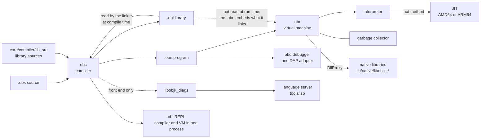
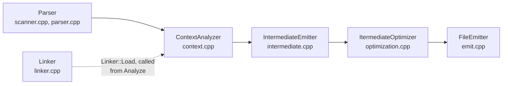
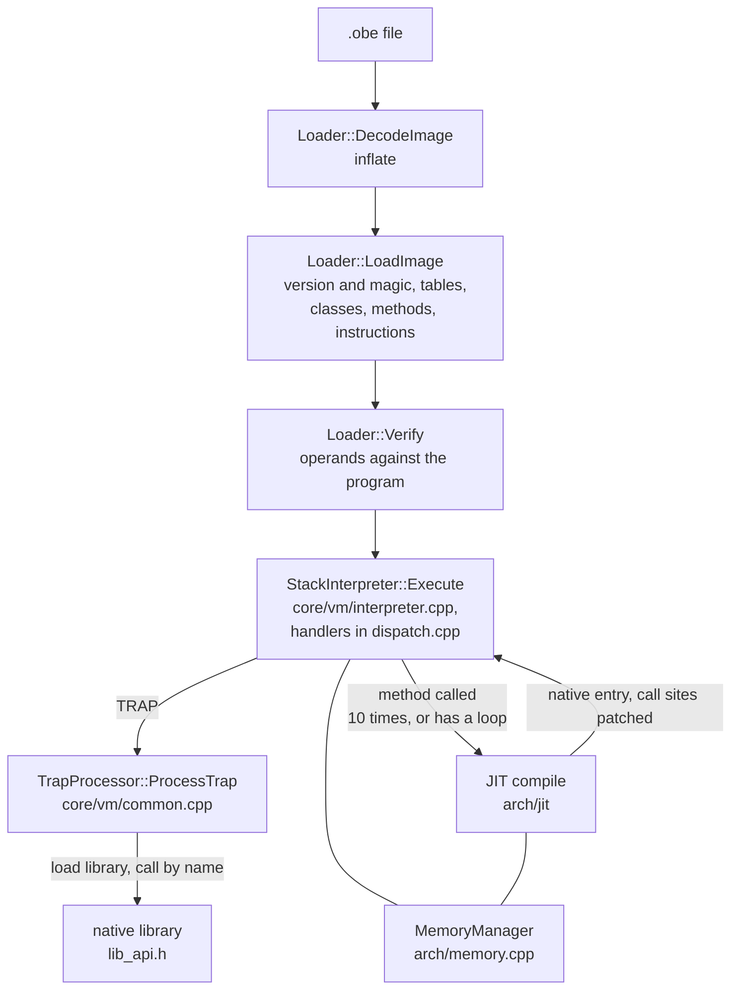

# Architecture map

The one-page entry point to how Objeck is put together: what each part is for, where it lives, what goes in and out, what must not be done to it, and which document goes deeper. Every statement was checked against the source on master `4cfcf08f04` (v2026.10.3 in development); where an older document disagrees with the code, the code wins and the disagreement is named in [the last section](#where-older-documents-disagree-with-the-code).

This page is the map. [architecture.md](architecture.md) is the long illustrated tour of the same ground, and every other page in `docs/` is listed in [README.md](README.md).

## The whole system

The statement "the `.obe` embeds what it links" is checked in [File formats](#file-formats). The dashed edges are the ones that are easy to get wrong: the VM never opens an `.obl`, and the language server and REPL do not run the `obc` executable, they link its sources.

## Directory map

| Path | What is there |
|---|---|
| `core/compiler/` | `obc`: scanner, parser, analyzer, intermediate emitter, optimizer, linker, file emitter. `lib_src/` holds the standard-library sources (`.obs`). `build_libs.sh` compiles them |
| `core/vm/` | `obr`: loader and verifier, interpreter, trap handlers (`common.cpp`), native-library API (`lib_api.h`). `arch/` is the collector, `arch/jit/` the two JITs |
| `core/shared/` | headers and code every executable includes: opcodes (`instrs.h`), trap ids (`traps.h`), the version header, byte streams and zlib (`sys.h`) |
| `core/lib/` | the shipped libraries: the committed `.obl` files, and one directory per native module (`sdl`, `onnx`, `opencv`, `odbc`, `diags` and others) |
| `core/debugger/`, `core/repl/` | `obd` (command line and DAP) and `obi` |
| `core/module/` | the compiler and VM packaged as one static library (`module.a`) that `obi` links |
| `core/utils/` | `obu` (updater), `obb` and `obn` (native launcher builders), the Windows and macOS launcher apps |
| `core/release/` | solutions, deploy scripts, packaging, `runtime_deps.json`, `update_version.ps1` |
| `tools/` | `cicd/` (checks and release scripts), `lsp/` (language server and editor clients), `fuzz/`, `deps/`, `packaging/` |
| `programs/` | `regression/` (the suite), `tests/` (older tests and benchmarks), `examples/`, `deploy/` (the examples a release ships), `web-playground/` |
| `docs/` | documentation; `docs/web/` is the published site |
| `.github/workflows/` | CI, release, nightly and probe workflows |

## Compiler

**Purpose.** Turn `.obs` source into an executable (`.obe`) or a library (`.obl`).

**Where.** `core/compiler/`. The pipeline is written out in `Compile()` in `compiler.cpp`:

| Stage | Output | Notes |
|---|---|---|
| Scanner and parser (`scanner.cpp`, `parser.cpp`, tree in `tree.h`) | a `ParsedProgram` | hand-written recursive descent. Nodes come from factories |
| Context analyzer (`context.cpp`, types in `types.cpp`) | the same tree, resolved and checked | types, generics, named and `ref` arguments, `?->`. The linker is loaded from here, so library classes are known before analysis starts |
| Linker (`linker.cpp`, `Library` and `Linker` in `linker.h`) | the library classes the program uses | reads each `.obl` named by `-lib`, plus `lang` and `gen_collect` unless `--strict` |
| Intermediate emitter (`intermediate.cpp`) | blocks of VM instructions per method | the opcodes are `core/shared/instrs.h`. The system intrinsics (below) are lowered here |
| Optimizer (`optimization.cpp`) | the same blocks, rewritten | `-opt s0` to `s3`, default `s3`. [optimization_pipeline.md](optimization_pipeline.md) lists the passes per level |
| File emitter (`emit.cpp`) | the `.obe` or `.obl` | zlib-compressed; the writer is `OutputStream` in `core/shared/sys.h` |

**Inputs and outputs.** In: `.obs` files (`-src`, comma-separated or `*.obs`), `.obl` libraries (`-lib`), options ([cli_options.md](cli_options.md)). Out: one `.obe` or `.obl`. Exit status: 0 success, 1 command-line or fatal error, 2 parse error, 3 analysis error (`compiler.cpp`).

**Three more builds of the same sources.** The Makefiles compile the compiler files with different defines:

| Build | Define | Product | Used for |
|---|---|---|---|
| `obc` | none | the compiler | everything |
| `sys_obc` (`make/Makefile.sys.*`) | `_SYSTEM` | the bootstrap compiler | `lang.obs` only: the intrinsic keywords exist only here |
| `compiler.a` (`make/Makefile.*.mod`) | `_MODULE` | a static library | `core/module/` and so `obi` |
| `libobjk_diags` (`core/lib/diags`) | `_DIAG_LIB` | scanner, parser, analyzer and tree only | the language server |

**Invariants and rules.**
- A new intrinsic or trap touches six code sites plus the library and a test, and a missing one fails late and quietly. Follow [ADDING_AN_INTRINSIC.md](ADDING_AN_INTRINSIC.md); `tools/cicd/check_trap_handlers.py` checks the sites it marks.
- Append to `enum Traps` in `core/shared/traps.h`, never insert or delete: an enumerator's position (counting up from `LOAD_CLS_INST_ID = -4000`) is the wire id written into every `.obl` and `.obe`.
- The back end no longer calls `exit(1)`: a fatal error is a `CompilerFatal` exception caught in `Compile()`, so a host that embeds the compiler survives it. Keep it that way (the language server and `obi` embed it).
- The linker checks that a library's toolchain version equals `VER_NUM`; do not hand-edit a library's header.

**Deeper.** [architecture.md](architecture.md) section 2; [optimization_pipeline.md](optimization_pipeline.md); [METHOD_GENERICS_DESIGN.md](METHOD_GENERICS_DESIGN.md), [NAMED_ARGUMENTS_DESIGN.md](NAMED_ARGUMENTS_DESIGN.md), [REFERENCE_PARAMETERS_DESIGN.md](REFERENCE_PARAMETERS_DESIGN.md), [ARRAY_LITERALS_DESIGN.md](ARRAY_LITERALS_DESIGN.md), [JAGGED_ARRAYS_DESIGN.md](JAGGED_ARRAYS_DESIGN.md) for individual features; [core/compiler/README.md](../core/compiler/README.md).

## File formats

| | `.obe` (program) | `.obl` (library) |
|---|---|---|
| Written by | `FileEmitter` via `IntermediateProgram::Write` (`emit.cpp`) | the same, with `-tar lib` |
| Read by | `Loader::LoadImage` (`core/vm/loader.cpp`) | `Library::LoadFile` in `linker.cpp` at compile time |
| On disk | `[uncompressed size: 4 bytes][zlib stream]`; an older raw zlib stream (first byte `0x78`) is still accepted | the same |
| First two integers | `VER_NUM`, then the magic `MAGIC_NUM_EXE` (`0xffbf`) | `VER_NUM`, then `MAGIC_NUM_LIB` (`0xffba`) |
| Then | the string id, the float, bool, byte, int and char string tables, the start class and method, enums, classes (methods, instructions) | the same tables, plus bundle names, aliases, and each method's signature, parameter names and defaults |
| Debug data | per-instruction line numbers and the source file name, only when compiled with `--debug` | the same flag |

The magic numbers and `VER_NUM` are defined in `core/shared/version.in` and rendered into `core/shared/version.h` by `core/release/update_version.ps1`. Edit the template, not the header.

Two compatibility rules, both enforced by refusal with a message:
- **Version.** The loader and the linker accept a file only when its first integer equals `VER_NUM`, the release number with the dots removed (2026.10.3 is `2026103`). Any release invalidates every older `.obe` and `.obl`. Every committed `core/lib/*.obl` must therefore be rebuilt at a version bump; `tools/cicd/check_obl_versions.py` fails the Tools job when one is stale.
- **Magic.** A change to what a file means without a change to what it looks like bumps the magic. The loader names the old ones it recognises (`MAGIC_NUM_EXE_UNTYPED_INT_ARRAYS`) and says to recompile; the linker does the same for the older library magics.

A library records what the compiler needs to link against it. A program records what the VM needs to run it, including the classes and methods it linked from libraries, which is why `obr` needs no `.obl`. (This is checked in `LoadImage`, which reads only the `.obe`; the only library files `obr` opens are the native shared libraries.)

**Do not.** Do not read an `.obe` as trusted input: see [SECURITY_MODEL.md](SECURITY_MODEL.md). Do not add a field without reading how the older magics are handled in `loader.cpp` and `linker.cpp`.

**Deeper.** [OTAB_FORMAT.md](OTAB_FORMAT.md) is a different format (the `.otab` table file of `Query.Structured`); [SECURITY_MODEL.md](SECURITY_MODEL.md) for what the loader checks.

## Virtual machine

**Purpose.** Run an `.obe`.

**Where.** `core/vm/`. `posix_main.cpp` and `win_main.cpp` parse options through the single parser in `vm_options.h`, then `Execute()` in `vm.cpp` builds a `Loader`, loads, and starts the interpreter.

### Loader and verifier

`Loader::Load` returns false with a message instead of exiting (`LoadFailed` throws, `Load` catches), so the debugger, the REPL and the fuzz harness can survive a bad file. It checks structure (every read stays inside the buffer, counts are bounded by the bytes left, ids are in range, opcodes are known). `Loader::Verify` then relates operands to the program: jump targets, local and field offsets against frame and object sizes, class and method ids, trap ids. The full list, and what is still unchecked (operand-stack depth, types), is in [SECURITY_MODEL.md](SECURITY_MODEL.md).

**Rule.** An `.obe` is native code with the privileges of `obr`. Do not describe `obr` as a sandbox; the playground isolates with a container.

### Interpreter and traps

A stack machine over the opcodes in `core/shared/instrs.h`. System services (files, sockets, time, threads, process, serialization) are **traps**: a `TRAP` instruction whose operand-stack id is a value of `enum Traps` (`core/shared/traps.h`), handled by one big `switch` in `TrapProcessor::ProcessTrap`. A trap handler allocates without collecting and pops exactly the arguments its declaration says; leaving one on the stack shifted every frame above it (#1457).

**Rules.** The trap table is append-only (see Compiler). A trap that reads `frame->mem` cannot be compiled: it is on the JIT's rejection list (`HasFrameDependentTrap` in `jit_common.h`).

### Native libraries and the versioned ABI

`DllProxy->New("libobjk_x")` loads `<lib dir>/native/libobjk_x.dll|.so|.dylib` (`StackInterpreter::SharedLibraryLoad`); `CallFunction` finds an exported function by name and passes a `VMContext` (`core/vm/lib_api.h`) with the argument array. There is no signature checking: the name is the only link. `VMContext` only grows at the end. Since 2026.10.3 it carries `abi_version` and `struct_size`; a library must read fields appended after them through `APITools_HasField`.

**Rules.** Never insert or reorder a `VMContext` field. A native library must not let an exception escape or call `exit()`. Everything a native library allocates lives in the old generation. A native library that stores an object it *received* (an argument, or a callback's result) into one it allocated must run the write barrier; `tools/cicd/check_native_write_barrier.py` scans for it.

**Deeper.** [native_interface.md](native_interface.md) is the whole contract.

### JIT

`core/vm/arch/jit/`: `jit_common.{h,cpp}` is the shared driver, `amd64/jit_amd_lp64.{h,cpp}` and `arm64/jit_arm_a64.{h,cpp}` the two code generators, `jit_frame_layout.h` the frame constants both generators and the collector share (with `static_assert`s).

A method is compiled on its call count reaching the threshold (default 10, `--jit=<n>` or `OBJECK_JIT_THRESHOLD`), or on its first call when it contains a loop. A pre-scan (`CanJitInstruction`, a whitelist) decides whether every opcode can be compiled; a method that cannot stays interpreted. `--jit=off` compiles nothing, including `native` methods. Compiled code reaches the interpreter, allocation and traps through a callback bridge, and compiled code calls compiled code directly through patched call sites and per-site inline caches.

**Rules.** After any point where compiled code can park or call back, `self` must be re-read from `frame->mem[0]`: a collection may have moved it. A frame's slot layout must be the same in the code generator and in the collector's frame walker, which is why they share `jit_frame_layout.h`. Bisect a suspected JIT bug with `--jit=off`, then `OBJECK_JIT_REPORT=1`.

**Deeper.** [core/vm/arch/jit/README.md](../core/vm/arch/jit/README.md) and its `amd64/` and `arm64/` pages; [JIT_CALLING_CONVENTION_DESIGN.md](JIT_CALLING_CONVENTION_DESIGN.md), [JIT_ENTRY_COMPILE_DESIGN.md](JIT_ENTRY_COMPILE_DESIGN.md), [JIT_LOOP_LOCALS_DESIGN.md](JIT_LOOP_LOCALS_DESIGN.md), [JIT_SELECT_TABLES_DESIGN.md](JIT_SELECT_TABLES_DESIGN.md), [TRY_IN_JIT_DESIGN.md](TRY_IN_JIT_DESIGN.md); [JIT_ARM64_HANDOFF_2026_09.md](JIT_ARM64_HANDOFF_2026_09.md) for what is open on ARM64.

### Garbage collector

`core/vm/arch/memory.{h,cpp}`. Generational, mark-and-sweep with promotion:

- Objects are bump-allocated in a **nursery** (a 128 MB reservation; `--nursery` lowers the limit). A **minor** collection promotes survivors to the **old generation** and resets the nursery. A **major** collection marks both generations and frees dead old objects. Arrays are allocated directly in the old generation.
- A **write barrier** (a remembered set) records old objects that point into the nursery. The interpreter, both JITs and the native API all emit it.
- Every collection runs **stop-the-world** and cooperative: other threads park at safepoints (the dispatch loop, allocation, blocking calls).
- **Roots.** Class statics, operand stacks, interpreter frames and compiled frames. The collector no longer guesses which words are references where it can know: reference maps (`arch/ref_map.h`) type the interpreter's operand stack, and compiled frames have typed spill slots (`TMP_REF_*` are scanned, `TMP_VAL_*` are not). Words no map types are still scanned conservatively (`OBJECK_GC_ROOTS=conservative` restores the old behaviour everywhere, as a negative control; `=audit` reports where maps and live stacks disagree).
- **Checkers.** `OBJECK_GC_VERIFY` runs the heap verifier (`arch/memory_verify.cpp`); `OBJECK_GC_VERIFY_INJECT` plants faults to prove it notices; `OBJECK_GC_TRACE`, `OBJECK_GC_STATS` print what happened.

**Rules.** Any new collection entry point must replicate the stop-the-world protocol of `CollectMajor` and `CollectMinor`; a minor collection that ran beside live threads corrupted memory once. The object-layout walkers (mark, fixup, dirty scan, verifier) must agree on field widths. Counters must not reach stdout (differential runs compare stdout). A teardown crash means earlier heap corruption: look upstream.

**Deeper.** [core/vm/arch/README.md](../core/vm/arch/README.md); [GC_ROOTS_DESIGN.md](GC_ROOTS_DESIGN.md) for the root model and what is left.

## Standard libraries

**Purpose.** The class library: collections, I/O, networking, JSON and XML, machine learning, graphics, and bindings to native code.

**Where.** Sources are `core/compiler/lib_src/*.obs`, 56 files. `core/compiler/build_libs.sh` is the one list of how they group into libraries (several source files can make one `.obl`, for example `ml_*.obs` into `ml.obl`) and in what dependency order. `lang.obl` is the exception: it is built by `sys_obc` because only that compiler accepts the intrinsic keywords. The results are committed in `core/lib/*.obl` and copied, not rebuilt, by the deploy scripts. Native modules live in `core/lib/<name>/`, and ship as `lib/native/libobjk_*`.

**Inputs and outputs.** A program names what it uses with `-lib` (`lang` and `gen_collect` are implicit); `@std`, `@web`, `@data`, `@ml`, `@ai`, `@vision` and `@game` expand from `lib/configobjk.ini`.

**Rules.**
- A new library is added in `build_libs.sh` and in the doc-build lists that `tools/cicd/check_doc_lists.py` verifies against `lib_src`.
- Doc comments are `#~ ... ~#` immediately before a class, method, function, enum or constructor; `code_doc` builds the API reference from them, and `tools/cicd/check_doc_fences.py` guards the code-fence rule. [DOC_COVERAGE.md](DOC_COVERAGE.md) measures which public members have one.
- `.obl` files are tied to the toolchain version (see File formats); a source change that must reach users means rebuilding and committing the `.obl`.
- Report failure the way the library you are editing does, until [ERROR_CONVENTIONS.md](ERROR_CONVENTIONS.md) (a proposal) is adopted.

**Deeper.** [core/lib/README.md](../core/lib/README.md); [COLLECTIONS_GUIDE.md](COLLECTIONS_GUIDE.md); [AI.md](AI.md), [MODELS.md](MODELS.md), [QUERY_DESIGN.md](QUERY_DESIGN.md), [opengl.md](opengl.md).

## Tools

| Tool | Source | What it does | Deeper |
|---|---|---|---|
| `obc` | `core/compiler/` | compile | [cli_options.md](cli_options.md) |
| `obr` | `core/vm/` | run an `.obe` | [cli_options.md](cli_options.md) |
| `obd` | `core/debugger/` | command-line debugger; `--dap` is a Debug Adapter Protocol server for editors. Built from the VM sources with `-D_DEBUGGER`, so it has its own interpreter build and no JIT | [core/debugger/README.md](../core/debugger/README.md) |
| `obi` | `core/repl/` | REPL and a small full-screen editor. Links `core/module/module.a`, so it compiles and runs in one process. It re-runs the whole buffer on every entry | [core/repl/README.md](../core/repl/README.md) |
| `obu` | `core/utils/updater/` | `check`, `update`, `rollback`, `verify`. Verifies a signature before trusting the manifest | [UPDATER_DESIGN.md](UPDATER_DESIGN.md), [release_integrity.md](release_integrity.md) |
| `obb`, `obn` | `core/utils/launcher/` | `obb` builds a self-contained application directory from an `.obe` and a toolchain directory; `obn` is the launcher it copies in, which starts `runtime/bin/obr` on `app/app.obe` | |
| Language server | `tools/lsp/server/` (Objeck) | LSP over stdio; analysis through `libobjk_diags`; editor clients in `tools/lsp/clients/` | [tools/lsp/README.md](../tools/lsp/README.md), [INCREMENTAL_ANALYSIS_DESIGN.md](INCREMENTAL_ANALYSIS_DESIGN.md), [editors.md](editors.md) |
| `code_doc` | `core/lib/code_doc/` (Objeck) | builds the API reference from doc comments; the release ships it as `api.zip` | `core/release/code_doc64.in` |

## Build and release

**Build.** Windows builds with MSBuild on `core/release/objeck.sln`; Linux and macOS with the Makefiles under each component's `make/` directory (`core/vm/make/Makefile.amd64` and so on) or the Xcode projects. The QUIC and mbedTLS dependencies are built by `tools/deps/`. `core/release/deploy_windows.cmd`, `deploy_posix.sh` and `deploy_macos_arm64.sh` assemble a deploy tree (`core/release/deploy-x64`, `deploy`, ...) with `bin/`, `lib/` and `lib/native/`; the regression runners use that tree. [core/readme.md](../core/readme.md) has the per-platform steps.

**Version.** `core/release/update_version.ps1` holds the release number and renders every file that carries it from a `.in` template, including `core/shared/version.h`. Edit the `.in`, never the output; `tools/cicd/check_version_templates.py` fails when a generated file does not match its template. A bump must also rebuild and commit every `.obl`.

**Workflows** (`.github/workflows/`):

| Workflow | Runs | Purpose |
|---|---|---|
| `ci-build.yml` | every push and pull request to master | builds and tests the five platforms (windows-x64, windows-arm64, linux-x64, linux-arm64, macos-arm64), then the `Tools` job: the build-free checks, the language server and the editor extension |
| `nightly-hardening.yml` | daily 07:23 UTC, and on dispatch | the long checks CI cannot afford per push, run on the binaries CI built |
| `release-build.yml`, `release-publish.yml` | a `v*.*.*` tag | build, sign (macOS) and publish; Windows installers are signed afterwards by hand. [release_process.md](release_process.md) |
| `release-deb.yml`, `resign-manifest.yml`, `verify-platforms.yml`, `verify-signing-credentials.yml` | after publish, or on dispatch | `.deb` packages, re-signing `SHA256SUMS`, the cloud form of the release gate, a signing-secret check |
| `perf-gate.yml`, `benchmark.yml`, `stress-probe.yml`, `probe-gc-stress-arm64.yml` | dispatch or `probe/**` branches | performance and flake measurement; the perf gate is report-only |
| `codeql.yml`, `secret-scan.yml`, `playground-tests.yml`, `tests-manifest.yml`, `jekyll-gh-pages.yml`, `release-drafter.yml`, `release-stats.yml` | various | static analysis, secret scan, playground backend tests, the generated `TESTS.md`, the published site, release notes draft, download counts |

**Rules.** Do not commit `programs/regression/TESTS.md`: `tests-manifest.yml` regenerates it on master. A release dispatch of `release-build.yml` from master publishes. A check that can only return one answer proves nothing: give a gate a negative control (see the `--test` options in `tools/cicd/`).

**Deeper.** [CI_CD.md](CI_CD.md), [release_process.md](release_process.md), [release_integrity.md](release_integrity.md), [third_party_dependencies.md](third_party_dependencies.md), [tools/cicd/README.md](../tools/cicd/README.md).

## Testing

| Layer | Where | What it catches |
|---|---|---|
| Regression suite | `programs/regression/` (782 programs, see `TESTS.md`), `run_regression.sh` and `.cmd` | language, library and compiler behaviour, including `bad_*` programs that must be rejected. Run again with `OBJECK_JIT_THRESHOLD=1` |
| VM flag, loader and GC-fixture tests | `programs/regression/run_vm_flag_tests.py` | `obr` options, interpreter and JIT equivalence, loader refusals, GC address fixtures |
| Debugger and DAP | `run_debugger_tests.*`, `run_dap_tests.py` | `obd` and the adapter |
| Differential | `programs/regression/run_differential.py` | the same program must print the same output at `-opt s0` and `s3`, JIT off and forced on |
| Build-free checks | `tools/cicd/check_*.py`, run by `tools/cicd/local_ci.py` and the `Tools` job | drift between things that must agree by hand: trap sites, library lists, versions, templates, doc links |
| Language server | `tools/lsp/tests/run_lsp_tests.py` | diagnostics, completion, actions |
| Fuzz | `tools/fuzz/` (program generator, EMI mutation) and `tools/fuzz/loader/` (libFuzzer on `Loader::Load`) | miscompiles, VM crashes, loader robustness |
| Nightly | `nightly-hardening.yml` | the differential run, the fuzzer, the suite under the heap verifier, GC stress in both JIT modes; `tools/cicd/nightly_triage.py` sorts failures into infrastructure, known and new |
| Performance | `programs/tests/clbg`, `programs/tests/perf`, `perf-results/`, `perf-gate.yml` | regressions against Java and LuaJIT ratios (report-only today) |
| Local CI | `tools/cicd/local_ci.py` (seconds), `local_linux.sh` and `local_docker.sh` (a clean Linux build of the committed tree) | the cloud run, before the push |

A test fails by its exit code. A test that prints `FAIL` and returns normally is scored a pass, which `tools/cicd/check_test_exit_codes.py` exists to prevent. A reduced test gets a reason line: `# JIT_DISABLE`, `# VERIFY_SKIP` and `# GC_STRESS_SKIP` each need a following `# reason:`.

**Deeper.** [programs/TESTING.md](../programs/TESTING.md), [programs/regression/README.md](../programs/regression/README.md), [tools/fuzz/README.md](../tools/fuzz/README.md), [PLAN_2026_10_0_HARDENING.md](PLAN_2026_10_0_HARDENING.md).

## Facts that must agree by hand

The recurring defects in this project come from facts kept in several places. Each row names the places and the check that guards them; a row with no check is a known risk.

| Fact | Kept in | Guard |
|---|---|---|
| A trap or intrinsic | `traps.h`, `scanner.h`, `scanner.cpp`, `parser.cpp`, `intermediate.cpp`, `common.cpp`, `lang.obs` | `check_trap_handlers.py` |
| The release version | `update_version.ps1` and every file it renders; every `.obl` | `check_version_templates.py`, `check_obl_versions.py` |
| The library list | `build_libs.sh`; five doc-build lists | `check_doc_lists.py` |
| JIT frame layout | `jit_frame_layout.h`, both code generators, the collector's frame walkers | `static_assert`s in the header; the root audit (`OBJECK_GC_ROOTS=audit`) |
| Object layout | mark, fixup, dirty scan, heap verifier; `obd`'s `obj_layout.h` | the verifier; no single guard for `obd` |
| Native API layout | `lib_api.h` (compiled into every library) | `abi_version` and `struct_size`, checked by a VM flag test |
| Documentation counts and names | prose in many pages | none; this is why `check_doc_links.py` and the notes below exist |

## Where older documents disagree with the code

Checked while writing this page. The code is right in each case; the fix is noted where it was made in the same change.

| Document | Said | Code | Resolution |
|---|---|---|---|
| `core/compiler/README.md` | the linker is a back-end stage that "produces final bytecode" | `Linker::Load` runs inside `ContextAnalyzer::Analyze`, before analysis; `FileEmitter` writes the output | stage list corrected there |
| `core/vm/arch/jit/README.md`, `.../amd64/README.md`, `core/vm/README.md` | AMD64 method inlining is complete but never called; the VM inlines methods | `ProcessInlineMethod` and its helpers are deleted (GC roots phase 5, #1511); the compiler's `s3` inliner is the only one | corrected in those three |
| `docs/ARCHITECTURE_ASSESSMENT_2026_11.md` | 1.1 a dead parser copy; 2.1 no verifier; 2.2 `exit(1)` in the loader; 2.3 no ABI version; 5.1 nightly cron commented out | `ParseSystemStatement` is gone; `Loader::Verify` exists; the loader returns an error; `VMContext` has `abi_version`; the cron is live | the page is a dated snapshot; marked in `README.md` |
| `docs/GC_ROOTS_DESIGN.md` | "nothing below has landed" (opening paragraph) | phases 0 to 6 are merged; the status block below it says so | marked in `README.md` |
| test counts (`programs/README.md`, `programs/TESTING.md`, `programs/regression/README.md`, `core/readme.md`, `docs/architecture.md`) | "about 300", "299", "529" | 782 programs in `programs/regression/`, per its generated `TESTS.md` | corrected to point at `TESTS.md` |
| `docs/cli_options.md` | VM options are parsed in `win_main.cpp` and `posix_main.cpp` | both call the one parser in `core/vm/vm_options.h` | corrected |
| `docs/CI_CD.md` | "6 platforms" in the overview | five build platforms plus the language-server job | noted here; the page is the maintainers' |
