# Objeck Language Architecture

> **Comprehensive technical architecture with interactive diagrams**

This document provides detailed architectural views of the Objeck programming language implementation, including the compiler, virtual machine, JIT compilation, and development tools.

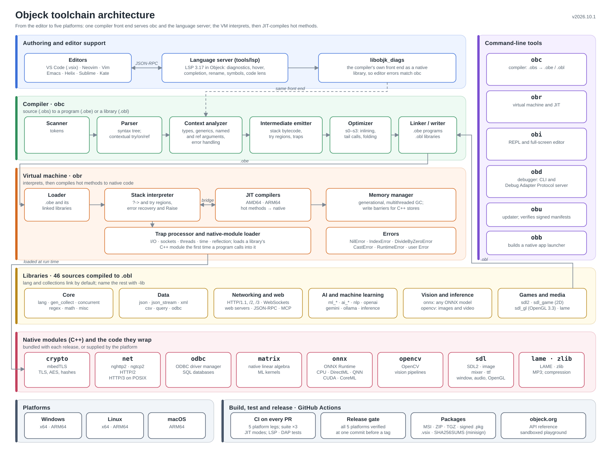

*The whole toolchain on one page ([SVG](images/objeck-architecture.svg)); the sections below go into each part.*

---

## Table of Contents

1. [Complete System Overview](#1-complete-system-overview)
2. [Compiler Pipeline](#2-compiler-pipeline)
3. [Virtual Machine Runtime](#3-virtual-machine-runtime)
4. [JIT Compilation Architecture](#4-jit-compilation-architecture)
5. [Library Ecosystem](#5-library-ecosystem)
6. [Development Tools](#6-development-tools)
7. [CI/CD Pipeline](#7-cicd-pipeline)
8. [Memory Management](#8-memory-management)
9. [Platform Abstraction](#9-platform-abstraction)
10. [Runtime Errors](#10-runtime-errors)

---

## 1. Complete System Overview

The whole toolchain, from the editor to the five platforms a release ships to. Source is
compiled by `obc` into an executable (`.obe`) or a library (`.obl`); `obr` runs it, interpreting
until a method is hot and then compiling it to native code. The language server analyzes the
same source with the compiler's own front end, linked into a native library.

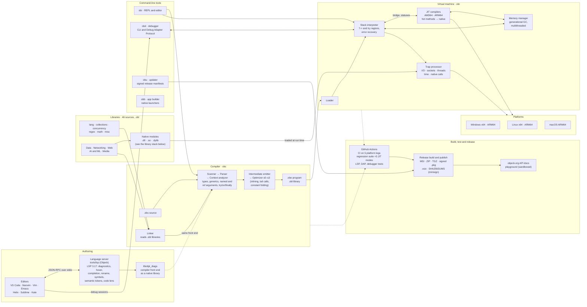

### The library stack

Most libraries are Objeck alone. The rest pair an Objeck interface with a C++ module that the
VM loads when the program first calls it, and that module wraps the third-party code a release
bundles or the platform supplies.

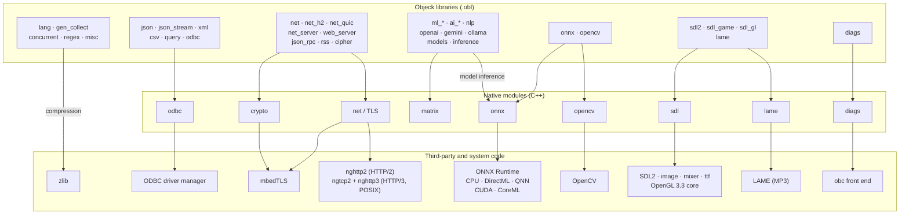

**Key components:**
- **Compiler (`obc`):** scanner, parser and context analyzer, an intermediate emitter, an optimizer with four levels (s0–s3, s3 by default), and a linker that reads `.obl` libraries. Libraries record their methods' parameter names and type parameters, so named arguments and generic inference work across binaries.
- **VM (`obr`):** a stack interpreter that JIT-compiles hot methods for AMD64 and ARM64. Errors under `?->` or `try` recover in either mode; a compiled method reports a status the interpreter that owns the handler acts on.
- **Memory:** generational, multithreaded garbage collection; C++ code that stores into an old object takes a write barrier.
- **Language server:** written in Objeck (`tools/lsp`), analyzing with the compiler's own front end through `libobjk_diags`, so editor diagnostics match `obc`.
- **Tools:** `obi` (REPL and full-screen editor), `obd` (debugger, also a Debug Adapter Protocol server), `obu` (updater that verifies signed manifests), `obb` (builds a native launcher for a program).
- **Libraries:** 46 library sources; native modules wrap mbedTLS, nghttp2/ngtcp2, ODBC, ONNX Runtime, OpenCV, SDL2 and LAME.
- **CI and release:** five platform legs on every pull request, the regression suite in three JIT modes, LSP, DAP and debugger tests, and a release gate that verifies all five platforms at one commit before tagging.

---

## 2. Compiler Pipeline

Detailed compilation flow from source to bytecode with optimization stages.

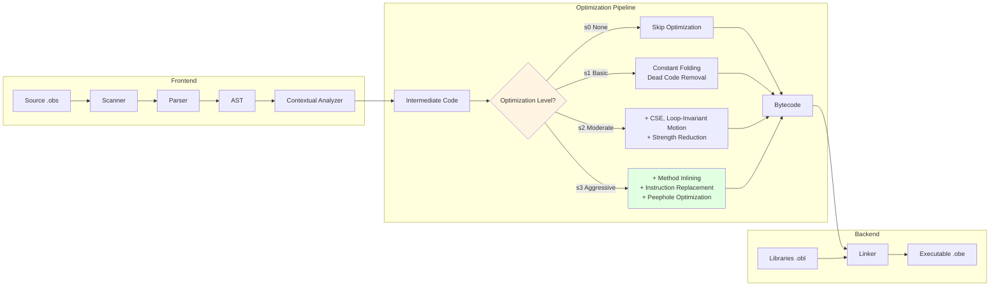

### Optimization Levels

| Level | Name | Optimizations | Use Case |
|-------|------|---------------|----------|
| **s0** | None | No optimization | Fast compilation, debugging |
| **s1** | Basic | Constant folding, dead code elimination | Development builds |
| **s2** | Moderate | + Common-subexpression elimination, loop-invariant code motion, strength reduction | Testing |
| **s3** | Aggressive | + Method inlining (not in libraries), instruction replacement, peephole optimization | **Production (default)** |

### Optimization Passes (s3)

In the order `ItermediateOptimizer` runs them on each method, once each; the method inliner
runs last, after every method of the class has been through the rest.

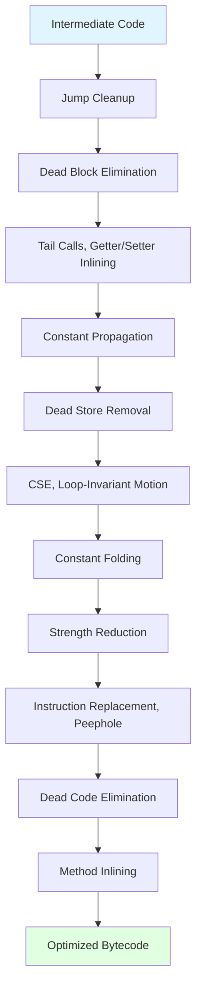

**Performance Impact:**
- s0 → s3: ~30-40% faster execution
- s0 → s3: ~10-15% smaller bytecode
- Compilation time: s0 = 1x, s3 = 1.5x

**Source Files:**
- `core/compiler/optimization.h/cpp` - Optimization engine
- `core/compiler/intermediate.h/cpp` - IR generation
- `core/compiler/emit.h/cpp` - Bytecode emission

---

## 3. Virtual Machine Runtime

Execution model with interpreter and JIT compilation.

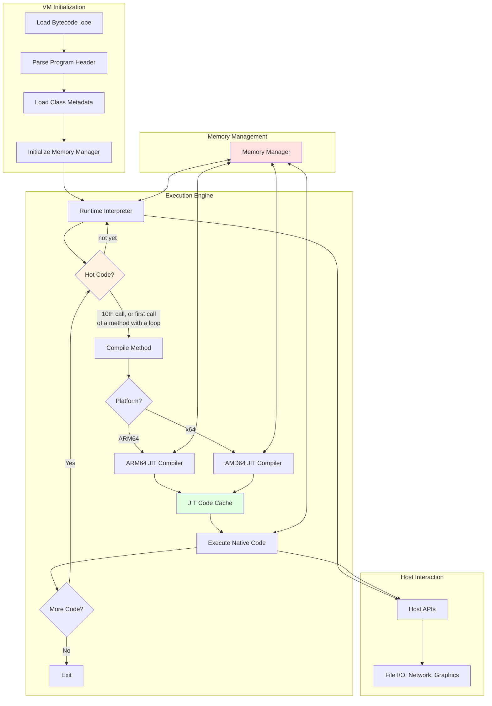

### Execution Modes

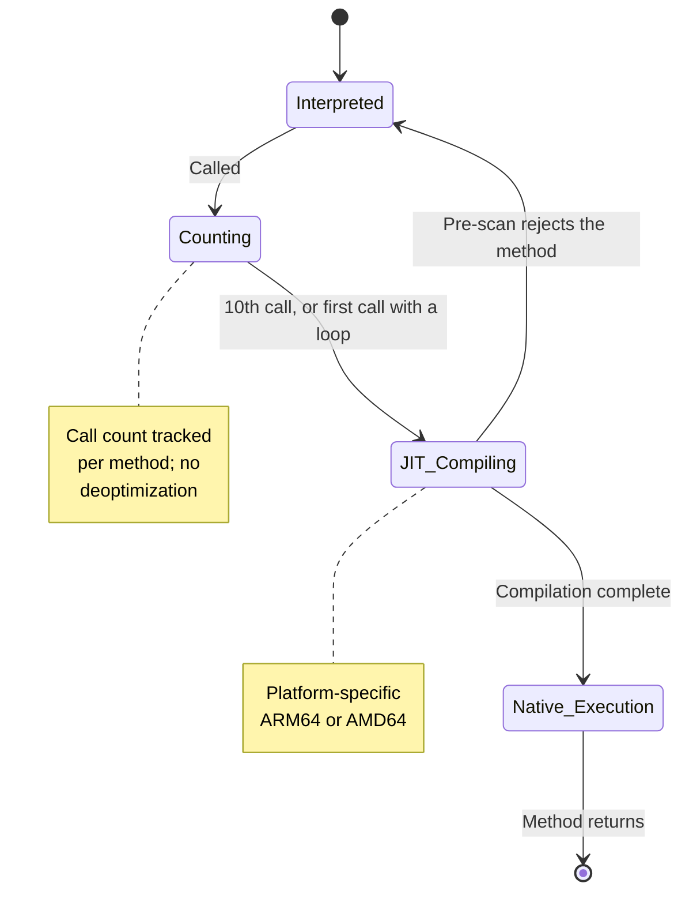

### Memory Layout

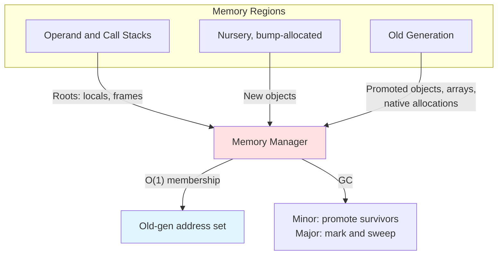

**Key Features:**
- **Tiered Execution:** Interpreter → call counting → JIT
- **Hot Code Detection:** Automatic at 10 calls (default; configurable via `--jit=<calls>` or `OBJECK_JIT_THRESHOLD`). A method with a loop is compiled on its first call instead, which is how `Main` gets compiled, and a thread's `Run` with a loop on entry; see `docs/JIT_ENTRY_COMPILE_DESIGN.md`
- **Platform-Specific JIT:** Separate compilers for ARM64/x64
- **Efficient Memory:** O(1) object lookups, generational GC

### Call Depth

Each VM thread has its own call stack: an array of frame pointers, with the operand stack
beside it (`core/vm/call_stack.h`). Calls may nest **16,384 frames** deep by default;
`obr --call-depth=<frames>` (or `OBJECK_CALL_DEPTH`) sets it, from 256 to 1,048,576. Until
2026-10 the limit was a fixed 256 frames, which the Rosetta "Man or boy" test (647 frames at
k=10) and a recursive-descent parser on input nested a few hundred deep both exceeded.

- **Reserved, then committed as it deepens.** A thread reserves address space for the maximum
  -- 8 bytes a frame, and 8 operand-stack words a frame -- and commits it as the stack grows,
  so an idle thread holds a page of frame array and 32 KB of operand stack, not the maximum.
  Measured on Windows x64 with 1,000 threads: the working set per thread is unchanged (94 KB
  idle). Frames themselves come from a per-thread pool, as before.
- **The operand stack is checked.** An interpreted frame can leave values on it across a call
  (`Sum(n - 1) + n` keeps `n`), one word a frame for plain recursion. Nothing checked it when
  it was 768 words; each interpreted call now checks that 1,024 words are left.
- **The native stack is checked.** A compiled frame is on the machine stack (about 520 bytes
  for a small method on x64), and so is each interpreter a JIT bridge starts. The compiled call
  site compares the stack pointer with the thread's floor -- its stack's lowest address plus
  1 MB -- as well as the depth with the committed limit; the bridge and the interpreter's call
  into compiled code test the floor too. So running out of native stack is the same
  `call stack bounds have been exceeded` error, and recovers the same way. On Windows a thread
  the VM starts reserves 16 MB of native stack (1 KB a frame plus 2 MB for a larger
  `--call-depth`), and `obr.exe` and `obi.exe` reserve 32 MB for the main thread, so compiled
  code reaches the maximum. On Linux and macOS a thread gets 8 MB (macOS's default was 512 KB),
  more only for a `--call-depth` above the default, and the main thread has what `ulimit -s`
  gives it, typically 8 MB: about 12,000 small compiled frames, so there a compiled recursion
  stops before the maximum -- with the same error. Bigger POSIX stacks are not free: where
  transparent huge pages are on for every mapping, 2 MB pages back thread stacks, and 100 idle
  threads measured 48 MB resident with 8 MB stacks and 86 MB with 18 MB ones.
- **Full is a recoverable error.** At the maximum, the error is a `RuntimeError` that `try`/`on`
  and `?->` recover from, compiled or interpreted (`core_call_depth_max.obs`). Unhandled, the
  listing shows the innermost 40 and outermost 10 frames and counts the rest.
- `Runtime->GetProperty("runtime.call.depth_max")` reports the maximum.

**Source Files:**
- `core/vm/interpreter.h/cpp` - Bytecode interpreter
- `core/vm/call_stack.h` - A thread's call and operand stacks, and the depth limits
- `core/vm/arch/jit/jit_common.h/cpp` - JIT infrastructure
- `core/vm/arch/memory.h/cpp` - Memory management

---

## 4. JIT Compilation Architecture

Platform-specific native code generation for ARM64 and AMD64.

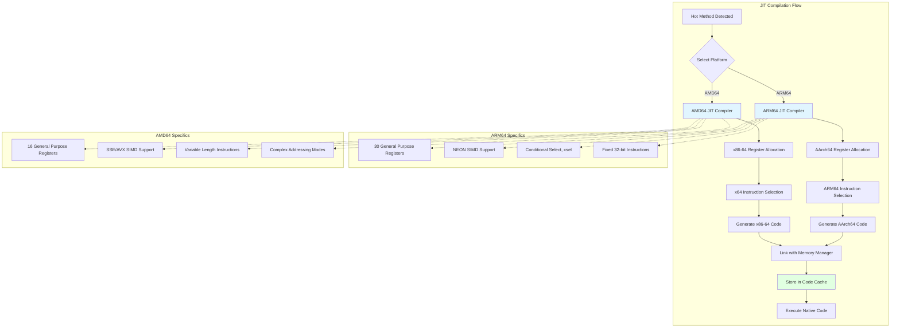

**Calls between compiled methods.** Since v2026.9.1 a compiled caller enters a
compiled callee's *native entry* directly — arguments in the caller's outgoing
area, the frame record built in the callee's own frame, the result in `XMM0`
(`D0` on ARM64) — with an inline cache at `virtual` and func-ref sites. The C++
callback bridge remains the slow path (a callee not yet compiled, a full call
stack, a `Nil` receiver, a megamorphic site) and the only path for allocation,
traps and conversions. A bound call costs 5.5 ns rather than 26.5 ns as a result.
The call path is drawn in `core/vm/arch/jit/README.md`; the design and its
measurements are in `docs/JIT_CALLING_CONVENTION_DESIGN.md`.


### JIT Frame Structure

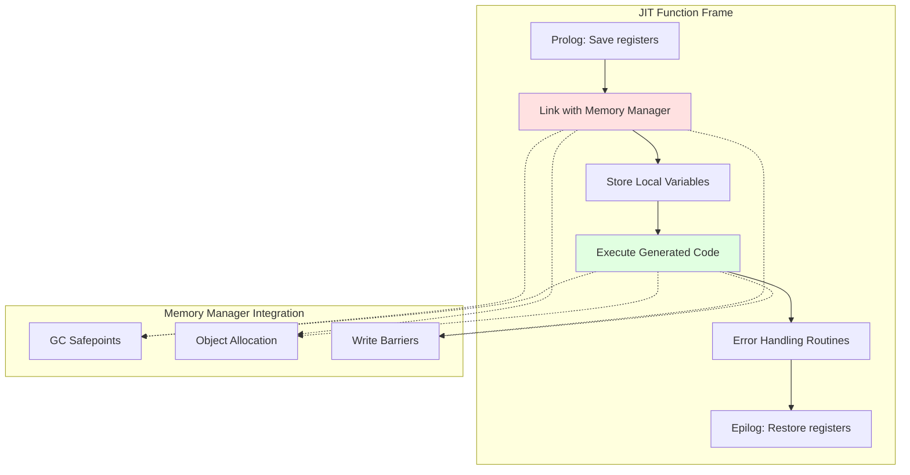

### Register Allocation Strategy

The registers each backend's allocator hands out; neither spills, so an expression that needs
more falls back to the interpreter whole.

| Platform | General Purpose | Float/Vector | Reserved |
|----------|----------------|--------------|----------|
| **ARM64** | x0-x7, x12-x15 (12 regs) | d0-d15 (16 regs) | x9-x11 (scratch), x19 (safepoint flag's address), x29 (FP), x30 (LR) |
| **AMD64** | rax, rbx, rcx, rdx, r8-r11 (8 regs; Windows adds rsi, rdi) | xmm10-xmm15 (6 regs) | r12 (safepoint flag's address), r13-r15 (pinned loop locals), rsp (SP), rbp (BP) |

**Source Files:**
- `core/vm/arch/jit/arm64/jit_arm_a64.h/cpp` - ARM64 JIT
- `core/vm/arch/jit/amd64/jit_amd_lp64.h/cpp` - AMD64 JIT
- `core/vm/arch/jit/jit_common.h/cpp` - Shared JIT infrastructure

---

## 5. Library Ecosystem

46 library sources providing comprehensive functionality.

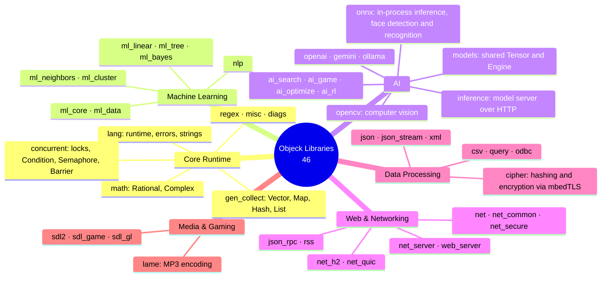

### Library Dependencies

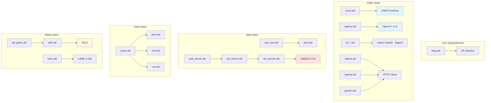

### External Dependencies

Versions differ by platform (vcpkg, vendored DLLs, apt, Homebrew, static builds); the
per-platform table, and how to check each one, is in
[third_party_dependencies.md](third_party_dependencies.md).

| Category | Library | Purpose |
|----------|---------|---------|
| **Crypto** | mbedTLS 3.6 LTS | TLS, hashing, encryption |
| **HTTP** | nghttp2; ngtcp2 + nghttp3 + AWS-LC (POSIX) | HTTP/2, HTTP/3 |
| **ML/AI** | ONNX Runtime (CPU, DirectML, QNN, CUDA, CoreML) | Neural network inference |
| **Vision** | OpenCV 4.12 | Computer vision, image processing |
| **Math** | Eigen 3.4 (vendored) | Linear algebra, matrices |
| **Graphics** | SDL2, SDL2_image, SDL2_mixer, SDL2_ttf | Cross-platform graphics/input/audio |
| **Audio** | LAME 3.100 | MP3 encoding |
| **Database** | ODBC | System driver manager |

### Face Recognition Example

```objeck
use API.OpenCV, API.Onnx;

class FaceDemo {
  function : Main(args : String[]) ~ Nil {
    session := FaceSession->New("det_10g.onnx", "w600k_r50.onnx");

    img1 := Image->Load("person_a.jpg")->Convert(Image->Format->JPEG);
    img2 := Image->Load("person_b.jpg")->Convert(Image->Format->JPEG);

    r1 := session->Recognize(img1, 0.5);
    r2 := session->Recognize(img2, 0.5);

    faces1 := r1->GetResults();
    faces2 := r2->GetResults();
    sim := FaceSession->Compare(faces1[0]->GetEmbedding(), faces2[0]->GetEmbedding());
    "Similarity: {$sim}"->PrintLine();   # >0.35 = same person
    session->Close();
  }
}
```

Uses SCRFD 10G-KPS detector + ArcFace R50 recognizer from InsightFace buffalo_l. Runs on DirectML (Windows), CPU/CUDA (Linux), CoreML (macOS).

**Source Files:**
- `core/compiler/lib_src/*.obs` - Library source code (46 files)
- `core/lib/*.obl` - Compiled libraries, shipped in a release's `lib/`

---

## 6. Development Tools

Interactive development environment with REPL, debugger, and LSP support.

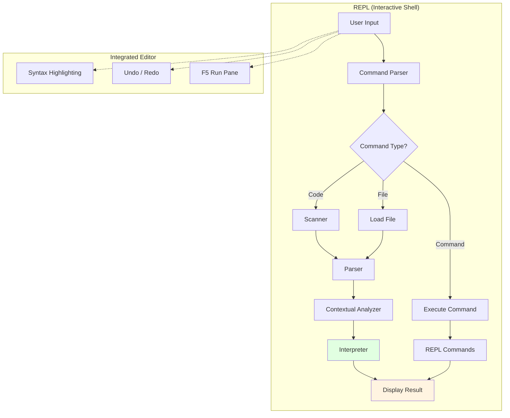

### Debugger Architecture

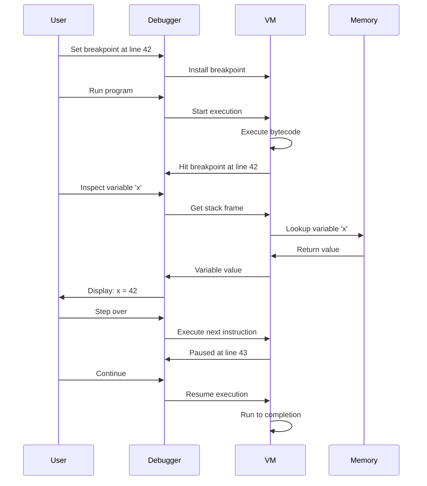

### LSP Server Integration

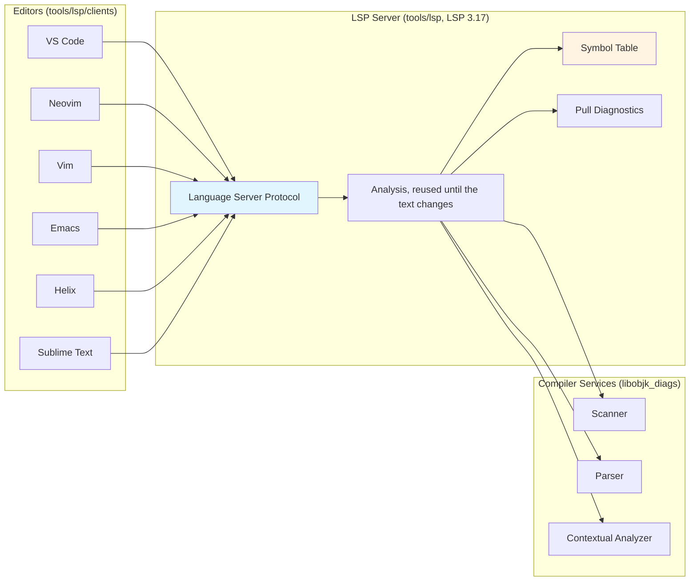

### REPL Features

- **Interactive Evaluation:** Execute code line-by-line
- **Syntax Highlighting:** In the full-screen editor (`/e`); the line prompt colors only its prompt, status and errors
- **No history or completion yet:** the line prompt is plain line entry
- **File Loading:** Execute entire files
- **Inline/File Modes:** Switch between modes

### Full-Screen Editor (`/e`)

A terminal editor over the REPL buffer, header-only (`core/repl/{term,screen,keymap,tui_editor,highlight,child_run}.h`) so it adds no build-system changes on any platform. Raw-mode input and damage-diffed rendering work identically on Windows (VT console) and POSIX (termios), with display-width handling for CJK/wide characters.

- **Editing:** movement, selection (Shift+arrows), undo/redo with coalesced typing, an internal clipboard (Ctrl+C/X/V)
- **Run pane (F5):** compiles the buffer with `obc` and runs it with `obr` as child processes, started from an argument vector with no shell, and streams their merged output into a pane; **Esc** cancels a run, **F8** jumps the cursor through compile errors. The in-process VM cannot run off the main thread, which is why the run is a child
- **Binding profiles:** a notepad-style default and an opt-in `vi` profile (F2) — a second binding table plus a mode field over the same actions, not a second editor
- **Read-only shell:** the REPL's class/function frame is dimmed and protected at both the view and model level

### Software Updater (`obu`)

`core/utils/updater/obu.cpp` — in-place version upgrades without reinstalling. `obu check` compares the installed version against GitHub releases; `obu update`/`rollback` download the platform archive, **verify a SHA-256 digest against the release's `SHA256SUMS` before touching disk**, then perform an all-or-nothing staged swap with an `obc -v` post-install check and automatic rollback. No shell is used anywhere — curl/tar/obc run via argument vectors (`fork`/`execvp` on POSIX, `CreateProcess` on Windows), including the release-JSON fetch behind `obu check`. The flow is covered by an offline CI test (`test_update.py`) that runs on both Linux and Windows: `check` is exercised on every platform against fake releases, and the update/rollback swap plus a command-injection PoC wherever the swap is implemented. The Windows swap needs no re-exec dance: Windows forbids deleting a running image but allows renaming one, so the running `obu.exe` moves into `.previous` and keeps executing. Since v2026.10.0 a release's `SHA256SUMS` is itself signed with minisign, and `obu` refuses a manifest whose signature does not verify against the release key compiled into it, so a substituted archive cannot pass with a substituted manifest. Still outstanding (`docs/UPDATER_DESIGN.md`): reconciling an MSI-managed install's registry entries, and elevation against a real `Program Files` tree.

### Debugger Features

- **Breakpoints:** Set/remove at any line
- **Step Execution:** Step over, step into, step out
- **Stack Inspection:** View call stack at any depth
- **Variable Viewing:** Inspect locals and instance variables
- **Expression Evaluation:** Evaluate expressions in context
- **Memory Inspection:** View heap objects

**Source Files:**
- `core/repl/repl.h/cpp` - REPL implementation
- `core/repl/editor.h/cpp` - Integrated line editor
- `core/repl/{term,screen,keymap,tui_editor,highlight,child_run}.h` - full-screen editor
- `core/debugger/debugger.h/cpp` - Debugger core
- `core/debugger/obj_layout.h` - shared object/collection layout (CLI + DAP)
- `core/debugger/parser.h/cpp` - Debug command parser
- `core/utils/updater/obu.cpp` - software updater

---

## 7. CI/CD Pipeline

Automated multi-platform testing and build system.

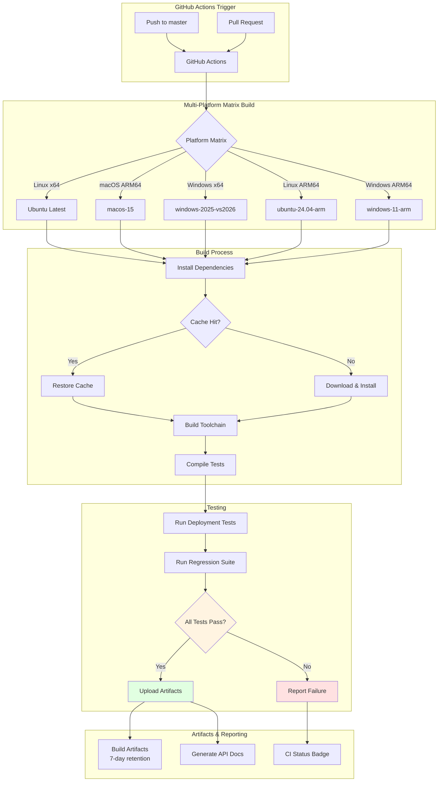

### Platform Matrix

| Platform | Runner | Architecture | Compiler | Tests |
|----------|--------|--------------|----------|-------|
| **Linux** | `ubuntu-latest` | x64 | GCC | 529 regression |
| **Linux** | `ubuntu-24.04-arm` | ARM64 | GCC | 529 regression |
| **macOS** | `macos-15` | ARM64 (Apple silicon) | Clang | 529 regression |
| **Windows** | `windows-2025-vs2026` | x64 | MSVC (v145) | 529 regression |
| **Windows** | `windows-11-arm` | ARM64 | MSVC (v143) | 529 regression |

Every leg builds natively and runs what it builds: the regression suite twice, at the default
JIT threshold and with every method compiled on its first call (`OBJECK_JIT_THRESHOLD=1`), then
the debugger, DAP and VM-flag tests. The Windows ARM64 leg used to be **cross-compiled on an x64
host, which cannot execute what it builds**, so its tests were skipped. That blind spot is how
an ARM64-only miscompile reached six releases before anyone noticed. The release build still
cross-compiles Windows ARM64 on the x64 image; CI's native leg is what tests it.

### Caching Strategy

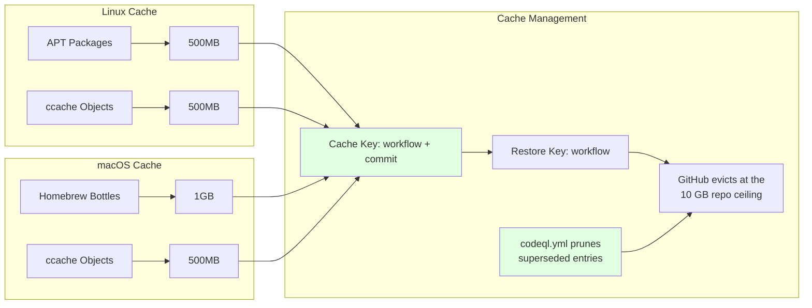

**The 10 GB ceiling is the constraint that matters.** Actions caches are capped
per repository, and past the cap GitHub evicts the oldest entries -- which is how
a release build lost its dependency caches and gained about forty minutes. The
families that grow without bound are the ones whose key embeds something that
changes: CodeQL writes a ~460 MB TRAP cache per analysed *commit*, and the
dependency caches re-key whenever their input hash moves. A superseded entry can
never be hit again, because the key names it.

A `prune-caches` job in `codeql.yml` therefore keeps only the newest few of each
family, taking `<prefix>:<keep>` pairs -- currently
`codeql-trap:3 macOS-brew-downloads:2 Linux-x64-apt:2 Linux-arm64-apt:2`. It
keeps several rather than one because these actions restore by key *prefix*, so
a recent entry still warm-starts a new run; pruning to exactly one would trade
the ceiling problem for a slower build.

### Regression Test Suite

529 tests under `programs/regression/`, grouped by the prefix on each filename.
Counts are the file count per prefix, not a sample.

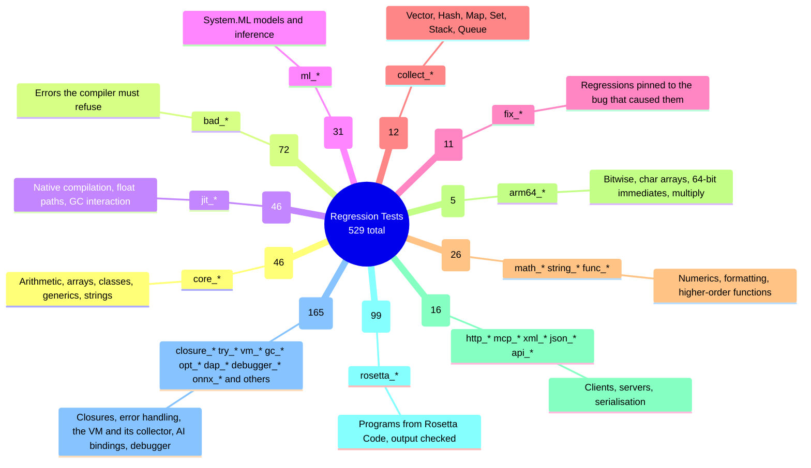

---

## 8. Memory Management

### Multithreaded Collection (Cooperative Stop-the-World)

With multiple threads running, a collection cannot begin until every other
thread has reached a known-safe point. Objeck uses a **cooperative**
stop-the-world scheme rather than OS thread suspension:

- **Safepoints.** Each mutator polls a safepoint in the interpreter dispatch
  loop and again on each allocation. When a collection is requested, threads
  observe the request at their next safepoint and **park** until it completes.
  The AMD64 and ARM64 JITs emit the same safepoint poll at every label so
  JIT-compiled code parks just as promptly as interpreted code.
- **Blocking calls.** A thread about to block in a syscall (thread `Join`/sleep,
  socket I/O) brackets the call with *begin/end-blocking* markers so it counts as
  already parked — a collection never waits on a thread stuck in a blocking read.
- **Root scanning.** Once all threads are parked, the collector marks from every
  thread's roots: static fields, each thread's full call stack **including the
  currently-executing top-level frame**, and each thread's operand stack. The set
  of roots scanned by the mark phase is exactly the set the fixup phase rewrites,
  so a live object can never be reclaimed while a reference to it survives in a
  parked thread's frame or operand stack.

The collector remains generational and non-OS-suspending; correctness comes from
complete root coverage at the safepoint, not from freezing threads mid-instruction.

### Old-Generation Membership

The collector must answer "is this address a live old-generation object?" for
words taken from conservative scans — operand stacks and JIT temporaries — which
may not be pointers at all. That rules out reading a flag from the candidate:
the answer has to be decidable **without dereferencing it**. An object's header
does carry `GC_OLD_BIT`, but reading it means trusting the address first.

So the old generation keeps a set of known-good addresses, `PtrSet`
(`core/vm/arch/ptr_set.h`). It is open-addressed: keys live directly in one
power-of-two array, probed linearly, with `nullptr` for an empty slot and an
all-ones sentinel for a tombstone.

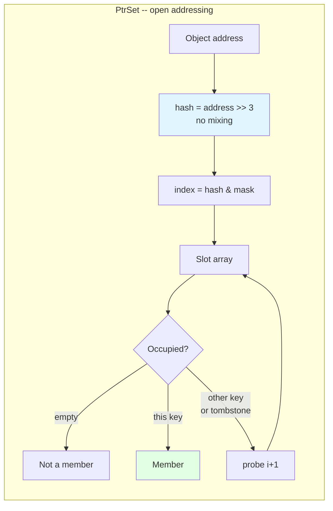

Two properties are deliberate and easy to undo by accident:

- **The hash is unmixed.** Allocator addresses arrive in rising runs, so an
  unmixed hash keeps objects allocated near each other in slots near each other
  and a probe reuses the cache line the last one pulled in. Fibonacci mixing
  scatters them and costs a miss per lookup: over 2M realistic addresses,
  insert 6.8 ns and lookup 4.0 ns unmixed against 9.4 ns and 8.2 ns mixed.
- **There is no reference counting.** Collection is generational mark-and-sweep.
  The header carries `GC_MARK_BIT`, `GC_OLD_BIT`, `GC_RSET_BIT` and
  `GC_TRACED_BIT`, and nothing counts references.

This replaced a `std::unordered_set` in v2026.9.7. That container is node-based,
so every insert was a separate heap allocation, and the old generation gains one
entry per promoted object — a minor collection paid that allocation once per
survivor, on top of the object's own. On Windows it cost 239.5 ns per insert
against the allocation's 38.5 ns. Promotion cost tracks promoted bytes rather
than collection count, so it dominated: `binarytrees(17)` went from 2.392 s to
1.789 s (−25.2%) with peak RSS 194.6 MB → 179.1 MB, closing a 3.5× gap against
Linux on the same hardware. `ptr_set_test.cpp` pins the behaviour the collector
relies on, including that `count()` never dereferences its argument.

### GC Algorithm Flow

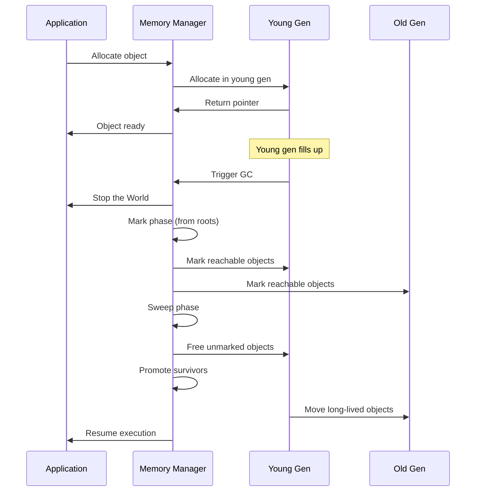

### Memory Manager Improvements

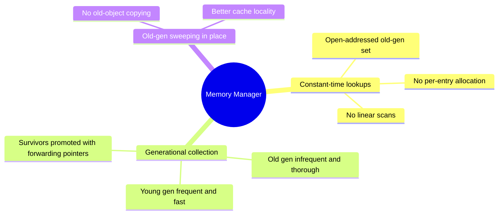

### Where Allocations Go

| Region | What lands there | Collected by |
|--------|------------------|--------------|
| **Nursery** (young) | Objects, bump-allocated in one contiguous region: 128 MB reserved (`YOUNG_REGION_SIZE`), its usable limit set by `--nursery` / `OBJECK_NURSERY`; on Windows only the limit is committed | Minor GC: survivors promoted to the old generation, references fixed up |
| **Old generation** | Promoted objects, arrays, objects larger than the nursery limit, and every allocation a native library makes; each tracked in `PtrSet` | Major GC: mark and sweep in place |
| **Operand and call stacks** | Locals, frames, temporaries | Scanned as roots, never collected |

**Key Characteristics:**
- **O(1) Membership:** the old generation is an open-addressed address set; no linear scans
- **Generational:** a nursery that moves survivors (promote-and-forward with pointer fixup); an old generation swept in place
- **Write barrier:** a store of a young object into an old one is recorded on a lock-free dirty list, so a minor GC need not scan the whole old generation; C++ code that stores into an old object must call `WriteBarrier`
- **Stop-the-World:** cooperative, at safepoints (above)

**Source Files:**
- `core/vm/arch/memory.h/cpp` - Memory manager: allocation, collection, write barrier
- `core/vm/arch/ptr_set.h` - Old-generation address set
- `core/vm/arch/memory_verify.cpp` - Heap verifier (`OBJECK_GC_VERIFY`)

---

## 9. Platform Abstraction

Cross-platform system call abstraction for POSIX and Win32.

```mermaid
graph TB
    subgraph "Application Layer"
        A[Objeck Program]
    end

    subgraph "VM & Libraries"
        B[Runtime Interpreter]
        C[JIT Compiled Code]
        D[Standard Libraries]
    end

    subgraph "Host API Layer"
        E[Host APIs<br/>Platform Abstraction]
    end

    subgraph "Platform Implementations"
        F1[POSIX APIs]
        F2[Win32 APIs]

        G1[File I/O]
        G2[Networking]
        G3[Threading]
        G4[Dynamic Loading]
        G5[System Calls]

        F1 --> G1 & G2 & G3 & G4 & G5
        F2 --> G1 & G2 & G3 & G4 & G5
    end

    subgraph "Operating Systems"
        H1[Linux]
        H2[macOS]
        H3[Windows]
    end

    A --> B & C & D
    B & C & D --> E
    E --> F1 & F2
    G1 & G2 & G3 & G4 & G5 --> H1 & H2 & H3

    style E fill:#fff4e1
    style F1 fill:#e1f5ff
    style F2 fill:#e1f5ff
```

### Platform-Specific Implementations

```mermaid
graph LR
    subgraph "File I/O"
        A1[open/read/write] -->|POSIX| B1[open/read/write syscalls]
        A1 -->|Win32| B2[CreateFile/ReadFile/WriteFile]
    end

    subgraph "Threading"
        A2[Thread Create] -->|POSIX| C1[pthread_create]
        A2 -->|Win32| C2[CreateThread]

        A3[Mutex] -->|POSIX| C3[pthread_mutex_*]
        A3 -->|Win32| C4[CreateMutex/WaitForSingleObject]
    end

    subgraph "Networking"
        A4[Socket] -->|POSIX| D1[socket/bind/listen]
        A4 -->|Win32| D2[WSASocket/bind/listen]
        A6[HTTP/2] --> D3[nghttp2 + mbedTLS/OpenSSL]
        A7[HTTP/3] -->|POSIX| D4[ngtcp2 + nghttp3 + AWS-LC, static]
        A7 -->|Win32| D5[WinHTTP over MsQuic]
    end

    subgraph "Dynamic Loading"
        A5[Load Library] -->|POSIX| E1[dlopen/dlsym]
        A5 -->|Win32| E2[LoadLibrary/GetProcAddress]
    end

    style A1 fill:#fff4e1
    style A2 fill:#fff4e1
    style A4 fill:#fff4e1
    style A6 fill:#fff4e1
    style A7 fill:#fff4e1
    style A5 fill:#fff4e1
```

### HTTP Protocol Stack

Three protocols, and they do **not** share a serialization path — which is the
single most important thing to know before touching this code.

| Protocol | Where the request is built | Engine |
| --- | --- | --- |
| HTTP/1.1, HTTPS | **Objeck** (`net.obs`, `net_secure.obs`) — assembled as text | sockets + mbedTLS/OpenSSL |
| HTTP/2 | **Native** (`common.cpp`) | nghttp2, all platforms |
| HTTP/3 | **Native** (`common.cpp`) | ngtcp2 + nghttp3 + AWS-LC on POSIX, linked statically (`tools/deps/build_quic_deps.sh`); **WinHTTP over MsQuic** on Windows 11 / Server 2022+ |

Consequences that have each produced a real bug:

- **Request headers.** HTTP/1.1 serializes headers in Objeck, so `AddHeader`
  worked there from the start. HTTP/2 and HTTP/3 hand off to a trap, and for a
  long time that trap had no headers argument — so `AddHeader` stored values
  that were silently dropped. They now travel as a `String[]` of alternating
  key/value through `HTTP2_REQUEST_HDRS` / `HTTP3_REQUEST_HDRS`.

- **Header validation lives in Objeck** (`Web.HTTP.HeaderCheck`), not in the
  trap, precisely because HTTP/1.1 never reaches native code. A trap-side check
  could not have covered the line-oriented protocol where injection is worst.
  The native validators are defence in depth for the two protocols that do
  cross into C++.

- **HTTP/3 on Windows must assert the negotiated protocol.** WinHTTP treats
  HTTP/3 as a *preference* and falls back to HTTP/2 or HTTP/1.1 transparently,
  so a 200 proves nothing. Every request checks
  `WINHTTP_OPTION_HTTP_PROTOCOL_USED` and fails unless HTTP/3 was really used.
  (Also non-obvious: `WINHTTP_OPTION_ENABLE_HTTP_PROTOCOL` must be set on the
  **session** handle before the request is created; setting it later is
  accepted and silently ignored.)

- **Capability is reportable.** The traps compile unconditionally, so the
  presence of `Http3Client` proves nothing about whether an engine is behind
  it. `Runtime->GetProperty("runtime.feature.http3")` (and `.http2`) returns
  `"1"` only when one is compiled in — which is how a caller, or a test, tells
  *unsupported* apart from *the network failed*. The msys2 Windows builds have
  no HTTP/3 engine and correctly report `"0"`.


### Threading Model

```mermaid
sequenceDiagram
    participant Main as Main Thread
    participant VM as VM Thread Manager
    participant T1 as Worker Thread 1
    participant T2 as Worker Thread 2
    participant GC as GC Thread

    Main->>VM: Create thread
    VM->>T1: Start execution

    Main->>VM: Create thread
    VM->>T2: Start execution

    T1->>T1: Execute bytecode
    T2->>T2: Execute bytecode

    Note over T1,T2: GC triggered

    VM->>GC: Start GC
    GC->>T1: Suspend (safepoint)
    GC->>T2: Suspend (safepoint)

    GC->>GC: Mark & Sweep

    GC->>T1: Resume
    GC->>T2: Resume

    T1->>VM: Thread complete
    T2->>VM: Thread complete
```

### Platform Detection

| Platform | Macro | Compiler | ABI |
|----------|-------|----------|-----|
| **Linux x64** | `__linux__` && `__x86_64__` | GCC/Clang | System V AMD64 |
| **Linux ARM64** | `__linux__` && `__aarch64__` | GCC | ARM64 AAPCS |
| **macOS ARM64** | `__APPLE__` && `__aarch64__` | Clang | ARM64 AAPCS |
| **Windows x64** | `_WIN32` && `_WIN64` | MSVC | Microsoft x64 |
| **Windows ARM64** | `_WIN32` && `_M_ARM64` | MSVC | Microsoft ARM64 |

**Source Files:**
- `core/vm/arch/posix/posix.h` - POSIX abstractions
- `core/vm/arch/win32/win32.h/cpp` - Win32 abstractions
- `core/shared/sys.h/cpp` - Cross-platform utilities

---

## 10. Runtime Errors

Errors are objects. `System.Error` and its subclasses are raised with `Runtime->Raise` and
caught by type with `try { } on(e : T) { } finally { }`; the runtime's own faults are raised
the same way, as `NilError`, `IndexError`, `DivideByZeroError`, `CastError` and
`RuntimeError`. `?->` still recovers from any error in a call chain, yielding `Nil`. An error
nothing handles ends the program.

```objeck
try {
  port := ParsePort(text, line);   # may Runtime->Raise(ConfigError->New(...))
}
on(e : ConfigError) {               # clauses are tested in order
  "line {$(e->GetLine())}: {$(e->GetMessage())}"->PrintLine();
}
on(e : Error) {                     # a catch-all goes last
  e->GetMessage()->PrintLine();
}
finally {                           # runs on every way out, return/break/continue included
  "checked"->PrintLine();
};
```

```mermaid
flowchart TB
    A["Error raised<br/>Runtime->Raise, or a runtime fault:<br/>Nil, index, divide by zero, cast"] --> B{"Handler on this<br/>thread's handler stack?"}
    B -->|yes| C["TryErrorRecovery: pop frames back to<br/>the handler's, restore the operand stack"]
    C --> D{"Which construct?"}
    D -->|"?-> / Try()"| E["The guarded chain yields Nil<br/>(?? may supply a default)"]
    D -->|"try / on"| F["First clause whose type matches runs;<br/>no match: the error goes on after finally"]
    F --> H["finally runs"]
    B -->|no| G["Message on stderr, the call stack,<br/>exit with status 1 (obd halts instead)"]

    style E fill:#e1ffe1
    style H fill:#e1ffe1
    style G fill:#ffe1e1
```

- **`try`/`on`/`finally`** (`EmitTry`, design in `docs/ERROR_HANDLING_DESIGN.md`). The words
  are contextual, so no existing name stops compiling. The body runs in a `TRY_START`/`TRY_END`
  region; its handler fetches the error with `GetLastError` and tests each clause's type in
  order. The clauses run in a region of their own, so `finally` runs before an error raised in
  a clause goes on. An error no clause names is raised again after `finally`, so a typed `try`
  never swallows what it did not ask for. A `return`, `break` or `continue` that leaves the
  `try` closes its region and runs `finally` on the way out.
- **Fatal unless handled.** The interpreter prints one `>>> ... <<<` line, such as
  `>>> Attempting to dereference a 'Nil' memory instance <<<`, `>>> Index out of bounds: <index>,<size> <<<`
  or `>>> Divide by zero <<<`, then lists the methods on the call stack (`StackErrorUnwind`) and
  exits with status 1. An invalid cast (`>>> Invalid object cast ... <<<`) and a full call
  stack are recovered like the rest when they happen in interpreted code. An invalid cast is
  now recovered inside a JIT-compiled method too (#925): the handler stack is per-thread, so
  the bridge callback that raises the cast can see it, and the callback reports a status (-5)
  that compiled code tests and carries out through its epilogue, where the interpreter already
  recovers a guard stub's status. The diagnostic is printed only when no handler is active, so
  a recovered cast is as silent as it is in interpreted code. **A full call stack is recovered
  in compiled code too** (since 2026-10): compiled frames consume the real C stack, which used
  to run out first and end the process in the OS. The compiled call site now tests the native
  stack as well as the depth (two compares a call; see Call Depth in section 3), so the call
  that would overrun it fails as a full call stack does, with no compiled frame left mid-way.
- **`Try()` and `?->`.** `a?->b()` is `a->Try()->b()`. The compiler brackets the rest of the
  chain with `TRY_START` and `TRY_END` (`EmitTryIntrinsic`); `TRY_START` pushes a handler, with the
  operand-stack position and call-stack depth to return to, on the thread's handler stack
  (which grows as needed). On a `Nil` dereference, a bad index or a zero divisor, `TryErrorRecovery` pops frames
  back to that depth, restores the operand stack and resumes at the handler, which stores `Nil`
  as the chain's value, and `Runtime->GetLastError()` says what it was. A compiled callee that
  returns one of those errors as its status is recovered the same way.
- **`Otherwise()` and `??`.** `a ?? b` is `a->Otherwise(b)`: a `Nil` test, not a handler, so `b`
  is evaluated only when `a` is `Nil`.
- **The JIT leaves try regions alone.** `TRY_START` and `TRY_END` are in neither backend's
  whitelist, so a method that holds a `?->` or a `try` stays interpreted: recovery needs the
  interpreter's handler stack. Errors raised inside a compiled *callee* still reach it.
- **Under the debugger** (`obd`, built with `_NO_HALT`) an unguarded error halts the program
  instead of exiting, and DAP "uncaught" exception breakpoints stop there first
  (`Debugger::OnRuntimeError`).
- **Faults in the VM itself**, a C++ exception such as `std::bad_alloc`, are caught at the top
  of `Execute`, or by the JIT bridge under compiled code, and reported as
  `>>> virtual machine: ... <<<`.

**Source Files:**
- `core/compiler/intermediate.cpp` - `EmitTry`, `EmitTryIntrinsic`, `EmitOtherwiseIntrinsic`
- `core/compiler/lib_src/lang.obs` - `System.Error` and its subclasses, `Runtime->Raise`, `Runtime->GetLastError`
- `core/vm/interpreter.h` - the handler stack (`PushTryHandler`, `TryErrorRecovery`)
- `core/vm/dispatch.cpp` - `TRY_START`, `TRY_END`
- `core/vm/interpreter.cpp` - error messages and `StackErrorUnwind`

---

## Summary

This architecture demonstrates a modern, multi-platform language implementation with:

✅ **Multi-tiered Execution:** Interpreter → call counting → JIT compilation
✅ **Platform-Specific JIT:** Optimized ARM64 and x64 code generation
✅ **Efficient Memory Management:** O(1) lookups, generational GC
✅ **Structured Errors:** `try`/`on`/`finally` over typed `Error` objects, plus `?->` recovery
✅ **Rich Library Ecosystem:** 46 libraries including AI/ML, web servers
✅ **Modern Development Tools:** REPL, debugger, LSP support
✅ **Automated CI/CD:** Multi-platform testing with caching
✅ **Cross-Platform:** Linux x64/ARM64, macOS ARM64 (Apple silicon), Windows x64/ARM64
✅ **Full Unicode:** Emoji and supplementary plane characters on all platforms including Windows console

**For More Information:**
- [Core Implementation README](../core/readme.md)
- [Compiler Details](../core/compiler/README.md)
- [VM Architecture](../core/vm/README.md)
- [JIT Compilation](../core/vm/arch/jit/README.md)
- [Regression Tests](../programs/regression/README.md)

**Contributing:**
See [CONTRIBUTING.md](../CONTRIBUTING.md) for guidelines on improving this architecture.

---

*Last updated: October 2026 | Version: 2026.10.2*
