# Objeck CLI Options

> Command-line options for the two core tools: the compiler **`obc`** and the
> virtual machine **`obr`**.

```mermaid
graph TD
    OBJECK["Objeck Toolchain"]

    OBJECK --> OBC["<b>obc</b> — Compiler<br/>obc [options] &lt;source&gt;"]
    OBJECK --> OBR["<b>obr</b> — Virtual Machine<br/>obr [options] &lt;program.obe&gt;"]

    %% ---- Compiler ----
    OBC --> C_IN["<b>Input</b>"]
    C_IN --> C_src["--source / -src / -s &lt;files&gt;<br/>comma-separated .obs (wildcards ok)"]
    C_IN --> C_inline["--inline / -in / -i &lt;code&gt;<br/>wrap statements in Main()"]

    OBC --> C_OUT["<b>Output</b>"]
    C_OUT --> C_dest["--destination / -dest / -d &lt;file&gt;"]
    C_OUT --> C_tar["--target / -tar / -t  &lt;exe | lib&gt;<br/>default: exe (.obe / .obl)"]

    OBC --> C_BUILD["<b>Build</b>"]
    C_BUILD --> C_lib["--library / -lib / -l &lt;libs&gt;"]
    C_BUILD --> C_strict["--strict<br/>exclude default libs (lang, gen_collect)"]
    C_BUILD --> C_opt["--optimize / -opt / -o &lt;s0..s3&gt;<br/>default: s3"]
    C_BUILD --> C_alt["--alt-syntax / -alt  (C-like syntax)"]

    OBC --> C_DIAG["<b>Diagnostics</b>"]
    C_DIAG --> C_dbg["--debug / -D  (debug symbols)"]
    C_DIAG --> C_asm["--assembly / -asm / -a  (emit asm)"]
    C_DIAG --> C_ver["--version / -ver / -v"]

    %% ---- VM ----
    OBR --> V_FLAGS["<b>Flags</b> (consumed before program args)"]
    V_FLAGS --> V_gc["--gc-threshold=&lt;n&gt;(k|m|g)<br/>legacy: --GC_THRESHOLD="]
    V_FLAGS --> V_nursery["--nursery=&lt;n&gt;(k|m), 64k to 128m<br/>env: OBJECK_NURSERY"]
    V_FLAGS --> V_stdio["--objeck-stdio=binary|utf16|utf8<br/>acted on by Windows; accepted everywhere<br/>legacy: --OBJECK_STDIO="]
    V_FLAGS --> V_depth["--call-depth=&lt;frames&gt;, 256 to 1048576<br/>default 16384; env: OBJECK_CALL_DEPTH"]
    V_FLAGS --> V_jit["--jit=off | --jit=&lt;calls&gt;<br/>env: OBJECK_JIT_DISABLE / OBJECK_JIT_THRESHOLD"]
    V_FLAGS --> V_lib["--lib-path=&lt;dir&gt;<br/>env: OBJECK_LIB_PATH"]

    OBR --> V_ENV["<b>Environment variables</b>"]
    V_ENV --> E_lib["OBJECK_LIB_PATH  (library search path)"]
    V_ENV --> E_stdio["OBJECK_STDIO  (binary stdio mode)"]
    V_ENV --> E_jitd["OBJECK_JIT_DISABLE=1  (auto-JIT off)"]
    V_ENV --> E_jitt["OBJECK_JIT_THRESHOLD=N  (default 10)"]
    V_ENV --> E_depth["OBJECK_CALL_DEPTH=&lt;frames&gt;  (call-nesting limit)"]
    V_ENV --> E_nursery["OBJECK_NURSERY=&lt;size&gt;  (young-generation size)"]
    V_ENV --> E_gcstats["OBJECK_GC_STATS=1  (GC summary on stderr at exit)"]
```



## Compiler — `obc`

| Option | Aliases | Description |
|--------|---------|-------------|
| `--source` | `-src`, `-s` | Source files, comma-separated `.obs` (wildcards supported) |
| `--inline` | `-in`, `-i` | Inline code statements (wrapped in a generated `Main()`) |
| `--destination` | `-dest`, `-d` | Output file name |
| `--target` | `-tar`, `-t` | `exe` or `lib` (default: `exe`; produces `.obe` / `.obl`) |
| `--library` | `-lib`, `-l` | Linked libraries, comma-separated. An entry may be `@name`, a group from `configobjk.ini` — see [Library groups](#library-groups) |
| `--strict` | | Exclude default libraries (`lang`, `gen_collect`) |
| `--optimize` | `-opt`, `-o` | Optimization level `s0`–`s3` (default: `s3`) |
| `--alt-syntax` | `-alt` | Use the alternative C-like syntax |
| `--debug` | `-D` | Include debug symbols. Also forces optimization level `s0`, whatever `--optimize` says (`ItermediateOptimizer` constructor, `optimization.cpp`) |
| `--assembly` | `-asm`, `-a` | Write a listing of the emitted (post-optimization) bytecode to a `.obm` file, the destination name with its extension replaced (`FileEmitter`, `emit.h`). The `.obe`/`.obl` is still written |
| `--version` | `-ver`, `-v` | Show version |

See [optimization_pipeline.md](optimization_pipeline.md) for what each `-opt` level enables.

### Library groups

An entry in `--library` that begins with `@` is a **group**, expanded from
`lib/configobjk.ini` beside the installed `.obl` files. `-lib @web` is shorthand for the
eight libraries that group lists.

| Group | Expands to | For |
|-------|------------|-----|
| `@std` | `json`, `json_stream`, `net`, `cipher` | everyday programs: JSON and HTTP |
| `@web` | `net_h2`, `net_quic`, `web_server`, `json_rpc`, `net_server`, `net`, `json`, `cipher` | HTTP/2, HTTP/3, the embedded server, JSON-RPC |
| `@data` | `xml`, `regex`, `csv`, `query`, `rss`, `misc`, `net`, `json`, `cipher` | parsing and querying structured data |
| `@ml` | `gemini`, `openai`, `ollama`, `anthropic`, `llm_util`, `llm_util_clients`, `net_server`, `misc`, `net`, `regex`, `json`, `cipher` | hosted-model API clients and the `llm_util` prompt, token and structured-output helpers |
| `@ai` | `ai`, `ml`, `ml_lab`, `ml_vector`, `ml_report`, `ml_verify`, `ml_timeseries`, `stats`, `plot`, `nlp`, `nlp_topics`, `csv`, `json` | local `System.ML` / `System.ML.Lab` / `System.ML.VectorSearch` / `System.ML.Report` / `System.ML.Verification` / `System.ML.TimeSeries` / `System.Stats` / `System.Plot` / `System.AI` / `System.NLP` / `System.NLP.Topics` |
| `@plot` | `plot`, `plot_sdl`, `sdl2` | `System.Plot` charts in an SDL2 window or as PNG (SVG alone needs only `plot`) |
| `@vision` | `opencv`, `onnx`, `nlp_onnx`, `ml_clip`, `ml_verify`, `models`, `nlp`, `json`, `cipher` | OpenCV and ONNX inference, BERT text embeddings, CLIP image embeddings and face verification |
| `@cnn` | `ml_cnn`, `ml`, `ml_lab`, `opencv`, `csv`, `json`, `cipher` | `System.ML.Cnn` convolutional networks with image loading and history tables |
| `@game` | `sdl2`, `sdl_game`, `sdl_gl`, `json`, `gen_collect` | SDL2, the 2D game and 3D OpenGL frameworks |

Groups and explicit names mix in any order, for either `--target`: `-lib @ai,json` and
`-lib json,@ai` are the same. Listing a library twice is harmless.

**Adding your own.** A section in `configobjk.ini` named `[@yourname]` is a group. It must
be *closed under dependencies* — the linker loads exactly what the group lists and does not
chase a member's own dependencies, so if a member was built against another `.obl` that one
must be listed too. A group that misses a dependency fails on every use, including from a
program that never touches it. `@web` shipped that way, omitting `net_server.obl`.

If a group name is not found, the compiler prints the config file's path and every group
defined in it. If a class cannot be resolved, it names the library that would supply it:

```
Error: Unable to resolve external library class: 'Web.HTTP.Server.Request'.
        Add it with '-lib net_server'
```

## Virtual machine — `obr`

| Option | Legacy form | Description |
|--------|-------------|-------------|
| `--gc-threshold=<n>(k\|m\|g)` | `--GC_THRESHOLD=` | A fixed heap size at which a major collection runs, e.g. `512k`, `2m`, `1g`. Without it the threshold follows the program: after each major collection it is set to twice the live heap, and never below 8 MB. A given value suits stress testing (a small one collects often) or a program that knows its working set. It holds while a major collection leaves at least a quarter of it free; while more than three quarters of it survive, the next major waits for twice the live heap instead (it used to collect on nearly every allocation then), and the given value returns once the live heap fits under it again. `OBJECK_GC_TRACE` reports the first time that happens |
| `--nursery=<n>(k\|m)` | env `OBJECK_NURSERY=<n>(k\|m)` | Young-generation (nursery) size, from `64k` to `128m` (default `128m`). A full nursery triggers a minor collection, so a smaller one collects more often. The 128 MB region stays reserved; this only lowers the limit. The flag wins over the variable, and a bad value in either is an error |
| — | env `OBJECK_GC_STATS=1` | At exit, print one line to stderr: `[gc-stats] minor= major= pauses= pause_p50_us= pause_p95_us= pause_max_us= promoted_objects= promoted_bytes= peak_rss_bytes=`. Percentiles are nearest-rank over the first 1,048,576 recorded pauses (`GC_STATS_SAMPLE_MAX`); `pause_max_us` covers every collection. Pauses run from the collecting thread taking the collector lock until the world resumes, so they include the stop-the-world handshake and the minor GC's remembered-set scan |
| `--call-depth=<frames>` | env `OBJECK_CALL_DEPTH=<frames>` | How deep calls may nest, from `256` to `1048576` (default `16384`). Past it the program stops with `call stack bounds have been exceeded`, which a `Try()` can recover from. Compiled code can reach the end of the native stack first and reports the same error. The flag wins over the variable; a bad value in either is an error. Changes the size of the threads' native stacks too (`call_stack.h`) |
| `--jit=off` / `--jit=<calls>` | env `OBJECK_JIT_DISABLE=1` / `OBJECK_JIT_THRESHOLD=N` | `off` runs the interpreter only, `native` methods included; a positive number is how many calls a method makes before it is compiled (default `10`). A method with a loop is compiled on its first call or entry while the threshold is at or below the default, see [optimization_pipeline.md](optimization_pipeline.md) |
| — | env `OBJECK_JIT_REPORT=1` | Print, to stderr, every method the JIT hands back to the interpreter and why: an unsupported opcode (number per `obc -asm`), or the instruction at which compilation failed. Diagnostic; no effect on execution |
| `--lib-path=<dir>` | env `OBJECK_LIB_PATH` | The Objeck `lib` root. `obc` reads the `.obl` files from it; `obr` loads the native libraries from `<dir>/native/` (`libobjk_*.dll|.so|.dylib`), reads `<dir>/cacert.pem` for TLS, and reports it as the `lib_dir` runtime property. On Windows the third-party runtime DLLs those libraries import (SDL2, onnxruntime, opencv, lame, the VC runtime) are resolved from `obr.exe`'s own directory, so `bin/` keeps them wherever `lib/` is |
| `--objeck-stdio=binary\|utf16\|utf8` | `--OBJECK_STDIO=` | Console I/O mode. Acted on by **Windows**; accepted and ignored elsewhere so one script works on every platform |

Any other value for any of these is an error that names what was expected — `--objeck-stdio=1`
used to be accepted and silently do nothing.

### Environment variables

| Variable | Effect |
|----------|--------|
| `OBJECK_LIB_PATH` | Library search path |
| `OBJECK_STDIO` | Binary STDIO mode |
| `OBJECK_JIT_DISABLE=1` | Turn auto-JIT off entirely |
| `OBJECK_JIT_THRESHOLD=N` | Call count before a method is auto-JIT'd (default `10`) |
| `OBJECK_CALL_DEPTH=<frames>` | Call-nesting limit, `256` to `1048576` (default `16384`); `--call-depth` wins |
| `OBJECK_NURSERY=<n>(k\|m)` | Nursery size, `64k` to `128m`; `--nursery` wins when both are set |
| `OBJECK_GC_STATS=1` | One-line GC summary (counts, pause percentiles, promoted bytes, peak RSS) on stderr at exit |

## Notes

- **VM flag parsing is positional** — `obr` consumes its own options before the
  program path, so VM options must come *before* the `.obe` and any program arguments.
- **`--objeck-stdio` only has an effect on Windows.** Every platform accepts and
  consumes it, so a shared script does not have to know which one is running.
- **`--jit=off` is the first thing to try on a crash or a wrong answer** — it asks
  whether the bug lives in the JIT or in the interpreter. The environment variables
  still work and the flag wins when both are set.
- A `g` suffix on `--gc-threshold` is 2³⁰. Before v2026.9.1 it was 2⁴⁰, so `1g`
  asked for a terabyte.
- Combining `--library` with `--strict` drops the implicit `lang,gen_collect` defaults.

## How to check

- `obr` with no arguments prints the usage text that this page mirrors (`VmUsage()` in `core/vm/vm_options.h`); `obc` with no arguments prints the compiler's (`posix_main.cpp`). If this page and the usage text disagree, trust the parsing code named under Source.
- A bad value fails loudly: `obr --nursery=1g prog.obe`, `obr --call-depth=10 prog.obe` and `obr --objeck-stdio=1 prog.obe` each print what was expected.
- `OBJECK_GC_STATS=1 obr prog.obe` prints the `[gc-stats]` line to stderr at exit.

## Source

- Compiler option parsing: `core/compiler/compiler.cpp`, usage string in `core/compiler/posix_main.cpp`
- VM option parsing: `core/vm/vm_options.h` (one parser, called from `core/vm/win_main.cpp` and `core/vm/posix_main.cpp`)
- JIT threshold tunables: `core/vm/arch/jit/jit_common.h`
